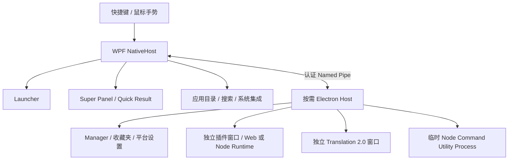

# WebTools

**为 Windows 打造的原生启动器、选区面板和插件效率工具。**

WebTools 使用 C# / .NET 10 / WPF 提供常驻搜索、全局快捷键、系统托盘和 Super Panel；Electron Host 按需承载 Manager、独立插件窗口与内置 Translation 2.0。插件通过统一的 Feature 声明接入入口，业务界面保持独立。

当前为 `0.1.0` 开发版本，主要面向 Windows x64。[累计变更与提交说明](docs/2026-10-21-platform-consolidation.md)记录了自 2026-10-09 上次源码提交以来的改动、兼容性和验证边界。

## 功能

### 原生 Launcher

- 搜索开始菜单、桌面快捷方式、Windows 注册应用和打包应用，支持中文、拼音、首字母、别名和模糊匹配。
- 搜索收藏网址、网页搜索、可选 Everything 文件搜索，以及已安装插件的功能。
- 使用系统托盘和可配置全局快捷键召唤；支持浅色、深色、跟随系统、紧凑与展开布局。
- 输入英文后可直接打开独立翻译窗口并携带原文。
- 改进开机启动后的应用目录刷新、搜索发现和窗口首次交接。

| 输入 | 用途 |
| --- | --- |
| `关键词` | 搜索本机应用、收藏网址和可用插件功能 |
| `?关键词` | 使用当前网页搜索引擎 |
| `/关键词` | 仅搜索收藏网址 |
| `file:关键词` | 使用 Everything 搜索文件与文件夹 |

文件搜索需要自行安装并运行 [Everything](https://www.voidtools.com/)，然后在 WebTools 设置中启用并检测或选择 `es.exe`。WebTools 不捆绑 Everything。

### Super Panel

- 通过可配置鼠标手势或托盘打开原生选区操作面板。
- 根据选中文字提供搜索、打开 HTTP(S) 链接、翻译与插件动作；无选区时显示快捷入口。
- 插件声明可接受的上下文，NativeHost 本地匹配功能，执行时由 Electron 再校验权限和当前插件状态。
- 在同一 WPF 面板内展示 Quick Result 文本和 AI 确认；翻译预览可配置，取消、换选区和进入完整翻译窗口具有独立生命周期。
- 选区获取使用应用 Copy 路径，处理剪贴板恢复、迟到结果、失焦及重复触发。

### Translation 2.0

- 内置一等插件，使用独立 Electron 窗口；Launcher、Super Panel 和插件中心都可进入。
- WebTools 翻译支持 MyMemory、共享 AI、DeepL API，以及高级 JSON 接口定义。
- Google、有道、Microsoft、DeepL 等网站翻译使用独立页签，支持拖动排序、显示开关和设置持久化。第三方网页的可访问性、布局和响应速度取决于网站与网络环境。
- WebTools 页签停止输入约 0.5 秒后自动翻译，保留手动操作，并处理取消、旧结果和重复请求。
- 翻译 AI 配置与平台“设置 → AI”共用提供方、模型和安全凭据，翻译所选服务单独保存。API Key 使用支持粘贴的密码框，保存后清空，不回显已保存值。
- 修复首次打开等待环、业务请求 ID 与 Pipe 消息 ID 混用，以及加载中关闭后请求未结束的问题。

### 插件平台与开发工具

- 插件中心支持本地 `.wtplugin` 安装、启停、权限、配置、替换和卸载。
- Manifest v3 支持 Web / Node Runtime、独立 Window Feature 和 Node Command；保留声明式 Manifest v1 兼容路径。
- Window Feature 可选择失焦后临时隐藏、方便召唤恢复，或留在其他窗口后方；Host 协调快捷键、Esc、显式关闭、停用和开发重载。
- Host 管理 Feature 身份、包校验、配置、私有数据、主题、Shared AI 和能力调用。Web Runtime 与 Node Runtime 的权限边界不同：Node 插件可使用当前 Windows 用户的 Node 能力，不是操作系统沙箱。
- SDK 当前为 `@webtools/plugin-sdk` **1.8.0**；独立脚手架 `create-webtools-plugin` **1.1.0** 支持 Vanilla、Vue、React、Svelte 和 Web / Node 组合。
- 开发工具支持 build / validate / pack / inspect、开发会话连接、重载和诊断。当前以本地 tarball 工作流为准，不假设已经发布到 npm。

### Manager

Manager 管理网址收藏夹、插件、平台配置与共享 AI。它是 Electron Host 自有界面；独立插件和 Translation 不放入 Manager 页面。关闭 Manager 后，仍在使用的插件窗口或任务可以继续运行。

## 架构与生命周期



NativeHost 启动时不启动 Electron。用户召唤搜索框或 Super Panel 后，WPF 先显示并可输入，再异步为当前会话预热 Electron Host；预热不创建 Manager、插件窗口或 renderer。

选择功能后，NativeHost 在隐藏入口前取得请求 ownership，Electron 用准确的业务请求 ID 执行并交接目标窗口。取消未选择目标的会话后退出预热 Host；窗口、隐藏中的有效插件或任务仍存在时保留 Host，最后一个所有者释放后正常退出。没有永久 keep-warm，也没有用于销毁隐藏临时插件窗口的自动闲置超时。

两种失焦行为、Esc 和召唤规则见[窗口焦点与生命周期设计](docs/superpowers/specs/2026-10-19-plugin-window-focus-lifecycle-design.md)；当前运行实现见[Plugin Runtime](docs/plugin-runtime.md)。设计文件中的“当前实现观察”是设计时快照，最新累计状态以[提交说明](docs/2026-10-21-platform-consolidation.md)为准。

## 安装与使用

Windows 安装包及解压预览包均以根目录 `WebTools.NativeHost.exe` 为入口。Electron 可执行文件位于 `Manager/WebTools.exe`，由 NativeHost 按需调用，通常无需直接启动。

使用新预览包前，从托盘正常退出旧版，再完整解压运行。预览 ZIP 与阶段验收结果不代表已签名的正式发布版本。

## 开发

需要 Windows、Node.js `>=20.19`、pnpm **9.15.9** 和 .NET **10** SDK。依赖与 Electron 版本以 `pnpm-lock.yaml` 为准。

```powershell
# 如需使用 Corepack
corepack enable pnpm

pnpm install --frozen-lockfile

# WPF NativeHost + 按需 Electron 开发入口
pnpm run native:dev

# 单独调试 Electron
pnpm run electron:dev
```

常用检查与构建：

```powershell
pnpm run typecheck
pnpm test
pnpm run build
dotnet build .\native\WebTools.NativeHost\WebTools.NativeHost.csproj --configuration Release
dotnet run --project .\native\WebTools.NativeHost.Checks\WebTools.NativeHost.Checks.csproj --configuration Release
```

`pnpm run acceptance:plugin-runtime` 是通用打包 Runtime 验收入口，需要按[运行时文档](docs/plugin-runtime.md)准备候选程序与 fixture。`pnpm run package:win` 构建 Windows 安装包；版本化发布使用 `release:preflight`、`release:build` 和 `release:verify`，详见[发布构建说明](docs/release-build.md)。构建成功、自动化通过和用户人工验收是不同状态，各阶段报告分别记录。

插件开发从[开发指南](docs/plugin-development.md)和[独立脚手架说明](plugin-sdk/create-webtools-plugin/README.md)开始。

## 项目结构

```text
native/       WPF NativeHost、搜索、选区面板、Named Pipe 与原生检查
electron/     Electron Host、插件运行时、独立窗口、preload、IPC 与服务
src/          Manager、Translation 2.0、设置与共享契约
plugin-sdk/   SDK、Manifest 校验、CLI、脚手架与运行时契约
examples/     使用公开 SDK 的插件示例
resources/    应用品牌资源
scripts/      开发、打包、发布与打包运行时验收工具
docs/         当前开发入口、提交说明、设计和历史阶段记录
```

## 当前边界与后续方向

本轮整合覆盖 Runtime 2.0、插件开发体验、Super Panel / Quick Result、Translation 2.0，以及焦点和会话内预热。插件在线分发/更新/信任、AI Tool authority、MCP 集成和最终系统性性能验收仍是后续方向。配置和接口的实际可用性以当前代码及对应验收记录为准，不将历史阶段编号视作整个产品已完成。

更多资料见[文档索引](docs/README.md)。

## 开源协议

WebTools 源码采用 [MIT License](LICENSE)，Copyright (c) 2026 dbt64。第三方依赖与随附资源保留各自的协议和版权声明。
