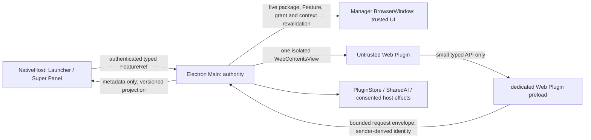
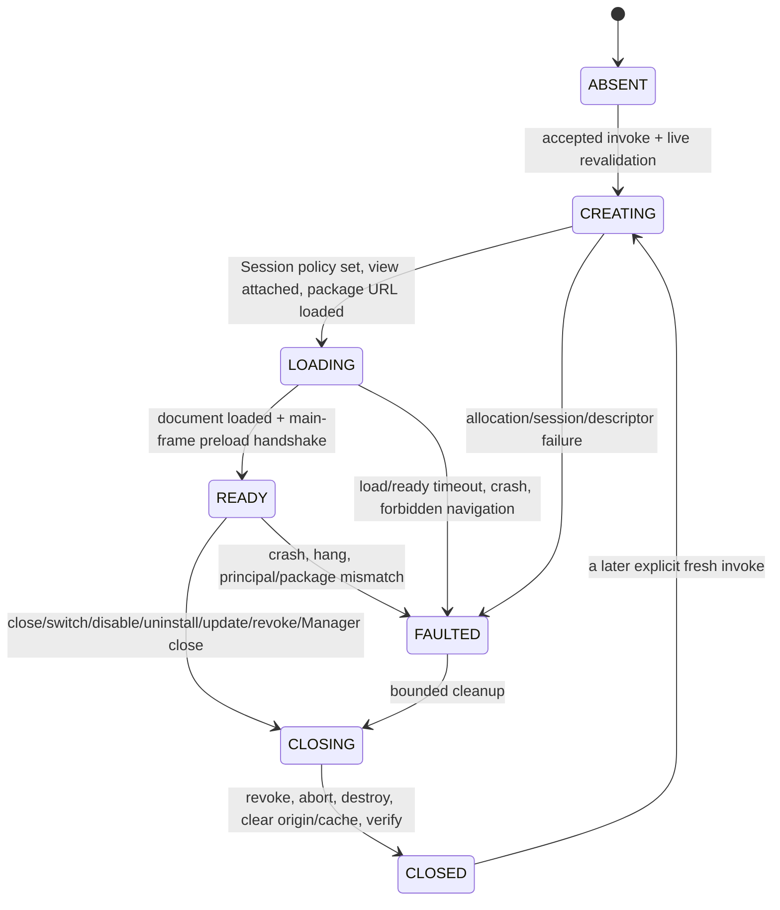

# Phase 6E-2 Web Plugin Runtime Contract

**Status:** design freeze complete; no Web Plugin runtime is implemented.
**Baseline:** Phase 6D frozen at <code>62b9774ad851f7c7159fbc6539f7d8771400d632</code>; Phase 6E-1 audit approved.
**Scope:** architecture, contracts, quotas, and future acceptance criteria only.

## 1. Status

This document freezes the first-release Web Plugin contract before any third-party JavaScript is executed. It is subordinate to the approved Phase 6C architecture freeze and refines only the runtime details needed to implement the Manifest v2 package validator and, later, the isolated runtime.

| Item | Phase 6E-2 result |
|---|---|
| Product code changed | No |
| Dependencies changed | No |
| Manifest parser changed | No |
| Native Feature Projection implementation/schema changed | No |
| Web runtime / WebContentsView created | No |
| Third-party JavaScript executed | No |
| Gate 4 implemented | No |
| Commit / push | No |

Phase 6E-3 may implement the Host-authoritative Manifest v2 archive validator only. It must not create a WebContentsView, load a package document, expose a Web Plugin bridge, or execute third-party code.

## 2. Frozen Baseline

- Phase 6D is complete and frozen at <code>62b9774ad851f7c7159fbc6539f7d8771400d632</code>. Gate 2 actual NativeHost/Manager pipe peer authentication and Gate 3 projection fail-closed behavior remain authoritative.
- Phase 6E-1 is an approved source/design audit, not a packaged-runtime certification. It found no current P0/P1 defect and recorded one runtime-boundary P2: the trusted Manager BrowserWindow policy cannot be reused for third-party Web content.
- Current production Plugins remain closed declarative Manifest v1 packages. There is no Web runtime, Manifest v2 parser, plugin-owned WebContents, or Web SDK v2 implementation in this checkout.
- Electron dependency range is <code>^44.4.5</code>; the lockfile and current installed package resolve Electron 44.4.5. Runtime claims below are design requirements unless backed by the future packaged acceptance gates.
- NativeHost owns Launcher, tray, global hotkey, Feature matching and context capture. Electron Main owns package bytes, plugin grants, runtime creation and privileged effects. Manager remains on demand; normal Manager close must leave Electron process count at zero while NativeHost remains alive.
- Manifest v1 bytes and parser, the v1 declarative compatibility adapter, translation identity, PluginStore format/quotas, Gate 2, Gate 3 and current Native projection v2 are frozen.

Related frozen documents: [Phase 6C architecture freeze](phase6c-architecture-freeze.md), [Manifest v2 migration design](phase6c-migration-design.md), [Web runtime security design](phase6c-web-runtime-security-design.md), [Feature/context contract](phase6c-feature-context-contract.md), [Native Feature Projection v2](phase6c-native-feature-projection.md), [Phase 6D-7 acceptance](phase6d7-feature-platform-acceptance.md), and [Phase 6E-1 audit](phase6e1-web-plugin-runtime-audit.md).

## 3. Trust Boundary

A Manifest v2 Web Plugin contains untrusted, author-controlled executable code. Installation confirmation must call this out even when the package requests zero Host capabilities. A zero-capability bundle can still consume CPU/memory and attack its own renderer; it does not gain operating-system authority.



The Web Plugin WebContents must have <code>sandbox: true</code>, <code>contextIsolation: true</code>, <code>nodeIntegration: false</code>, <code>webSecurity: true</code>, <code>webviewTag: false</code>, and no Manager preload. It receives no Manager DOM, Vue state, filesystem path, raw IPC channel, NativeHost pipe, SecretStore access, arbitrary process launch, or generic Node/Electron API. The WebContentsView is a WebContents/lifecycle boundary, not a promise of its own OS process or VM.

The future Web Plugin preload is separate from <code>electron/preload.ts</code>. The trusted Manager renderer and its current security policy remain unchanged and are not used as a security boundary for package code.

## 4. Runtime Architecture

```text
NativeHost surface selects FeatureRef
  → authenticated existing Manager pipe
  → Electron Main validates current session and request
  → Main re-resolves FeatureRef, package hash, enabled state, grants and context
  → Main starts or reuses the one on-demand Manager process/window
  → Main creates one fresh WebContentsView for that invocation
  → app-owned protocol serves immutable validated archive bytes
  → dedicated minimal preload exposes the typed SDK facade
```

First-release limits and behavior:

- At most one active Web Feature runtime across the application. This is independent of the Native search Feature result-group cap of six rows.
- No hidden WebContents pool, background plugin runtime, prewarming, persistent helper, plugin child process, NativeHost JavaScript runtime, or eager bundle evaluation.
- Install, enable, catalog projection, and search do not create a WebContents or start Electron solely for Web content.
- A second Feature request uses close-before-open. Main synchronously revokes the old runtime generation, aborts its pending work, completes bounded teardown, then creates the next runtime. Requests arriving while a close transition is in progress receive <code>RUNTIME_BUSY</code>; they do not create a queue or a second runtime. Re-selecting the already-ready same Feature focuses/reuses that one view.
- Manager remains the existing on-demand BrowserWindow. Main owns WebContentsView bounds and lifetime. Do not assume one WebContentsView maps to one dedicated Chromium process.
- On normal Manager close, Main revokes and destroys the plugin WebContents before the Manager window closes. Electron Main, Renderer, GPU and Utility members must then exit as the existing Manager lifecycle requires; NativeHost continues.

## 5. Session Model

Freeze one dedicated, non-persistent Session for all sequential Web Plugin invocations, separate from the Manager default Session:

1. After Electron app readiness, Main obtains the Session once from a fixed non-<code>persist:</code> partition named <code>webtools-plugin-runtime-v1</code>, with cache disabled. The exact partition string is app-owned and never renderer-controlled.
2. No Web Plugin WebContents may use the Manager/default Session. The plugin Session is exclusive to the one active runtime; it is never shared concurrently.
3. Before loading a runtime, Main verifies the isolated Session policy is installed. Proxy mode is pinned to direct (not inherited from the OS); this does not itself block URLs. The request policy below must cancel all non-package-origin requests. Apply Electron's WebRTC IP handling policy <code>disable_non_proxied_udp</code> to the plugin WebContents as additional defense; it is not considered proof of network isolation.
4. The custom protocol is registered on this Session only. Scheme privileges do not include <code>bypassCSP</code>, service-worker permission, or unnecessary CORS privileges.
5. Permission request and permission check handlers deny every browser permission. All downloads are canceled. New windows are denied. Certificate errors, client-certificate requests, HTTP authentication prompts and login events from the plugin WebContents are rejected without a dialog or credential forwarding.
6. Cookies, localStorage, IndexedDB and CacheStorage are at most runtime-scoped ephemeral browser state. They are never a Plugin persistence API. Runtime origin uniqueness prevents a later invocation from addressing the old origin. The origin's site data and Session cache are cleared before the Session is reused. No disk-backed cache or persistent partition is allowed.
7. Service workers and all dedicated/shared workers are denied. No background worker or hidden runtime may survive the Feature view.
8. Teardown revokes the runtime first, aborts bridge operations, removes/closes the WebContentsView/WebContents, closes connections, clears the exact runtime origin's storage data and cache, discards package-reader/runtime references, and verifies the next runtime cannot read a prior runtime's sentinel data.

The current Electron 44.4.5 type surface provides <code>session.fromPartition</code>, its cache option, <code>Session.setProxy</code>, <code>clearData</code>/<code>clearStorageData</code>, <code>clearCache</code>, <code>closeAllConnections</code>, permission handlers, and WebContents WebRTC IP policy. API existence is not runtime acceptance; the custom-origin clearing and isolation tests in Section 25 remain mandatory. See [Electron v44.4.5 Session](https://github.com/electron/electron/blob/v44.4.5/docs/api/session.md) and [WebContents](https://github.com/electron/electron/blob/v44.4.5/docs/api/web-contents.md).

## 6. Origin Model

Two models were compared:

| Dimension | A — fresh random runtime origin | B — stable plugin-scoped origin + generation |
|---|---|---|
| Shape | <code>webtools-plugin://&lt;random-host&gt;/</code> | <code>webtools-plugin://&lt;plugin-derived-host&gt;/</code> |
| Cross-plugin and cross-Feature isolation | Unique origin for every invocation | Same Plugin Features share a browser origin unless more partitioning is added |
| Stale-runtime attack | Old URL host no longer maps to the active descriptor; Main still checks generation | Generation protects bridge but old pages and same-origin state share the Plugin origin |
| Browser storage | Not addressable by the next invocation; clear on teardown | Requires cleanup before same Plugin origin can safely be reused |
| Package update | New origin naturally separates old/new code | Stable origin couples new package bytes with prior browser state |
| Code splitting / dynamic import | Relative same-origin chunks work | Relative same-origin chunks work |
| CSP | Per-runtime self-origin sources | Per-plugin self-origin sources |
| Identity privacy | URL does not reveal Plugin ID | URL leaks a stable correlator for Plugin identity |
| Super Panel reuse | Surface is irrelevant; new invocation still has its own origin | Surface is irrelevant; same-origin state concern remains |
| Complexity | One random host plus current Main descriptor | Stable host derivation, generation discipline and stronger same-origin state cleanup |

**Frozen choice: A — fresh random runtime origin.** Generate 16 cryptographic random bytes for each invocation and lowercase-hex encode them as exactly 32 ASCII characters. The host is never derived from Plugin or Feature identity. The origin is bound in Main's descriptor to one WebContents, generation, FeatureRef, version and package hash. It is not an authority token by itself.

The random origin is not reused after close, including same-Feature reopen, Plugin update, or another invocation from the same Plugin. `localStorage`/IndexedDB cannot make data durable; PluginStore remains the only durable store. Session cleanup is still required to bound state during the Electron Manager lifetime. The packaged runtime must prove cleanup for this exact custom origin before it can be enabled. This validation does not block the archive-only Phase 6E-3 work.

The stable Plugin origin is rejected for first release because it creates a durable same-origin identity surface without a first-release need. There is no unresolved origin-model choice requiring a design experiment.

## 7. Package Protocol

### Exact URL and identity

The scheme is <code>webtools-plugin</code>. A document URL has this shape:

~~~text
webtools-plugin://<32-lowercase-hex-runtime-host>/<canonical-relative-posix-path>
~~~

Example: <code>webtools-plugin://6f9a1b0e7c3447a6a1d09e5b613c42dd/web/index.html</code>. The path is an archive-relative canonical POSIX path. URLs never contain the install path, user profile, archive path, package storage path, executable path, or raw filesystem path.

### Registration and lookup

- Register scheme privileges before <code>app.ready</code> and once: <code>standard</code>, <code>secure</code>, and <code>supportFetchAPI</code> only. Do not enable <code>bypassCSP</code>, <code>allowServiceWorkers</code>, <code>corsEnabled</code>, or other privilege flags absent a separate reviewed requirement.
- Register one Main-owned handler on the dedicated plugin Session. Resolve the request's exact scheme/host to the current Main runtime descriptor, then resolve a normalized path only through that descriptor's immutable validated archive bytes and declared inventory.
- Reject wrong scheme/host, stale runtime, unknown package entry, malformed URL, NUL, backslash, drive prefix, absolute path, empty/dot/dot-dot segments, encoded slash/backslash, double encoding, invalid UTF-8, Unicode normalization collision, case collision, path not in inventory, and non-canonical path. Never decode a path and pass it to the filesystem.
- The package bytes are not extracted to arbitrary disk. Host validation and package hash happen before runtime. Protocol lookup binds every response to active package hash and generation. Any mismatch fails closed.
- Query and fragment may be used by the app document for UI state, but are excluded from archive lookup and cannot select a different package/path. No request can select an arbitrary disk path or another runtime host.
- Serve fixed MIME types only: HTML <code>text/html; charset=utf-8</code>, JavaScript module <code>text/javascript; charset=utf-8</code>, CSS <code>text/css; charset=utf-8</code>, JSON <code>application/json</code>, WASM <code>application/wasm</code>, PNG <code>image/png</code>, JPEG <code>image/jpeg</code>, WebP <code>image/webp</code>, and WOFF2 <code>font/woff2</code>. MIME comes from the validated inventory, never an author-supplied response header.
- SVG is not accepted in the first release, including as an icon or image. This avoids active SVG content, MIME ambiguity and nested-resource behavior. If a later requirement adds SVG, it needs a separate sanitized/rasterized policy and security review.
- Every document and subresource response receives Host-generated CSP and <code>X-Content-Type-Options: nosniff</code>. The protocol handler serves bytes; it does not rewrite or execute code.

See pinned [Electron v44.4.5 protocol](https://github.com/electron/electron/blob/v44.4.5/docs/api/protocol.md) and [Session](https://github.com/electron/electron/blob/v44.4.5/docs/api/session.md) docs. Runtime acceptance must confirm that this scheme has a stable origin and that relative ESM imports/fetch work without granting service-worker or CSP-bypass privileges.

## 8. CSP

The default Web Feature policy is strict and does not enable WASM evaluation:

~~~text
default-src 'none';
base-uri 'none';
object-src 'none';
frame-ancestors 'none';
form-action 'none';
script-src 'self';
style-src 'self';
img-src 'self' data:;
font-src 'self';
connect-src 'self';
worker-src 'none';
frame-src 'none';
manifest-src 'self'
~~~

### Conditional WASM profile

Phase 6C allows package-local browser WASM but its example CSP used <code>wasm-unsafe-eval</code> for every Web Plugin. Phase 6E-2 narrows this: an optional Feature field <code>executionRequirements: { "wasm": true }</code> selects a per-runtime WASM profile. Omission is equivalent to <code>wasm: false</code>. A Feature declaring it true must reference a package inventory containing at least one listed <code>application/wasm</code> module. Features that do not declare it receive only the strict policy above, even when another Feature in the same package uses WASM.

For a Feature with <code>wasm: true</code>, only <code>script-src</code> changes to <code>script-src 'self' 'wasm-unsafe-eval'</code>. All other directives remain identical. Never add <code>unsafe-eval</code> or <code>unsafe-inline</code>. Inline script is forbidden. Inline styles are also forbidden by default; any framework need requires production-build evidence and a separately approved, narrow CSP decision.

The [W3C CSP Level 3](https://www.w3.org/TR/CSP/) source-expression definition makes <code>wasm-unsafe-eval</code> specific to WebAssembly compilation/evaluation APIs and distinct from JavaScript <code>eval</code>. The exact supported WebAssembly compile/instantiate APIs and JavaScript-eval denial must still be tested in packaged Electron/Chromium 44.4.5 before a WASM Feature is enabled. If that test fails, disable the WASM profile; do not fall back to <code>unsafe-eval</code>.

CSP is defense in depth, not network authority. The plugin Session request policy remains the authority for <code>network.mode: none</code>.

## 9. Framework Artifact Contract

The Host contract is framework-neutral. Later packaged acceptance targets are Vanilla, Vue, React and Svelte production builds. The Host accepts static output only; it does not run npm, a framework compiler, development server, HMR client, or arbitrary author command.

Required artifact rules:

- Exactly one Manifest-listed entry HTML per Feature. All other documents/chunks/assets are package-local and listed in the closed archive inventory.
- Build output uses relative package paths and the runtime custom origin as its base. No absolute install path, `file:` URL, `localhost`, fixed `http(s)` origin, CDN URL, or user-controlled base path.
- Static ESM imports, relative CSS <code>url()</code>, fonts, images, JSON and dynamic-import chunks resolve to exact listed paths on the same runtime origin. Dynamic import is allowed only for listed package-local modules; bare npm specifiers must be bundled before packaging.
- No remote import, remote script/style/font/image/media, source map in a release archive, HMR/dev-server dependency, inline script, blob/data executable module, Worker/SharedWorker, service worker, or native binary/addon.
- Package-local WASM is a declared inventory file with <code>application/wasm</code> and requires the selected Feature's explicit WASM profile.
- Framework output must pass under the frozen CSP. The Host will not silently relax CSP to accommodate framework defaults. If one framework requires a different policy, document that concrete build and separately review the narrow change.

No Vite-specific behavior is part of the Host contract. Framework acceptance builds are fixtures for the later runtime gate, not part of Phase 6E-2 execution.

## 10. Manifest v2 Contract

Manifest v2 is a new closed schema inside the existing <code>.wtplugin</code> ZIP package. It never changes Manifest v1 bytes, parser, SDK v1 output, or v1 installation behavior. ManifestVersion (package shape) and Plugin API Major (Host bridge semantics) remain independent. The current design keeps API Major 1 and Product Version unchanged.

Top-level object exact fields:

~~~json
{
  "manifestVersion": 2,
  "id": "org.example.quick-tools",
  "name": "Quick Tools",
  "description": "A small set of browser-based tools",
  "author": { "name": "Example Author", "url": "https://example.org" },
  "version": "1.0.0",
  "api": { "apiMajor": 1, "minHostVersion": "0.1.0" },
  "type": "feature-bundle",
  "requestedCapabilities": [],
  "features": [],
  "webBundle": { "files": [] },
  "assets": [],
  "network": { "mode": "none", "domains": [] }
}
~~~

Required fields are <code>manifestVersion</code>, <code>id</code>, <code>name</code>, <code>description</code>, <code>author</code>, <code>version</code>, <code>api</code>, <code>type</code>, <code>requestedCapabilities</code>, <code>features</code>, <code>webBundle</code>, and <code>network</code>. <code>assets</code> is optional and defaults to an empty array. Unknown keys are rejected at every object level; there is no extension bag.

| Object/field | Frozen rule |
|---|---|
| <code>manifestVersion</code> | Exact integer 2 |
| <code>id</code> | Existing v1 grammar and length: 3–128 lowercase ASCII letters/digits separated by single dots or hyphens; additionally obeys reserved namespace rule in Section 11 |
| <code>name</code>, <code>description</code> | Name 1–80 and description 0–512 Unicode scalar values, reusing current v1 display bounds; no executable or HTML interpretation |
| <code>author</code> | Exact object; <code>name</code> 1–128 Unicode scalar values, optional canonical HTTPS <code>url</code>; unknown fields rejected |
| <code>version</code> | Existing canonical SemVer rules |
| <code>api</code> | Exact <code>apiMajor</code> and <code>minHostVersion</code>; unsupported Host/API compatibility rejects install/activation without parsing as v1 |
| <code>type</code> | Exact literal <code>feature-bundle</code> |
| <code>requestedCapabilities</code> | Unique known v2 capability IDs, bounded 0–12; empty is valid. Closed set: <code>plugin.config.read</code>, <code>plugin.config.write</code>, <code>plugin.storage.read</code>, <code>plugin.storage.write</code>, <code>external.open</code>, <code>clipboard.write</code>, <code>clipboard.read</code> (Native one-shot context only), <code>sharedAI.complete</code>, and <code>network.domains</code> (unavailable until Gate 4). Manifest v1-only <code>manager.page</code> is not a v2 Web capability. |
| <code>features</code> | 1–16 unique Feature definitions; exact closed object defined in Sections 10–11 |
| <code>webBundle.files</code> | Exact closed inventory of HTML/JS/CSS/JSON/WASM package files; every entry document and module reference is package-local |
| <code>assets</code> | Optional closed inventory of approved image/font asset paths and MIME types; SVG is excluded |
| <code>network</code> | Required exact object. <code>none</code> requires empty domains. <code>domains</code> contains 1–16 exact host/protocol tuples and cannot execute until Gate 4 passes |

The exact Feature object has only these fields:

~~~json
{
  "id": "word-count",
  "title": "Word Count",
  "description": "Count words in text",
  "commands": ["count words", "word count"],
  "icon": { "kind": "host", "key": "document" },
  "acceptedContexts": [
    { "type": "text", "sources": ["launcher-input"] }
  ],
  "entry": { "kind": "web-bundle", "document": "web/index.html" },
  "requiredCapabilities": [],
  "executionRequirements": { "wasm": false }
}
~~~

| Feature field | Contract |
|---|---|
| <code>id</code> | Required, 1–64 lowercase ASCII, exact grammar <code>^[a-z0-9]+(?:-[a-z0-9]+)*$</code>, unique in package |
| <code>title</code> | Required, 1–80 Unicode scalar values |
| <code>description</code> | Optional, 0–240 Unicode scalar values |
| <code>commands</code> | Optional, defaults to []; 0–8 unique aliases, each 1–48 scalar values |
| <code>icon</code> | Optional. Exact union: <code>{kind:"host", key:"sparkles"|"document"|"globe"|"translate"}</code> or <code>{kind:"asset", path}</code>. Asset icon path must name one listed PNG/JPEG/WebP image, never a font or SVG. Missing means generic Plugin icon. |
| <code>acceptedContexts</code> | Optional, defaults to []; at most 4 unique exact pairs. Only <code>{type:"text", sources:["launcher-input"|"clipboard"]}</code> is defined; no context value is embedded. |
| <code>entry</code> | Required exact object <code>{kind:"web-bundle", document}</code>; document is one listed HTML path. |
| <code>requiredCapabilities</code> | Optional, defaults to []; unique known capabilities, subset of top-level requests |
| <code>executionRequirements</code> | Optional narrow 6E-2 clarification; if present exact object <code>{wasm:boolean}</code>. Missing means false. |

<code>webBundle.files</code> is an array of exact <code>{path, mediaType}</code> objects. It accepts only <code>text/html</code> for <code>.html</code>, <code>text/javascript</code> for <code>.js</code>/<code>.mjs</code>, <code>text/css</code> for <code>.css</code>, <code>application/json</code> for <code>.json</code>, and <code>application/wasm</code> for <code>.wasm</code>. Each path is unique and canonical. <code>assets</code> is an optional array of exact <code>{path, mediaType}</code> objects and supports only <code>image/png</code>, <code>image/jpeg</code>, <code>image/webp</code>, and <code>font/woff2</code> with matching extensions. Paths may not occur in both lists. SVG, arbitrary binary, source map and executable file types are rejected. Every Feature entry and icon reference points to exactly one inventory item.

<code>network</code> is exactly one of <code>{mode:"none",domains:[]}</code> or <code>{mode:"domains",domains:[{host,protocol}]}</code>. For domains, host is a canonical IDNA ASCII A-label and protocol is exactly <code>https</code> or <code>wss</code>; port is implicitly 443 and cannot be added. Exact tuple and count rules are in Section 24.

The inventory must equal exactly one <code>manifest.json</code> plus every declared Web Bundle file and asset. No undeclared archive entry is allowed. The Host/Main install-time parser and archive validator remain final authority; SDK validation is preflight only. Validation and consent complete before any registry/package mutation. Web packages are explicitly identified as executable code during install/enable. An unsupported Manifest/API or invalid update leaves the currently installed valid package unchanged.

The new <code>executionRequirements.wasm</code> field is a narrow Phase 6E-2 clarification to make Phase 6C's approved package-local WASM capability opt-in per Feature. It adds no Host capability, plugin API, persistence field, or v1 schema change. Exact grammar: an optional object with only the required boolean field <code>wasm</code>; missing object means false; unknown properties reject.

## 11. Feature / Reserved Identity Contract

### Feature identity and metadata

- A Feature is identified only by the composite key <code>(pluginId, featureId)</code>. Feature ID is stable within a Plugin; changing it is a new Feature.
- Plugin ID remains the existing lowercase ASCII grammar so ordinary third-party IDs are not broken. Reserve exactly the top-level namespace <code>webtools</code> and IDs beginning <code>webtools.</code> for Host-owned Plugins. Do not reserve ordinary vendor IDs such as <code>org.example.webtools.private-notes</code>.
- Host-reserved Feature identities are maintained in a Main-owned closed registry. At minimum <code>(webtools.translation, translate-text)</code> is reserved. Third-party packages cannot claim any Host-reserved composite identity. A reserved identity match is rejected at install validation, not shadowed or aliased.
- Feature metadata includes title (1–80 Unicode scalar values), optional description (≤240 scalar values), 0–8 command aliases (≤48 scalar values each), optional closed host/asset icon, 0–4 accepted context pairs, one Web Bundle entry document and 0–12 unique required capabilities. Required capabilities must be a subset of package requests and known capabilities; declarations do not grant authority.
- Accepted contexts are eligibility metadata, not access permission. Absence of context is distinct from permission denial. Only context types/sources already defined by the versioned Feature/context contract are valid; this phase does not add file, folder, image, URL or selection context APIs.
- NativeHost receives display metadata only: FeatureRef, plugin/display names, title, bounded commands/context declarations, host icon token and kind. It never receives entry HTML, bundle paths, grants, package data or capability implementation.

### Future Feature kind serialization

Production Feature Projection v2 remains byte-for-byte and parser-for-parser closed at <code>declarative-compatibility | built-in</code>. It is not widened in 6E-2 or 6E-3. This differs from an earlier Phase 6C projection draft that said <code>declarative-compatibility | web</code>; the approved 6D-3 correction made the actual frozen v2 enum exactly <code>declarative-compatibility | built-in</code> so Translation could be projected. This contract follows the implemented/frozen 6D state.

When Web Features are eventually projected, the exact future serialized token is <code>featureKind: "web"</code> in a separately versioned Projection v3 contract. Projection v2 keeps its exact accepted enum and rejects unknown values. NativeHost remains metadata-only and fail-closed; it never dispatches a package path or interprets Web runtime authority. An old Host must not receive Projection v3. Host capability negotiation and fallback to the prior supported projection must be explicit before any Web Feature is searchable. This is documentation only; no production Projection schema is changed here.

## 12. Inherited Bounds

These values are already frozen in Phase 6C/6D or the existing v1 Host and are not new Phase 6E limits. The table records source, enforcement and boundary expectations so later work does not silently raise them. For each <code>limit</code>, equality is accepted where the rule says “at most”; the first value above the limit is rejected or omitted as specified.

| Bound | Frozen value / origin | Enforcement | Exact / limit+1 behavior |
|---|---|---|---|
| Features per Plugin | 1–16; Phase 6C | Host v2 validator | 16 accepted; 17 rejected |
| Total enabled/projected Features | ≤2,000; Phase 6C engineering cap | Main projection publisher and Native parser | 2,000 accepted; 2,001 causes fail-closed capacity result, never partial authority |
| Serialized Feature Projection | ≤3 MiB UTF-8; Phase 6C/6D | Main before send and Native before parse | Exactly 3 MiB accepted; 3 MiB + 1 byte rejected/fail-closed |
| Feature search group | ≤6 rows; Phase 6C/6D, separate from app/site cap | Native SearchCore | 6 rows; seventh is omitted from this bounded result group |
| Concurrent Web Features | Exactly 1 active; Phase 6C | Electron Main runtime coordinator | One active; a second cannot overlap; close-before-open or <code>RUNTIME_BUSY</code> |
| Launcher input context | 300 UTF-16 code units and 16 KiB UTF-8 envelope; Phase 6C | Native capture, Main context validation | At limit accepted; either limit + 1 rejected, never truncated |
| Clipboard context | 32 KiB UTF-8; Phase 6C | Native capture and Main authenticated handoff | 32 KiB accepted; +1 byte rejected as <code>LIMIT_EXCEEDED</code> |
| Undelivered context TTL | 30 seconds; Phase 6C | Native snapshot owner and Main | Before expiry accepted; at or after expiry rejected |
| Active invocation context TTL | Maximum 10 minutes; Phase 6C | Main runtime descriptor | Before deadline available; at/after deadline expired and cleared |
| PluginStore key count | ≤200; current v1 Host | Existing PluginStore | 200 accepted; 201 rejected with existing storage-limit path |
| PluginStore serialized value | ≤512 KiB per value; current v1 Host | Existing PluginStore JSON byte validation | Exact byte limit accepted; +1 byte rejected |
| PluginStore serialized document | ≤5 MiB; current v1 Host | Existing PluginStore before atomic write | Exact byte limit accepted; +1 byte rejected |
| Plugin key syntax | 1–64 ASCII letters/digits/underscore/hyphen; current v1 Host | Existing opaque-key validator | Length 64 accepted; 65 or invalid/prototype key rejected |

All context lengths and serialized payload bounds use UTF-8 bytes where stated; display-string limits use Unicode scalar values. No limit is inferred from character count when the contract specifies bytes.

## 13. V2 Bounds

This section distinguishes already-proven v1 archive-envelope values reused for v2 from v2-only bundle rules and new Phase 6E-2 proposals. Reuse does not change v1 behavior. The Host validator checks actual archive bytes, exact inventory, per-file uncompressed bytes, total expanded bytes, and compression ratios before installation. SDK checks are advisory only.

| Bound | Value and status | Rationale | Enforcement | Exact / limit+1 acceptance vector |
|---|---|---|---|---|
| Compressed package | ≤20 MiB; reused frozen v1 envelope | Prevent huge input | Host before ZIP expansion | 20 MiB accepted; 20 MiB + 1 byte rejected |
| ZIP entries | ≤256 total, including Manifest; reused frozen v1 envelope | Bound parsing and inventory | Host ZIP reader | 256 accepted; 257 rejected |
| Expanded archive | ≤50 MiB total; reused frozen v1 envelope | Bound decompression/storage | Host streaming counter | 50 MiB accepted; +1 byte rejected |
| Per-entry compression ratio | ≤100:1; reused frozen v1 envelope | ZIP-bomb defense | Host streaming entry validation | 100:1 accepted; ratio above 100:1 rejected |
| Manifest bytes | ≤64 KiB UTF-8; reused frozen v1 envelope | Bounded strict JSON parse | Host before parse | 64 KiB accepted; +1 byte rejected |
| JSON nesting | ≤16 container levels; reused frozen v1 strict-JSON guard | Bound parser recursion/stack | Host strict parser | Depth 16 accepted; depth 17 rejected |
| Plugin ID | 3–128 lowercase ASCII chars, existing v1 grammar | Preserve existing package identity grammar while reserving Host namespace | Host validator | 3/128 accepted; 2/129 or invalid separator rejected |
| Plugin name/description | Name 1–80; description 0–512 Unicode scalar values, same numeric display bounds as v1 | Bounded author metadata and projection text | Host validator | At-limit accepted; name 0/81 or description 513 rejected |
| Author name/URL | Name 1–128 Unicode scalar values; optional HTTPS URL ≤2,048 UTF-8 bytes, v1 numeric bounds | Bounded author attribution without active URL behavior | Host validator | 128/2,048 accepted; +1 scalar/byte rejected |
| Package version / minimum Host version | Canonical SemVer ≤128 ASCII chars, existing v1 rule | Stable compatibility comparison | Host validator | 128 accepted if valid SemVer; 129 or invalid SemVer rejected |
| Feature ID | 1–64 lowercase ASCII chars; Phase 6C | Stable composite identity | Host validator and Main registry | 64 accepted; 65 rejected |
| Entry HTML | ≤1 MiB per file; Phase 6C v2 | Bounded document startup | Host inventory validator | 1 MiB accepted; +1 byte rejected |
| JS/CSS/JSON/WASM | ≤8 MiB per file; Phase 6C v2 | Bounded module parse/compile | Host inventory validator | 8 MiB accepted; +1 byte rejected |
| Total Web bundle | ≤50 MiB expanded; Phase 6C v2 | Bound aggregate package code | Host total inventory counter | 50 MiB accepted if all other package constraints pass; +1 byte rejected |
| Asset entries | ≤128; Phase 6C v2 | Bound resource count | Host exact inventory validator | 128 accepted; 129 rejected |
| Feature icon PNG | ≤256 KiB; reused v1 PNG icon bound | Small UI icon and cache bound | Host asset validator | 256 KiB accepted; +1 byte rejected |
| Other PNG/JPEG/WebP image | ≤2 MiB each; new 6E-2 v2 freeze | Allows useful offline content while bounding a single image | Host asset validator | 2 MiB accepted; +1 byte rejected. If also used as icon, stricter 256 KiB applies |
| WOFF2 font | ≤1 MiB each; new 6E-2 v2 freeze | Supports small local font subsets without oversized font bundles | Host asset validator | 1 MiB accepted; +1 byte rejected |
| Network host/protocol tuples | 1–16 for <code>domains</code>; Phase 6C v2 | Explicit narrow scope | Host manifest validator; runtime disabled until Gate 4 | 16 accepted; 17 rejected |
| Feature title/description | Title 1–80; description 0–240 Unicode scalar values; Phase 6C | Bounded projection/UI metadata | Host validator and Native projection validator | At-limit accepted; +1 scalar rejected |
| Command aliases | 0–8; each 1–48 Unicode scalar values; Phase 6C | Bounded search index | Host validator and projection validator | 8/48 accepted; 9 aliases or 49 scalars rejected |
| Context declarations | 0–4 known pairs; Phase 6C | Bounded metadata | Host validator | 4 accepted; 5 rejected |
| Requested/required capabilities | 0–12 unique known values; Phase 6C | Closed authority declarations | Host validator | 12 accepted; 13 rejected; required-not-requested rejected |
| WASM per Feature | Boolean opt-in; new 6E-2 clarification | Select CSP only for code that needs WebAssembly | Host parser selects immutable profile before load | false/omitted selects strict CSP; true accepted only with listed WASM inventory; malformed/unknown form rejected |

The archive's 50 MiB total is also the aggregate Web Bundle ceiling; no additional independent 50 MiB allowance is added. Existing v1 asset format and v1 quotas remain unchanged. Current v1 assets are PNG-only; Manifest v2's image/font allowlist is a separate v2 contract.

The 2 MiB image and 1 MiB WOFF2 limits are new v2 choices made here, not inherited v1 facts. If a later real framework/sample package needs a larger asset, revise the bound with measured package evidence and a reviewed contract update; do not silently raise it.

## 14. Runtime Principal

Main is the only authorization authority. It creates one private descriptor per invocation:

~~~typescript
interface RuntimeDescriptor {
  readonly webContentsId: number
  readonly runtimeId: string
  readonly generation: number
  readonly pluginId: string
  readonly featureId: string
  readonly pluginVersion: string
  readonly packageHash: string
  readonly origin: string
  readonly grantRevision: number
  readonly contextId?: string
  state: 'CREATING' | 'LOADING' | 'READY' | 'CLOSING' | 'CLOSED' | 'FAULTED'
}
~~~

The descriptor is Main-only. Plugin-controlled request arguments MUST NOT authorize or select <code>pluginId</code>, <code>featureId</code>, <code>runtimeId</code>, generation, package hash/version, origin, capability/grant, or context source. The preload owns opaque request correlation; Main derives the principal from Electron's actual IPC <code>sender</code> and <code>senderFrame</code> and maps it to the one active descriptor.

For every bridge call Main verifies, before any effect:

1. Sender WebContents ID equals the descriptor WebContents.
2. Sender frame is the current top/main frame (not a subframe) and is the expected document.
3. Current origin and URL path are inside the exact active random origin/package entry.
4. Descriptor generation and state are current; runtime is READY and not revoked.
5. Main-owned live Plugin/Feature is still installed, enabled, compatible and matches current version/hash.
6. The Feature's required capability is still requested and the current plugin-wide grant includes it.
7. The current context ID/source matches the invocation and has not expired or been consumed.
8. Request schema, sequence, payload bytes, rate, concurrency and method-specific quotas pass.

Main repeats relevant checks after every asynchronous boundary and immediately before committing storage or an external effect. The Native projection and bridge payload are never authority. The authenticated Phase 6D pipe peer/session, current Native session, and existing Main Feature-invocation service remain the only invocation route; the plugin bridge is not a second registry or invocation authority.

Revocation increments/invalidate generation synchronously before cancellation or teardown begins. Disable, uninstall, update, permission revoke, package hash change, context expiry, runtime close, WebContents navigation away, renderer crash, and Manager close all revoke the descriptor. A stale sender is rejected even if its original request began before revocation. No filesystem/package path is returned to the SDK.

## 15. SDK / Preload Contract

The eventual preload is a dedicated small artifact, separate from the trusted Manager preload. It is sandboxed and context-isolated, bundles only the minimum Electron preload API it needs, and exposes one frozen, versioned facade with narrow methods. It never returns <code>ipcRenderer</code>, Electron objects, generic send/invoke/listen, filesystem paths, Node globals, or internal IPC channel names.

Conceptual public facade:

~~~typescript
interface WebToolsPluginRuntimeApi {
  runtime: {
    onClose(callback: () => void): () => void
  }
  context: {
    current(): Promise<ContextSnapshot | null>
  }
  storage: {
    get(key: string): Promise<PluginJson | null>
    set(key: string, value: PluginJson): Promise<void>
    delete(key: string): Promise<void>
  }
  external?: {
    open(url: string): Promise<void>
  }
  clipboard?: {
    writeText(text: string): Promise<void>
  }
  ai?: {
    complete(input: { prompt: string }): Promise<{ text: string }>
  }
}
~~~

The facade is framework-neutral and the SDK thin. Business logic, UI, formatting, parsing and local computation belong in the Plugin/browser code. API namespaces marked optional are exposed only when the selected Feature's package requested the matching capability and Main has a current grant; method-level checks remain mandatory. <code>runtime.onClose</code> is lifecycle notification, not a capability. <code>context.current</code> returns only the accepted snapshot bound to this invocation; it is not a clipboard read API. There is no <code>clipboard.readText</code>, permissions request, dialog, arbitrary network method, app launch, raw file access, or SecretStore accessor.

Each method maps to one frozen capability or current invocation contract:

| API | Main owner / gate |
|---|---|
| <code>context.current</code> | Main context snapshot; exact Feature accepted-context plus invocation/expiry validation. Clipboard context also requires the approved Native gesture and completed Gate 2 peer authentication. |
| <code>storage.get/set/delete</code> | Main → existing PluginStore, namespace derived from Main's Plugin ID; <code>plugin.storage.read</code>/<code>plugin.storage.write</code> grants. |
| <code>external.open</code> | Main HTTPS URL parser, <code>external.open</code> grant and existing Host-owned user confirmation; opens default browser only. |
| <code>clipboard.writeText</code> | Main, <code>clipboard.write</code> grant, bounded preview and explicit Host-owned confirmation immediately before write. |
| <code>ai.complete</code> | Main → existing SharedAIService, <code>sharedAI.complete</code> grant and current Host confirmation/provider policy. |
| <code>runtime.onClose</code> | Main sends a close notification to this runtime only; callbacks are revoked at close. |

There is no API for permissions, settings/grant changes, Plugin identity, logging/telemetry, filesystem, process, arbitrary IPC, or direct provider/network calls. The Host owns every privileged effect and always derives identity from the descriptor.

## 16. Bridge Quotas

Limits are per active runtime unless stated otherwise. Byte counts are UTF-8 of the complete JSON envelope after closed-schema validation. Time uses a monotonic clock. Exactly-at-limit calls are allowed where marked; the first byte/call/value beyond the limit receives the stated error and does not kill a healthy runtime unless the table says the deadline faults startup/teardown.

| Resource | First-release limit | Exact-bound behavior | Limit+1 / error | Runtime effect |
|---|---:|---|---|---|
| Complete bridge request envelope | 520 KiB (532,480 bytes) | Accepted if schema and method payload are valid | Reject <code>LIMIT_EXCEEDED</code> | Runtime survives |
| Complete bridge response envelope | 520 KiB (532,480 bytes) | Returned if serialized result fits | Do not send partial response; return small <code>LIMIT_EXCEEDED</code> | Runtime survives |
| Concurrent pending Host calls | 4 | Fourth pending call accepted | Fifth rejected immediately with <code>LIMIT_EXCEEDED</code>; no queue | Runtime survives; existing four continue |
| General call rate | Token bucket: capacity 20; refill 10 tokens/second | 20-call initial burst accepted; request accepted when ≥1 token | No token → <code>LIMIT_EXCEEDED</code>; no implicit queue | Runtime survives |
| Text context | Launcher: stricter inherited 300 UTF-16 units and 16 KiB envelope; Clipboard: 32 KiB UTF-8 | At all applicable limits accepted; original text preserved | First excess code unit/byte → <code>LIMIT_EXCEEDED</code>, no truncation | Runtime survives; invalid snapshot is not delivered |
| Context lifetime | Undelivered 30s; active maximum 10m (inherited Phase 6C) | Valid strictly before expiry | At/after expiry → <code>CONTEXT_EXPIRED</code> | Runtime survives; snapshot is erased |
| Storage operations | 60 calls per rolling 60 seconds, per runtime; no burst above that window | 60th in the window accepted | 61st → <code>LIMIT_EXCEEDED</code> | Runtime survives |
| Storage key count/value/document | 200 keys; 512 KiB serialized JSON/value; 5 MiB serialized document (existing PluginStore) | Existing exact boundary semantics retained | First excess → <code>LIMIT_EXCEEDED</code> | Runtime survives; failed write is atomic/no partial commit |
| Storage key | 1–64 ASCII [A–Z,a–z,0–9,_,-], prototype-danger keys rejected (existing v1 rule) | 64 characters accepted | 65 or forbidden key → <code>INVALID_REQUEST</code> | Runtime survives |
| AI calls | 1 concurrent; 5 per rolling 60 seconds, per runtime | First and fifth in-window call accepted subject to current Host consent | Excess/concurrent call → <code>LIMIT_EXCEEDED</code> | Runtime survives; no queued provider request |
| AI input | One UTF-8 prompt ≤32 KiB; no caller-supplied system/assistant roles | Exact 32 KiB accepted | +1 byte or extra/unknown field → <code>LIMIT_EXCEEDED</code>/<code>INVALID_REQUEST</code> | Runtime survives; no provider call |
| AI output | UTF-8 text ≤32 KiB; provider max output 1,024 tokens | Exact caps accepted | If provider returns more than either cap, discard the result and return <code>LIMIT_EXCEEDED</code>; never truncate or send oversized text | Runtime survives; provider call has completed but no result is exposed |
| External URL | ≤2,048 UTF-8 bytes; HTTPS only | Exact byte limit accepted after URL canonicalization | +1 byte, credentials, non-HTTPS, malformed URL → <code>INVALID_REQUEST</code> | Runtime survives; no navigation/open |
| External-open consent calls | 10 per rolling 60 seconds | Tenth call is evaluated through Host confirmation | Eleventh → <code>LIMIT_EXCEEDED</code> | Runtime survives; no dialog flood |
| Clipboard write | ≤64 KiB UTF-8 | Exact bound may be shown and confirmed | +1 byte → <code>LIMIT_EXCEEDED</code> | Runtime survives; clipboard unchanged |
| Clipboard consent calls | 5 per rolling 60 seconds | Fifth call is evaluated through Host confirmation | Sixth → <code>LIMIT_EXCEEDED</code> | Runtime survives; no dialog flood |
| Runtime creation/load | 20 seconds from accepted invocation to main document load | Completion by deadline proceeds | Deadline expiry → <code>TIMEOUT</code> | Runtime transitions to FAULTED and is destroyed |
| Bridge ready handshake | 10 seconds after main document load | Main-frame preload handshake by deadline proceeds | Deadline expiry → <code>TIMEOUT</code> | Runtime faults and is destroyed |
| Normal capability call | 30 seconds from Main dispatch | Result by deadline returned | Late result → <code>TIMEOUT</code> | Runtime survives; operation canceled where supported; late result discarded |
| Shared AI call | 60 seconds, within general and AI quotas | Completion by deadline returned | Late result → <code>TIMEOUT</code> | Runtime survives; AbortSignal propagated; late result discarded |
| Close grace | 2 seconds for orderly close notification and cancellation | Teardown within deadline continues normal close | Deadline → Main force-destroys only this validated WebContents; no arbitrary process kill | Runtime is revoked immediately; teardown must finish before replacement |
| Cancellation deadline | 2 seconds after revoke to observe pending operation cancellation | Cancellation observed by deadline is normal | Late promise is detached/ignored, result never commits; runtime remains revoked | Runtime does not regain authority |
| Error text | ≤256 UTF-8 bytes; stable generic message only | Exact length may be returned | Longer internal text replaced with generic safe text | Runtime survives unless the underlying error is fatal |
| Close subscribers | Maximum 4 callbacks per runtime | Fourth registered callback accepted | Fifth receives local SDK error <code>LIMIT_EXCEEDED</code> | Runtime survives; no Main IPC call required |

For rate tests, use a fake monotonic clock: the exact token/window limit passes; the first additional request before refill/window expiry fails. Request sequence/correlation IDs are generated by the preload, not caller-supplied identity. No bridge call is retried automatically after a timeout because an external side effect may already have completed.

## 17. Error Contract

Closed error codes:

~~~typescript
type WebPluginErrorCode =
  | 'INVALID_REQUEST'
  | 'UNAUTHORIZED'
  | 'PERMISSION_DENIED'
  | 'STALE_RUNTIME'
  | 'CONTEXT_EXPIRED'
  | 'NOT_AVAILABLE'
  | 'LIMIT_EXCEEDED'
  | 'TIMEOUT'
  | 'CANCELLED'
  | 'USER_CANCELLED'
  | 'RUNTIME_CLOSED'
  | 'INTERNAL_ERROR'
~~~

Error response shape is limited to protocol version, preload-generated request correlation ID, <code>ok: false</code>, stable code, retryable boolean, and an optional sanitized UTF-8 message no longer than 256 bytes. Error messages must not contain filesystem/package paths, OS usernames, tokens, provider secrets/configuration, stack traces, internal IPC channel names, pipe names, proxy details, raw exception text, or context content. Main logs only bounded sanitized category/runtime identifiers; never logs context values or secrets.

| Class | Examples | Behavior |
|---|---|---|
| Recoverable call error | INVALID_REQUEST, PERMISSION_DENIED, LIMIT_EXCEEDED, USER_CANCELLED, NOT_AVAILABLE, CONTEXT_EXPIRED, TIMEOUT | Reject only the call; no partial side effect; healthy runtime remains READY. Cancellation is not retried. |
| Runtime-fatal | Main detects sender/origin/generation mismatch, package hash or grant revision changed, renderer crashed/hung, main document failed/left allowed origin, bridge channel compromised | Revoke generation first, abort pending calls, transition to FAULTED/CLOSING, destroy the view, show Host-owned safe error and require explicit reinvocation. |
| Feature-fatal | Invalid installed archive/reference, unsupported Manifest/API, missing listed entry, impossible required capability, unsupported security profile | Refuse activation; existing valid package and user data remain unchanged. |
| Internal Host error | Unexpected exception or service unavailable | Return INTERNAL_ERROR/NOT_AVAILABLE with generic text. If commit status is uncertain, fail closed and do not report success; no raw details leave Main. |

Malformed but correctly sender-bound Plugin payload does not itself crash the Manager or NativeHost. Repeated request flooding is bounded by byte, concurrency and rate quotas. A request from an unrelated WebContents/subframe never receives a privileged response.

## 18. Runtime State Machine



| State | Meaning and allowed work |
|---|---|
| ABSENT | No Web runtime; may have a verified installed package and projected Feature metadata. No WebContents/session activity. |
| CREATING | Main has accepted an invocation and frozen a new descriptor/generation; no bridge effect is allowed. |
| LOADING | Main has attached the isolated view and loaded the exact custom-scheme entry. Only the fixed preload handshake is accepted; Plugin API calls are not READY. |
| READY | Both document-load and main-frame preload handshake succeeded; Main revalidation gates each call. |
| CLOSING | Generation is already revoked. No new calls/effects; pending calls abort and late results cannot commit. |
| CLOSED | View/WebContents destroyed, site data/cache cleared and descriptor discarded. Safe to reuse the single Session. |
| FAULTED | Security/lifecycle failure detected. No further Plugin calls; only cleanup and Host-owned diagnostic are allowed. |

Race rules:

- Main serializes runtime transitions. It assigns a never-reused generation and random origin for every creation.
- On Feature switch, disable, uninstall, update, grant revoke, context expiry, webContents navigation/reload, renderer crash/hang or Manager close, Main marks the descriptor revoked and increments generation synchronously before awaiting UI, storage, AI, cancellation or cleanup work.
- Every privileged operation captures generation/package hash/grant revision at dispatch and rechecks them immediately before commit or external effect. If changed, it aborts/no-ops and returns <code>STALE_RUNTIME</code> or <code>RUNTIME_CLOSED</code>.
- Close-before-open means no replacement view is created until the old WebContents is confirmed destroyed and the origin cleanup completes. Failure to prove teardown keeps the runtime unavailable; it does not create another view.
- Renderer reload does not preserve bridge calls. It faults/revokes the old generation, destroys the old view and requires a fresh explicit Feature invocation.
- A Manager BrowserWindow reload also revokes the plugin runtime and clears any pending handoff. No plugin JavaScript is automatically resumed after trusted Manager reload.
- On timeout the Main uses event/deadline state, not a fixed sleep. The 2-second grace is a maximum bounded wait after signal/revoke.

## 19. Invocation Context

Use a versioned bounded envelope so future Context types can be added without treating declarations as permission:

~~~typescript
interface ContextSnapshotV1 {
  schemaVersion: 1
  invocationId: string
  contextId: string
  capturedAtUnixMs: number
  expiresAtUnixMs: number
  type: 'text'
  source: 'launcher-input' | 'clipboard'
  value: { text: string }
}
~~~

Only <code>text</code> is supported in this first contract. Future image/file/folder/URL/selection context requires a later schema version and Host-mediated access policy. Unknown context types or fields are rejected. The value is created by NativeHost/Main and bound to exactly one invocation; Plugin code cannot choose source, context ID, invocation ID, expiry, another Feature, or another Plugin's data.

- Launcher input is the exact original user text selected from the Native Launcher, limited by the inherited 300 UTF-16-unit/16 KiB envelope bounds. Search normalization never changes the delivered value.
- Clipboard is explicit, one-shot, text-only, ≤32 KiB UTF-8, captured only after the user invokes the Native Clipboard Context action. Opening Super Panel alone does not read it. The pending snapshot has a 30-second delivery TTL and binds at most once. It crosses NativeHost/Manager only after actual peer authentication (Phase 6D Gate 2).
- Context is data, not capability. A declaration for clipboard context does not grant clipboard.read or expose ambient clipboard APIs. The selected Feature must match accepted type/source and required/granted Host rules.
- <code>context.current()</code> returns only this invocation's immutable snapshot. No polling, clipboard history, silent reread, synthetic Ctrl+C, filesystem path, or arbitrary URL is included.
- Closing/canceling/revoking/expiring/crashing the runtime clears the snapshot. Values never enter logs, diagnostics, analytics, crash reports, plugin persistence, projection, or unrelated requests.

## 20. Storage

PluginStore remains the only durable Plugin storage authority. The browser origin's localStorage, IndexedDB, CacheStorage and cookies are ephemeral convenience state and are cleared at runtime teardown; they are not a backup/migration/persistence contract.

The initial bridge surface is only <code>get(key)</code>, <code>set(key, jsonValue)</code> and <code>delete(key)</code>. A general key enumeration/list API is omitted because the current use case is key-based access and enumeration increases exposure without a justified requirement. Main derives the namespace Plugin ID from the RuntimeDescriptor; no method accepts a Plugin ID, path or storage root.

- Reuse current key grammar, JSON-only values, 200-key count, 512 KiB serialized value and 5 MiB serialized document caps. No increase or schema migration.
- Read requires <code>plugin.storage.read</code>; writes/deletes require <code>plugin.storage.write</code>. Missing key returns null. Delete of missing key is idempotent.
- <code>set</code> validates strict JSON/prototype safety, byte/depth/key quotas, writes atomically, and checks runtime generation again before commit. Stale or canceled calls cannot write after Feature switch, disable, grant revoke, uninstall, update or Manager close.
- The per-runtime 60-calls/rolling-minute quota applies across get/set/delete. Quota or storage errors do not expose physical path or raw ManagedFs error.
- Uninstall/data deletion follows existing Host confirmation and PluginStore deletion semantics; Web runtime cannot delete another Plugin's data.

## 21. Shared AI

The Plugin submits one bounded prompt via <code>ai.complete({prompt})</code> → dedicated Web bridge → Main → existing SharedAIService → current configured provider. The Web Plugin never receives API keys, provider tokens, SecretStore entries, raw credential configuration, provider transport objects, arbitrary provider URLs, or direct provider SDK access.

- One user prompt only; UTF-8 ≤32 KiB. No Plugin-supplied system or assistant messages, provider ID/model override, temperature/tool configuration, or arbitrary options. Main applies the current Host-owned system policy and provider configuration.
- At most one AI request at a time and five per rolling minute per runtime. Provider output is limited to 1,024 tokens and 32 KiB UTF-8; public result is only <code>{ text }</code>.
- Reuse existing shared AI configuration, credential store, provider lifecycle, consent and error handling. No Plugin-specific token, provider registry, settings store or new dependency.
- If no provider is configured, consent is canceled, provider is unavailable, or request times out, return a stable safe error. Pass cancellation through Main to provider using the existing AbortSignal path; stale results are discarded after revocation.
- Host confirmation previews bounded prompt text before sending according to existing policy. No AI request is automatically issued on Feature startup or context delivery.

## 22. Clipboard / External Navigation

### Clipboard

- No ambient clipboard read API. <code>context.current()</code> can receive clipboard text only after Native explicit gesture, accepted-context match, capability/grant validation and authenticated Phase 6D transport.
- <code>clipboard.writeText</code> is optional and requires <code>clipboard.write</code>, ≤64 KiB UTF-8, bounded preview, explicit Host confirmation immediately before the write, Main sender/runtime validation and final generation check.
- Permission cancellation leaves the system clipboard unchanged. No background writes, polling or clipboard monitoring.

### External URL

- Plugin WebContents never navigates to an arbitrary URL. Main cancels all cross-origin navigation, redirects, forms and new-window requests.
- <code>external.open</code> accepts only a canonical absolute HTTPS URL ≤2,048 UTF-8 bytes. Reject username/password, control characters, unsupported schemes, malformed host, and file/javascript/data/blob/http URLs. Port policy follows the existing HTTPS open validation; no filesystem or executable URL.
- Main requires <code>external.open</code> grant and Host-owned confirmation. On confirmation, Main opens the URL in the default external browser. It never loads the target into Manager/plugin WebContents.
- <code>window.open</code>, target=_blank and popup are denied even when a Host external.open grant exists; the Plugin must call the explicit typed Host method.

## 23. network:none

This is the first runtime profile. “None” means the Plugin cannot cause a network connection by any browser API, content resource, or proxy/transport bypass. App-owned immutable package-origin requests are local protocol reads, not a network permission.

Required layered policy:

1. CSP <code>connect-src 'self'</code>; all other resource directives remain closed as Section 8 specifies.
2. Dedicated plugin Session uses direct proxy mode, not system proxy configuration. No Proxy-Authorization/OS credentials are exposed to Plugin code.
3. A single Main-owned Session request-policy listener cancels every request except exact active runtime-origin package reads. It covers fetch, XHR, scripts/modules/dynamic imports, CSS/URL resources, images, fonts, media, WebSocket and EventSource. Do not register competing listeners; Electron uses a single effective listener per webRequest event, so policy ownership must be centralized and tested.
4. Only one exact active random origin can reach the package protocol handler. No external redirect, external frame, popup or URL navigation is allowed.
5. WebRTC policy is set to <code>disable_non_proxied_udp</code>; browser permission checks are deny-all; workers and service workers are denied. These reduce attack surface but are not claimed as sufficient egress proof alone.
6. Session proxy/request restrictions must not inherit proxy credentials or silently honor OS proxy exceptions. Renderer cannot change proxy settings.
7. Packaged Gate 1 must exercise connection-level capture for direct HTTPS/HTTP, QUIC/UDP, WebRTC/STUN, proxy bypass, redirects and all resource types. If any external packet escapes, the no-network runtime profile fails and Web execution stays disabled until fixed and retested.

Do not assume CSP alone, absence of an SDK fetch method, a development-only test, or a request-cancel callback proves there is no direct network. Test both IPv4 and IPv6. Network:none failure is a runtime release blocker; it does not change the product's current declarative Plugin behavior.

## 24. Future network.domains / Gate 4

Gate 4 is design-only here: **implemented: no**. <code>network.domains</code> stays unavailable until a separate packaged connection-level enforcement gate passes. A structurally valid Manifest may describe the capability, but Main must mark it unsupported and must not activate that Feature while the gate is closed. Do not grant the capability, start a network broker, or silently downgrade its declared behavior.

Frozen future scope:

- Manifest lists 1–16 exact canonical ASCII A-label host/protocol tuples; only HTTPS and WSS, fixed port 443. HTTPS does not imply WSS. No wildcard, IP literal, scheme/userinfo/port/path/query/fragment inside the host field, HTTP, WS, arbitrary port, or unrestricted network mode.
- Host matching is exact after IDNA normalization/lowercasing. A declared host does not imply parent/subdomain. Redirects/retries/CONNECT are revalidated.
- Reject loopback, localhost, private, unique-local, link-local, multicast, reserved, unspecified, IPv4-mapped IPv6, zone IDs, alternate numeric encodings, non-canonical IDN and mixed/public-private DNS answers.
- Gate proof must cover DNS rebinding; resolve/check both A and AAAA; connect to validated IP without a second name resolution; retain TLS hostname verification; prevent direct, system-proxy, proxy-auth, CONNECT, QUIC, UDP and WebRTC bypass; independently scope WSS; and prove added grants require re-consent while removed scope is immediately denied.
- Electron webRequest is defense-in-depth only; URL/initiator/resource type do not establish the actual connected IP. The Main-owned loopback broker proposed in 6E-1 remains a candidate, not an accepted implementation.
- If no approach proves exact connection authority in the shipped runtime, do not weaken the contract. Ship no Web Plugin network capability; <code>network.mode: none</code> remains the only supported profile.

## 25. Gate 1 Acceptance Matrix

These are future adversarial tests for packaged Phase 6E-4, not tests run by this design task. Each row uses an isolated disposable profile, harmless fixture package, no real Favorites/Secrets/AI tokens, exact WebTools build identity, and test-only packet capture where stated. Any result must be collected without logging secrets or full context contents.

| ID | Setup and attack/action | Expected result and evidence | Failure severity |
|---|---|---|---|
| G1-01 | Package main frame evaluates <code>typeof require</code>, <code>process</code>, <code>Buffer</code>, <code>module</code>, <code>__dirname</code>; attempts <code>process.env/argv/execPath/getCPUUsage</code>. | No Node/Electron API or process object is visible to author code. Capture isolated main-world probe and packaged Electron version. A limited sandbox process object still fails this strict contract. | P1; P0 if environment/secret data is exposed |
| G1-02 | Attempt <code>require('fs')</code>, <code>require('child_process')</code>, <code>require('electron')</code>, Node imports, <code>ipcRenderer</code> and guessed raw IPC channels. | Imports/globals unavailable; no IPC effect. Capture safe probe and Main audit counter showing no unapproved dispatch. | P0 |
| G1-03 | Read <code>window.desktop</code>, Electron globals and Manager preload globals. | Absent; only the documented <code>window.webtools</code> facade appears, with only granted optional namespaces. | P0 |
| G1-04 | Attempt parent/top/opener traversal, inspect Manager DOM, Vue app/store, Manager window globals or execute selectors against the Manager. | No Manager object/window/DOM reference exists; no cross-WebContents DOM access. | P0 |
| G1-05 | Call exposed API with forged <code>pluginId</code>, <code>featureId</code>, package hash, runtime ID, generation, capability or permission fields; add unknown envelope fields. | Public API cannot set authority fields; unknown fields reject; Main identity comes only from sender descriptor; no other Plugin/data/effect is touched. | P0 |
| G1-06 | Invoke bridge from an iframe/subframe or sender with wrong origin/frame URL. | No bridge in subframe; Main rejects senderFrame not equal to current main frame and does not dispatch. | P0 |
| G1-07 | Main-frame navigate to <code>file:</code> or file path. | Navigation canceled; no file content or path is exposed; runtime safely errors/closes. | P0 |
| G1-08 | Navigate to <code>https:</code> from Plugin content. | Cross-origin navigation canceled; external URL only via Host method/consent. | P1 |
| G1-09 | Navigate to <code>http:</code>. | Canceled; no cleartext request. | P1 |
| G1-10 | Navigate to <code>data:</code>. | Canceled as a main-frame document; permitted data image use remains limited to CSP <code>img-src</code>. | P1 |
| G1-11 | Navigate to <code>blob:</code>. | Canceled as document/executable URL; no blob module/worker execution. | P1 |
| G1-12 | Navigate to <code>javascript:</code>. | Canceled/no execution. | P1 |
| G1-13 | Use <code>window.open</code> to HTTP/HTTPS/file or an arbitrary URL. | Popup denied; no BrowserWindow created and no external open. | P1 |
| G1-14 | Click <code>target=_blank</code> link. | New window denied; plugin must call Host external.open explicitly. | P1 |
| G1-15 | Submit GET/POST form to same-origin alternative path or remote origin. | Forms blocked by CSP; no alternate document/effect. | P1 |
| G1-16 | Cause HTTP/custom-scheme redirect to another host/path or stale runtime origin. | Redirect rejected unless it remains exact active origin and listed package path; stale/other host denied. | P1 |
| G1-17 | Add same-origin or cross-origin iframe. | CSP <code>frame-src 'none'</code> and response policy block all frames. | P1 |
| G1-18 | Insert <code>&lt;webview&gt;</code> element with arbitrary source. | Webview tag disabled; no guest WebContents is created. | P0 |
| G1-19 | Start Worker, SharedWorker, blob worker or module worker. | CSP worker-src none; no worker created/background execution. | P1 |
| G1-20 | Register service worker or reload with an old worker script. | Scheme does not allow service workers; registration fails; no persistent worker/controller. | P1 |
| G1-21 | Request camera and microphone through media APIs. | Permission request/check denied; no OS prompt/device stream. | P1 |
| G1-22 | Request geolocation. | Denied without OS/browser permission prompt. | P1 |
| G1-23 | Request notifications. | Denied; no notification is shown. | P1 |
| G1-24 | Request USB/Serial/HID/screen capture or any unknown permission. | Default deny for every permission not explicitly defined (none in this contract). | P1 |
| G1-25 | Trigger a download from a package link/data or remote URL. | Session will-download canceled; no file prompt/write. | P0 if a file is written |
| G1-26 | Call browser Clipboard API read/write directly. | No ambient clipboard read/write; denied/no clipboard mutation. Only Host clipboard.writeText with confirmation can write. | P0 |
| G1-27 | Write localStorage sentinel; close and reopen same Feature (fresh runtime ID/origin). | Sentinel is absent; site data cleared and old origin cannot be resolved to new descriptor. | P1 |
| G1-28 | Write IndexedDB, CacheStorage and cookie sentinels; close/reopen and restart Manager. | No prior invocation data available; in-memory Session and site data cleanup verified. | P1 |
| G1-29 | Plugin A attempts Plugin B storage key/namespace via forged calls or key path. | Main derives Plugin ID; A cannot access B. Path-like/prototype-danger keys reject. | P0 |
| G1-30 | Plugin A requests Plugin B custom-scheme host/package path or uses stale random origin. | Request denied; no bytes from another Plugin/runtime are served. | P0 |
| G1-31 | Load remote fetch/XHR, including HTTP/HTTPS, public/private IPv4/IPv6, localhost and redirect. | Session policy cancels before connection; CSP also blocks; packet capture shows zero external packets. | P1; P0 if private/local target is reached |
| G1-32 | Load remote image, CSS <code>url()</code>, font and media resource. | Canceled before connection; no request escapes; package-local listed resources still work. | P1 |
| G1-33 | Load remote script, module, CDN import and remote dynamic import. | CSP/session deny; unlisted package imports fail; no remote code executes. | P0 |
| G1-34 | Open WebSocket and EventSource to remote hosts. | No connection; <code>network.mode:none</code> packet capture remains empty. | P1 |
| G1-35 | Attempt WebRTC/STUN, direct UDP/QUIC, OS proxy, proxy bypass and direct socket-style URLs. | No external packet or candidate to external IP; proxy credentials absent; all paths denied. | P1; blocks network:none release |
| G1-36 | Close Feature during pending storage/AI/external operation. | Generation revoked before await; cancellation observed or detached by deadline; late response/write discarded; no new view overlaps. | P1 |
| G1-37 | Close Manager normally while Web Feature is active. | WebContentsView destroyed; Electron process group reaches zero; NativeHost/tray/hotkey remains. | P1 |
| G1-38 | Disable Plugin while Feature is active. | Main revokes before disabling state commit; pending bridge work cannot commit; view destroyed. | P1 |
| G1-39 | Revoke a required capability while active. | Runtime closes immediately; future and pending calls fail; no stale grant use. | P0 if privileged effect succeeds |
| G1-40 | Uninstall Plugin while active. | Runtime revoked/destroyed before package/data deletion; no later package bytes or store access. | P1; P0 if another Plugin's data is removed |
| G1-41 | Install/update package while old runtime is active, including newly requested capability. | Old generation closes before registry switch; added privilege requires consent; old code cannot call new package authority. | P0 if privilege expands without consent |
| G1-42 | Crash isolated Web renderer using test harness fault injection. | Only runtime faults; Main/Manager/NativeHost survive; runtime is destroyed, no pending effect commits, explicit reinvoke needed. | P1; P0 if privileged process crashes |
| G1-43 | Hang isolated renderer with deterministic test fixture. | Main observes deadline, cancels/destroys that runtime only; Manager UI and NativeHost remain responsive; no arbitrary process kill. | P1 |

The first row is intentionally a hard gate: Electron 44.4.5's sandbox documentation distinguishes a sandboxed renderer from a full Node environment, but its Electron Process API documents a reduced process object for sandboxed renderers. Therefore <code>sandbox: true</code> and <code>nodeIntegration: false</code> alone are not evidence that <code>process</code> is absent from the Plugin's main world. The exact WebContentsView main-world behavior and any safe mitigation must be proven before Web execution is enabled. References: [Electron v44.4.5 sandbox](https://github.com/electron/electron/blob/v44.4.5/docs/tutorial/sandbox.md), [Electron v44.4.5 process API](https://github.com/electron/electron/blob/v44.4.5/docs/api/process.md), and [Electron security guidance](https://github.com/electron/electron/blob/v44.4.5/docs/tutorial/security.md).

## 26. Validator Acceptance Matrix

These are future Phase 6E-3 Host install-time validation tests. They validate inert archive bytes only; they do not create a WebContents or execute JavaScript. “Reject” means no registry/package mutation and an existing installed package remains intact.

| Test vector | Expected Host validator result |
|---|---|
| Valid minimal Manifest v2 package, one Feature, exact inventory | Accept and return normalized immutable descriptor; no runtime start |
| Valid multi-Feature package within 16 Feature bound, shared local assets/chunks | Accept; each composite Feature identity unique |
| Manifest version not 2 or malformed version | Reject as unsupported/invalid; never fallback-parse as v1 |
| Unknown field at top level, nested Feature, API, author, network, file or asset object | Reject closed-schema violation |
| Duplicate Feature ID within a Plugin | Reject |
| FeatureRef attempts Host-reserved identity including Translation | Reject; no shadow/override |
| Plugin ID in reserved <code>webtools</code> namespace | Reject third-party ownership |
| Entry document missing from archive or wrong MIME | Reject |
| Entry or module path absent from <code>webBundle.files</code> | Reject undeclared reference |
| Archive contains extra undeclared file | Reject exact-inventory mismatch |
| Literal parent traversal, encoded traversal, encoded separators, double encoding, backslash, drive/absolute path | Reject before lookup/extraction |
| Case-only or Unicode-normalization path collision | Reject |
| Duplicate ZIP member name, encrypted member, ZIP64 ambiguity, symlink/special file | Reject |
| ZIP bomb, per-entry ratio >100:1, total expanded size above 50 MiB | Reject without allocating full expanded payload |
| Compressed package >20 MiB or >256 entries | Reject before full processing |
| Manifest >64 KiB, malformed UTF-8/JSON, duplicate JSON keys | Reject before registry mutation |
| HTML >1 MiB; JS/CSS/JSON/WASM >8 MiB; aggregate bundle >50 MiB | Reject at first bound exceeded |
| Feature count 17, asset count 129, network tuples 17, commands 9, context pairs 5, capability list 13 | Reject at first bound exceeded |
| Each limit exactly at its boundary | Accept if all other schema/inventory checks pass |
| Any bound at limit + 1 byte/item/scalar | Reject with deterministic safe validation code |
| Unsupported or mismatched MIME/extension; SVG; disguised HTML/native bytes | Reject; MIME is fixed by closed extension map |
| EXE/PE, DLL, .node/native addon, package executable, special file | Reject |
| Remote URL, absolute file/http(s) entry, CDN import, bare npm import in release output | Reject where statically identifiable; dynamic runtime import remains covered by Gate 1 |
| Source map in release package | Reject |
| Capability unknown/duplicate or Feature required capability not subset of package request | Reject |
| Invalid network declaration, HTTP/WS, wildcard/IP/port/path in domain host, none with domains | Reject |
| <code>network.mode: domains</code> with valid tuples before Gate 4 is available | Package may be structurally validated but is marked unsupported/inactive; never silently run as none |
| WASM file without exact <code>application/wasm</code>, unlisted WASM, or Feature <code>wasm:true</code> with no listed WASM | Reject |
| Optional executionRequirements missing/false/true, unknown property or non-boolean | Missing/false selects strict CSP; valid true accepted only with WASM inventory; unknown/invalid rejects |
| Invalid package update over existing valid package | Reject update; old package, grants and data remain unchanged |

6E-3 must also establish parity between Host validator and SDK preflight for accepted/rejected package grammar without treating SDK output as authority. Any parser disagreement is resolved in favor of Main's stricter final validation; no partial writes.

## 27. Lifecycle Acceptance Matrix

Install, enable and search are metadata operations and must never start Web JavaScript. These are future packaged runtime/lifecycle acceptance cases, not run in 6E-2.

| Scenario | Expected result |
|---|---|
| Install valid v2 package | Validate and store bytes/registry only; Manager may be open for UI; no WebContents created |
| Enable package | Update enabled state/projection only; no runtime created |
| Search Feature | Native search uses projection metadata; Electron remains zero when Manager closed; no package code evaluated |
| Cold invoke | Authenticated request revalidates current package/grants, starts/reuses Manager then creates one WebContentsView; readiness is event/handshake based |
| Warm invoke same Feature | Reuse the single active runtime/view; no second view or extra Manager process group |
| Invoke another Feature | Revoke/close old runtime, wait actual destruction and clear, then create new runtime; no overlap |
| Close Feature | Revoke, cancel, close/destroy, clear origin/cache; Manager may remain open, no hidden WebContents |
| Close Manager | Destroy plugin view and Manager BrowserWindow; Electron count returns to zero; NativeHost remains |
| Reopen Manager | One Manager process group/window; no plugin runtime until explicit invocation |
| Disable | Active runtime revoked/destroyed; Feature omitted from active projection; package retained |
| Re-enable | Metadata reprojected; runtime remains absent until explicit invoke |
| Revoke capability | Close runtime before grant state applies; pending call cannot complete privileged effect |
| Valid package update | Validate/stage and obtain any required re-consent; old runtime closes before active hash switches |
| Failed/invalid update | Existing package/hash/grants/data remain; active runtime policy follows existing explicit rollback behavior; no partial new code |
| Uninstall | Active runtime closes before package/reference removal; PluginStore policy follows existing explicit confirmation |
| Runtime crash/hang | Fault only this Web runtime; Manager and NativeHost remain; no silent restart or repeated plugin execution |
| Manager renderer reload | Plugin runtime revoked and destroyed; no stale preload/request survives; explicit new invoke required |
| Rapid invoke/close/switch race | State machine remains single-active, generations monotonic, late response/write discarded |

Acceptance must observe actual WebContents IDs, runtime generations and active-view count from Main's test-only diagnostics; confirm one Manager process group. No fixed sleep is the correctness signal. After normal Manager close, confirm Electron process count zero and NativeHost still responsive.

## 28. Phase 6D Compatibility

This contract preserves the frozen architecture:

- **Gate 2:** Feature/context invocation continues through the authenticated NativeHost ↔ Manager pipe. Web Plugin IPC is separate and cannot bypass peer authentication. Clipboard context never crosses before Gate 2.
- **Gate 3:** Native projection remains a rebuildable cache, validates fail-closed, carries no paths/grants/package authority, and cannot authorize Main effects.
- **Main authority:** Main owns package bytes, runtime descriptor, grants, package hash/version, PluginStore, SharedAI and external effects; it revalidates live state for each invoke and bridge effect.
- **Native metadata-only:** NativeHost receives only bounded Feature presentation metadata. It does not parse Manifest v2, inspect Web bundle entries, load JavaScript/WASM, or host a runtime.
- **Launcher independence:** app/site/file/`?`/`/` search behavior and Native Launcher do not depend on Electron; install/enable/search do not start the Web runtime.
- **Translation:** reserved built-in identity <code>(webtools.translation, translate-text)</code> remains unchanged and cannot be claimed by third-party package.
- **Manifest v1:** Existing parser, package bytes, declarations, install behavior and read-time <code>declarative-compatibility</code> Feature adapter remain unchanged.
- **Projection v2:** Existing serialization and enum stay exactly unchanged. Future <code>web</code> requires the separate versioned contract from Section 11 and explicit compatibility negotiation; there is no silent v2 widening.
- **Manager lifecycle:** Manager is still on-demand. Normal close destroys the Web view and Electron process group; NativeHost remains. No second BrowserWindow, process, helper or registry is added by this design.
- **No parallel authority:** No second Feature registry, grant database, plugin invoker, pipe, Native JavaScript engine, arbitrary preload channel or plugin-specific AI configuration.

No existing product code or contract is edited in this phase to implement these requirements.

## 29. Super Panel Forward Compatibility

Super Panel is not implemented here. The contracts keep invocation surface separate from Feature identity:

- Launcher: user intent → FeatureRef.
- Future Super Panel: bounded Context → matching FeatureRef.
- Both use the same Main Feature registry, authorization, runtime state machine and Plugin API.
- Runtime authorization is not based on which native UI initiated the request. Main receives a closed gesture/source value for policy and audit, then revalidates Feature, context, capability and grant.
- Search command aliases are metadata, not context payload. Accepted context pairs are matching metadata, not permission.
- Context is versioned and extensible, but only text/launcher-input and text/clipboard are in scope. Future image/file/folder/URL/selection data needs an explicit schema/capability review.

## 30. Open Decisions

Settled questions are not reopened here. The remaining items require a real Electron/framework observation and are explicit runtime gates, not reasons to expand Phase 6E-3.

Design-review finding counts: P0 = 0; P1 = 0; 6E-3-blocking P2 = 0; runtime-blocking P2 = 1 (sandboxed main-world <code>process</code> exposure); runtime-evidence P2 = 2 (conditional WASM behavior and custom-origin cleanup); P3 = 2 inherited from 6E-1 (WebContentsView geometry and real-world Feature ranking/context tuning). The Phase 6E-1 finding that Manager's trusted BrowserWindow is not a Web Plugin boundary is resolved at design level by using a separate WebContentsView, Session, origin and preload; packaged Gate 1 remains mandatory before execution.

| Item | Option A | Option B | Recommendation | Required evidence | Blocking scope |
|---|---|---|---|---|---|
| Sandboxed Electron <code>process</code> global in Plugin main world | Assume sandbox/nodeIntegration settings are enough | Require main-world <code>process</code> to be absent and validate a safe mitigation on exact WebContentsView/Electron build; otherwise keep Web execution disabled | B. Electron v44.4.5 docs expose a reduced sandbox process API, so do not assume absence. Treat <code>typeof process !== 'undefined'</code> as Gate 1 failure under this contract. | Packaged Electron 44.4.5 WebContentsView harness: probe globals/API access from the actual Plugin main world; inspect no secrets; prove mitigation or leave runtime disabled. | Blocking for enabling Web execution / Gate 1; non-blocking for 6E-3 inert archive validation. |
| Conditional WASM CSP on shipped Chromium | Enable WASM only for Feature with <code>executionRequirements.wasm:true</code> | Disable WASM if policy does not allow compile/instantiate while blocking JS eval | A with fail-closed B fallback. No <code>unsafe-eval</code>. | Packaged Electron 44.4.5 tests: declared WASM compile/instantiate succeeds, undeclared Feature fails, JavaScript eval fails, package MIME/origin remains enforced. | Blocking for WASM-enabled runtime only; non-blocking for network:none runtime without WASM and for 6E-3. |
| Custom app-origin storage/cache cleanup | Reuse the one in-memory plugin Session sequentially and clear exact random origin/cache | Keep Web runtime disabled if origin data cannot be cleared/reuse cannot be proven | A, because random per-invocation origins prevent later invocation access; require exact cleanup to bound session resources and satisfy Gate 1. | Packaged Electron 44.4.5: localStorage/IndexedDB/CacheStorage/cookies sentinel, close, verify cleared and no cross-invocation read; confirm scheme remains originful and relative chunks work. | Blocking for enabling Web runtime; non-blocking for 6E-3. |

The chosen origin model, Manifest grammar, bridge methods, quota values, reserved identity, and current Projection v2 compatibility are otherwise frozen. These validations must not be replaced with a design assumption or a development-only result.

## 31. Phase 6E-3 Entry Criteria

**Recommendation: READY FOR PHASE 6E-3 — Host-authoritative package validator only.** The remaining Electron process-global, WASM and Session-cleanup evidence is a blocker for executing/enabling a Web Plugin runtime, but does not block an inert archive validator that neither loads nor executes package code.

6E-3 may start only with this exact boundary:

- Implement a separate closed Manifest v2 parser and ZIP/inventory validator in Electron Main. Preserve the v1 parser and package bytes unchanged.
- Use this document's exact schema, bounds, reserved identities, MIME/path rules and test vectors. Host install-time validation remains final authority; SDK validation is preflight.
- Complete the validator acceptance matrix, limit/limit+1 tests, safe failure/no-mutation tests and v1 compatibility regression.
- Do not create a WebContentsView runtime, plugin Session/protocol handler, runtime preload/bridge, WASM execution, network broker, or execute third-party JavaScript.
- Do not widen current production Feature Projection v2. A later runtime/Native projection phase must separately implement the reviewed Projection v3 token and host compatibility negotiation.
- No phase-wide implementation of Gate 1 or Gate 4 is authorized by this recommendation. Gate 1 remains mandatory before runtime enablement; Gate 4 remains closed until connection-level proof.

6E-3 must not proceed if it discovers that this closed package contract cannot be represented without changing frozen Manifest v1, current PluginStore data, product dependencies or the Phase 6D security boundary. Report that incompatibility rather than expanding scope.
