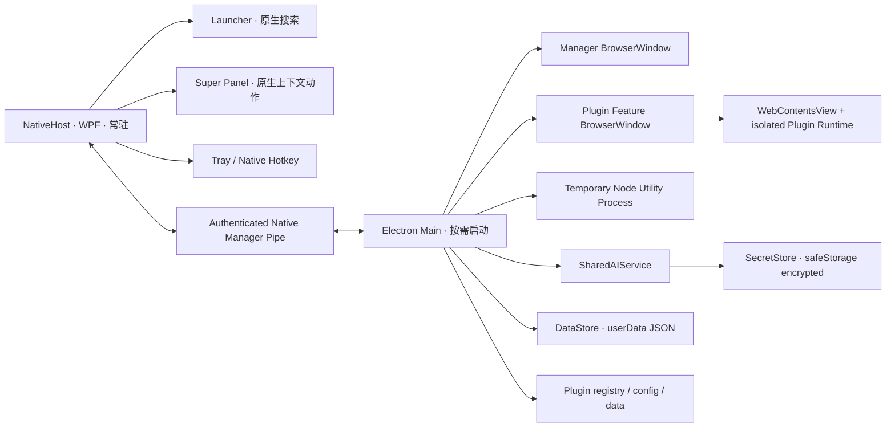

# WebTools Phase 6F-4A — Manager IA & Platform Architecture

**阶段：** Phase 6F-4A — Architecture Audit + Product / IA / Capability Design\
**状态：** APPROVED / COMPLETE\
**审核记录：** 用户已批准整体架构方向；本轮三项定向修订已合并到本冻结基线。\
**范围：** 当前源码审计、产品信息架构、能力边界、6F-4B/4C/4D 实施计划。\
**不包含：** 产品实现、测试、typecheck、构建、打包、启动应用或安装器。

> 本文以当前 working tree 中的源码和可读取的 Phase 6B–6F 文档为依据。文中使用 **CURRENT SOURCE FACT**、**DESIGN DECISION**、**FUTURE DIRECTION**、**DEFERRED** 区分现状、已定方向和未来能力。源码事实不等于人工运行验收；没有在本轮运行测试来证明任何行为。

## 1. Executive decisions

### Product surfaces

- **Launcher = DISCOVER / INVOKE**：通过搜索发现并调用应用、网站及 WebTools Plugin Features。Applications / Websites 始终排在 Plugin Features 之前；使用频率或排名信号只在 Plugin Features 类别内部影响次序。
- **Super Panel = CONTEXTUAL ACTION**：根据 NoContext、SelectedText、SelectedFiles、SelectedDirectories、ExplorerFolder 呈现适配的 Feature。用户已确认 Phase 6F-3 完成；本阶段不重做捕获、触发器、窗口布局或呈现。
- **Manager = MANAGE / CONFIGURE**：管理 WebTools 平台设置、已安装插件、插件权限和配置、Shared AI、诊断与产品信息。Manager 不作为所有插件业务 UI 的通用容器；插件业务 Feature 优先在 WebTools Electron Host 承载的独立 Plugin Window 中运行。

### Platform principles

1. Plugin Platform 保持 **AI-optional**。普通插件不需要 AI、MCP、Provider 凭据，也不为此启动额外常驻 Runtime。
2. Shared AI 是 WebTools Host-owned platform capability，不归 Translation 私有所有。Plugin 只能请求受授权、受宿主约束的能力，不能读取 Provider 原始凭据。
3. **Install != Run；Enabled != Resident。** 安装只表示已验证并存放；启用只表示 Feature 可注册、可发现、可按需激活，不表示存在常驻插件进程。
4. **Plugin Window 仍由 WebTools Electron Host 承载；Node Command 仍按需运行于临时 Utility Process。** 不增加 always-on plugin daemon、永久第二 Electron Host、用于命令执行的隐藏浏览器或插件自有 Electron 应用。
5. **User-invocable Feature != AI-callable Tool。** 用户可以调用某个 Feature，不代表 AI 已获准调用它。
6. Translation 保留为当前 Manager 内置功能，直到 Phase 6G 的 first-party Plugin 达到功能等价或更好、完成跨 Surface 验证及迁移后，才移除旧实现。

## 2. Evidence and source scope

### 2.1 Reviewed source areas

- Manager Shell 与页面：`src/App.vue`、`src/features/favorites/FavoritesView.vue`、`src/features/settings/SettingsView.vue`、`src/features/settings/SuperPanelSettings.vue`、`src/features/translate/TranslateView.vue`、`src/features/plugins/PluginManagerView.vue`、`src/features/plugins/DeclarativePluginView.vue`、`src/features/plugins/WebRuntimeView.vue`。
- Manager 目录与呈现模型：`src/shared/plugin-catalog-contracts.ts`、`src/shared/plugin-contracts.ts`、`src/shared/feature-contracts.ts`、`src/features/plugins/catalog-view-model.ts`、`src/features/plugins/plugin-view-model.ts`。
- Electron Main、IPC、Preload 与进程生命周期：`electron/main.ts`、`electron/preload.ts`、`electron/web-plugin-preload.ts`、`electron/node-web-plugin-preload.ts`、`electron/ipc/`。
- Plugin 平台：`electron/plugins/plugin-manager.ts`、`plugin-catalog.ts`、`feature-registry.ts`、`plugin-window-manager.ts`、`web-plugin-runtime.ts`、`web-host-capabilities.ts`、`node-command-execution.ts`、`plugin-store.ts`、Manifest validators 与 SDK 的 Manifest v1/v3 源码。
- AI、Translation 和用户数据：`electron/services/shared-ai-service.ts`、`ai-provider-registry.ts`、`ai-credentials.ts`、`secret-store.ts`、`secret-store-core.ts`、`translation-service.ts`、`data-store.ts`、`src/shared/ai-config.ts`、`src/shared/domain.ts`、`src/shared/translation-contracts.ts`。
- NativeHost 与 Manager Settings 的交界：`native/WebTools.NativeHost/Services/NativeManagerPipeServer.cs`、`native/WebTools.NativeHost/SuperPanel/SuperPanelSettingsController.cs`、`native/WebTools.NativeHost/SuperPanel/SuperPanelStateStore.cs`、`electron/services/native-manager-client.ts`、`electron/ipc/settings-handlers.ts`。
- 参考文档：Phase 6B SDK 文档、Phase 6C 架构冻结/Native Projection 文档、Phase 6D Feature Platform 文档、Phase 6E Web Plugin Runtime 文档、`docs/plugin-runtime.md`、`docs/plugin-development.md`、`docs/super-panel.md`、`docs/phase6-master-plan.md`。

### 2.2 Evidence limits and repository documentation drift

- 本轮只读源码、文档和 Git 状态摘要；没有运行代码。所有实现结论均为 **静态源码确认**，不代表新的 GUI、Windows Runtime 或打包验收。
- 当前用户明确确认 Phase 6F-3 Universal Selection Preview 人工运行无问题，本文据此记录 **USER ACCEPTED / COMPLETE**。仓库里的 `docs/super-panel.md` 仍保留“Phase 6F-3 development only / not complete”的旧文字；该文档与最新用户确认不一致，本轮按范围不修改该历史文档。
- `docs/phase6-master-plan.md` 的状态仍描述 Phase 6D 尚未开始、Phase 6E/6F 为旧计划；与当前用户给定的 Phase 6E、6F 完成状态及当前源码不一致。本文不借 6F-4A 顺手重写 Master Plan。
- 文档清单中没有专门的 `phase6f1` / `phase6f2` 架构文件；6F-3 约定主要记录在 `docs/super-panel.md`。本轮以当前源码和用户给出的当前 Phase 状态为准。
- `plugin-sdk/declarative-v1/package.json` 当前源码版本为 `@webtools/plugin-sdk@1.4.0`。本轮在仓库 `release/` 与 `artifacts/` 搜索范围内没有找到 `.tgz`；外部分发副本及其哈希无法从仓库确认。6F-4 后的 SDK Sync Gate 会重新生成并验证当前源包，不沿用旧版 tarball 身份。

## 3. Current process and responsibility architecture

### 3.1 Current runtime topology



### 3.2 Current process ownership

**CURRENT SOURCE FACT**

- NativeHost（C# WPF）是常驻入口，持有原生 Launcher、托盘、全局/原生输入职责和 Super Panel。Native search projection 是表现与查找用缓存；Feature 的最终许可和激活由 Electron Main/Plugin Host 再次校验。
- Electron Host 按需启动，创建 Manager `BrowserWindow`，并在需要时为独立 Plugin Feature 创建 `BrowserWindow`。Plugin Window 内使用独立的 Web runtime/`WebContentsView`；它仍属于同一个 WebTools Electron Main process group。
- Manager 关闭并不强制关闭已打开的 Plugin Windows。Plugin Windows、激活请求及命令执行仍在时 Electron 可以继续存活；只有 Manager、Plugin Windows、激活工作等所有者均释放后，Main 才可执行 idle quit。
- Node Command 经 `NodeCommandExecutionAdapter` 使用临时 `utilityProcess.fork` 执行；这是按需能力，不是常驻插件 Runtime。
- Launcher 使用不需要 Manager 的 NativeHost 路径。Electron Manager 未打开时 NativeHost 能独立工作；目标架构保持 Electron process count 为 0。
- Manager renderer 使用受信任的 Manager preload。Web Plugin 和 Node Plugin 使用各自受限的 preload/bridge；不能把 Manager 的 `window.desktop` 当作插件 API。

**DESIGN DECISION**：保留 NativeHost 常驻、Electron Host 按需的所有权模型。Manager Information Architecture 变化不得通过常驻 Electron 或统一插件 UI 容器换取便利。

### 3.3 Main / Preload / Renderer boundary

- Electron Main 持有 DataStore、Plugin Host / validator、registry、runtime authorities、Feature activation、Shared AI、Translation Service、SecretStore adapter 及与 NativeHost 的已认证客户端。
- Manager renderer 负责页面呈现与临时交互状态，经 typed preload IPC 请求 Main 执行持久化、授权、系统选择器和服务操作。
- Main 对管理功能 IPC 检查来源是否为当前 Manager main frame；Plugin 独立 Bridge 根据运行来源、当前 authority、能力 grant 和生命周期校验插件请求。
- Provider Key 输入期间会短暂存在 Manager 输入框状态，并通过窄化的 Manager IPC 传到 Main；Main 调用 SecretStore 保存。状态接口只返回是否已配置等元数据，不能把 Key 返回到插件或 Plugin SDK。
- Named Pipe 的 Settings / NativeHost 请求由现有 NativeHost 与 Main 通信代码持有；不要为 6F-4 引入 Renderer 直连 Named Pipe 或新的并行 Settings 真源。

## 4. Current Manager Information Architecture

### 4.1 Actual navigation and routing

**CURRENT SOURCE FACT**

- `src/App.vue` 使用 `activeSection` ref 加 `v-if` / `v-else-if` 条件呈现页面；源码中没有 Vue Router。默认首页是 `favorites`。
- 侧栏当前包含“网址”、可折叠的“插件”组和底部“设置”。“插件”组里可出现 Catalog Feature 项（包括 Translation）和“插件管理”。
- Manager 通过 `NativeManagerIntent` 接受 Settings、Entries、Translation handoff、Plugin/Feature 等显式入口。Native Entries 映射到 Favorites；Settings 可带 `settingsSection='super-panel'` 聚焦 Super Panel 设置。
- Settings 和 Plugin Center 使用 async component 按需导入；Favorites 为静态导入。切换 active section 时大部分页面走条件呈现并卸载，不是 keep-alive 页签系统。
- 页面切换、Catalog 和 Native intent 的异步状态由 `App.vue` 局部 generation / request-id 管理；这不是统一的全局页面 Router/Store。

### 4.2 Current pages

| Surface/page | Current implementation | Architecture note |
| --- | --- | --- |
| 网址 / Favorites | `FavoritesView.vue` | 当前默认页，承载 Websites/Favorites workspace。目标中复用为 Home，不新增重复首页。 |
| 翻译 | `TranslateView.vue` 经 `builtinPluginPage('translation')` 挂入 Manager | 真实的 Manager 业务页；Catalog 上显示为 built-in Translation，但它不是 `.wtplugin`。6F-4 不删除或迁移。 |
| 翻译 handoff gate | `BuiltinTranslationGate.vue` 与 Main-owned handoff | Native 入口在 Manager 尚未启用 Translation 时展示 gate；Main 保存 handoff 状态并通过 intent/request id 协调。 |
| 插件管理 | `PluginManagerView.vue` | 已有本地安装、列表、详情、权限、启用/停用、重导入替换、卸载和内置 Translation 控制。 |
| Declarative v1 plugin page | `DeclarativePluginView.vue` | 宿主渲染的闭合描述式页面，与插件自有 BrowserWindow 不同；需作为现有包的兼容路径保留。 |
| Web Runtime | `WebRuntimeView.vue` | Manager 中存在 embedded runtime view、状态订阅和 bounds 发布代码；但静态调用链中未找到当前普通生产 Feature 激活把 `openAuthority` 路由到该 Manager-owned runtime 的调用者。当前 FeaturePresentationRouter 将 Manifest v3 Window Feature 路由到 `PluginWindowManager`。实现阶段要先判清开发/兼容路径与生产路径，不可仅按组件名删除。 |
| Settings | `SettingsView.vue` | 一个长页面，没有类别导航、URL route 或独立 Settings store。当前页面加载时集中查询设置、Provider 状态、翻译服务状态和 Everything 检测。 |
| About | 无独立页面 | 目标可以加入轻量静态产品信息，版本从已有 Host API 取得；不包含更新服务、在线检查或发布渠道管理。 |

### 4.3 Current Manager role vs target

现在 Manager 已经混合了平台配置、插件管理和插件业务入口。目标将 Shell 收敛到 Home、Plugins、Settings、About，并把新的业务 Feature 优先放进 Plugin Window。兼容现有 Declarative v1 Manager pages 不等于继续把 Manager 设计成新插件的业务容器：旧 Manifest 页只从 Plugin Center 的兼容入口打开；不为新 Feature 默认创建 Manager 内嵌页面。

## 5. Current Plugin Management and Feature architecture

### 5.1 Installation, records and authority

**CURRENT SOURCE FACT**

1. Plugin Center 通过用户选择本地 `.wtplugin` 调用 Main。`PluginManager.install()` 在异步安装前复制归属包字节、调用 Host validator 校验，再执行宿主确认；安装新包默认为 disabled。
2. 安装与替换会比对版本、SHA-256、能力增减和重新授权需求；实际 registry、受控包路径、快照与运行授权归 Main / Host 所有。Renderer/Catalog DTO 是只读呈现，不是安装或执行 authority。
3. `PluginCatalog` 是 built-in Translation 与已安装包的只读整合视图；它不是第二份持久 Plugin Registry。Catalog `PluginRef` 用 `{kind,id}` 区分 built-in/declarative/web；Feature identity 使用 `{pluginId,featureId}`。
4. 启用时 Host 校验安装包、配置和 grant，再使 eligible Feature 进入 registry/projection。关闭会撤销活动授权、停止运行、关闭该插件 Feature windows 并持久化 disabled 状态。
5. 卸载需要 Host-owned 确认；删除配置/私有数据是单独选择。默认保留数据，不能把卸载解释成简单删除插件目录。
6. Native Feature Projection 传递经解析、有限长度和身份校验的 Feature 元数据。NativeHost 对 App / Websites 与 Plugin Features 使用既定类别优先级；真正激活回到 Main 重新验证当前 authority。

### 5.2 Current Feature model and surfaces

一个 Plugin 可提供多个 Feature。`FeatureRef`、`FeatureInvocationSurface`、`FeaturePresentation`、accepted context 是不同维度；Launcher/Super Panel/Manager 表示从哪里调用，`window` / `command` 表示怎样运行，不是互斥的 Plugin 类型。

- Declarative v1 `manager.page` 仍是宿主渲染页面兼容方式。
- Runtime v3 的 Window Feature 使用独立 Plugin Window，WebView 由 Main-owned `PluginWindowManager` / runtime 管理；相同 Feature 的再次打开可复用既有窗口/运行时。
- Runtime v3 的 Command Feature 使用 Node runtime 的临时 Utility Process；执行完成后退出。
- Launcher Feature projection 和 Super Panel context matching 是入口/可发现性，不使 Plugin 进程常驻。

### 5.3 Current Plugin Center UX and status evidence

当前 UI 已有本地安装；插件列表和详情；作者/版本/API 兼容信息；来源未经验证与 SHA-256 integrity 提示；Requested/Granted capability；启用/停用；Feature 打开入口；重导入替换/新版导入；卸载和数据保留说明；内置 Translation 的启用、停用和状态恢复；Developer Panel 与有限的开发 Runtime diagnostics。

真实可用 health/status 信号来自 `PluginStatus` / `PluginSummary`、catalog Builtin state、`errorCode` 与 Web Runtime 状态。包括 installed-disabled、enabled/active、needs-permission、incompatible、invalid、faulted，以及短期 invoking/stopping。当前错误展示可映射“发生什么 + 可尝试的操作”；开发诊断限定于开发者面板，不能把普通 Manager 改造成日志浏览器。

当前没有在线 Marketplace、自动更新服务或更新可用/更新中状态。UI 中的“导入替换或新版本”是用户本地再次导入，不代表存在 update feed。不能虚构 Publisher 验证或把哈希当作身份认证。

### 5.4 Current plugin settings and persistence

- Manifest v1 有闭合的 `settings` descriptor：text、enum、boolean、number。`DeclarativePluginView.vue` 使用 Host 提供的描述式控件；Host validator 和 `PluginStore` 校验值与键。
- `PluginStore` 将 plugin `config` 与通用 `data` 分开保存在 Host-controlled ManagedFs 下，例如 `config/<pluginId>.json` 与 `data/<pluginId>.json`。配置值按照 Manifest descriptor/default 校验；数据只能是限长、限深度的 JSON。两者都不是 AppSettings，也不是 SecretStore。
- Runtime v3 SDK/Manifest 允许声明 `plugin.config.read` 和 `plugin.config.write`，但 `IMPLEMENTED_WEB_CAPABILITIES` 当前只实现 Web Storage、Shared AI、Clipboard 等能力；Web/Node Runtime Bridge 没有对应的 v3 typed config API。Manifest 接受能力名不代表 Runtime 已经实现它。现有 v1 config 代码不能自动证明 v3 public runtime 的 config contract 已完整。
- Package registry、config、data、built-in Translation lifecycle state 是 Host-owned 的不同存储边界。Translation built-in state 当前存于独立 `builtin-plugins/state.json`；不要在 6F-4 无依据地合并这些存储或改 schema。

## 6. Current Settings architecture and mapping

### 6.1 Current settings surface

`SettingsView.vue` 是单页纵向区块，目前包含主题、Launcher 显示模式、快捷键预设与 Apply/Cancel、Windows 登录启动、Everything 文件搜索路径/检测、Super Panel 设置、WebTools AI Provider/模型/凭据配置、连接测试，以及独立的翻译引擎选项与 Provider 状态。没有 General/Launcher/AI 等分类切换。

### 6.2 Current data ownership

- Electron Main 的 `DataStore` 持久化 `AppData` JSON（schema version 2），包含 Websites/Favorites、bookmarks/folder/order、搜索记忆与 `AppSettings`。
- `AppSettings` 当前包括 `searchEngines`、`defaultSearchEngineId`、`quickSearchShortcut`、`launchOnStartup`、`websiteLayout`、`everythingEnabled`、`everythingEsPath`、旧 `aiBaseUrl` / `aiModel`、`sharedAI`、`translation`、`theme`、`launcherDisplayMode`。
- `normalizeSharedAISettings()` 将旧 `aiBaseUrl` / `aiModel` 输入兼容到新的 `sharedAI` 配置；旧字段留存是兼容事实，不意味着目标 UI 继续同时暴露两套 AI 配置。
- Launcher 有 NativeHost 执行侧设置/热键注册职责。Manager settings IPC 在需要时先更新 NativeHost，再写 DataStore；失败可尝试回滚 NativeHost 状态。Super Panel settings 则由 NativeHost 自有 state store/controller 持有，经能力协商过的 authenticated Manager Pipe 读写。
- Manager 是 Super Panel 唯一设置 UI。当前 Super Panel 是 mouse-first：Middle/XButton1/XButton2、Press/Hold、Hold 300–1500 ms，默认 Middle + Hold + 600 ms。没有 Super Panel 键盘快捷键；6F-4 不增加。

### 6.3 Current → Target settings map

| Current field / control | Target category | 6F-4 treatment |
| --- | --- | --- |
| `launchOnStartup` | General | 迁移呈现位置；保持现有启动服务、开关语义和持久化，不新增第二注册来源。 |
| `websiteLayout` | General（Home/网址偏好） | 只在仍需全局 Settings 管理时保留；继续使用现有值，不改 Favorites 数据。 |
| `quickSearchShortcut`、`launcherDisplayMode`、Everything enabled/path、search engines/default engine | Launcher | 集中到 Launcher 子页；保存仍通过 Main 与 NativeHost 现有管道。 |
| Super Panel enabled/button/gesture/hold duration | Super Panel | 移动页面区块，不改变 NativeHost 为权威设置存储及已确认 mouse-first contract。 |
| `sharedAI` provider config/default model/region/workspace | AI | 提升为 WebTools 平台 AI 配置；仅 UI 分类迁移，不因页面拆分改变数据格式。 |
| Provider API keys | AI → Credentials | 仍写入 Main-owned SecretStore；Renderer 只短暂处理新输入和脱敏状态。 |
| `translation` engine/source/target/Qwen-MT translation preference | Legacy Manager Translation surface / compatibility path | 6F-4C 不将它们搬入 `Settings → AI`；继续通过现有 Translation surface 可访问、可保存。Phase 6G 迁移到 `Plugins → Translation → Configuration`。 |
| theme | Appearance | 迁移呈现位置，沿用当前 theme 值和 `applyTheme`。 |
| legacy `aiBaseUrl` / `aiModel` | Hidden compatibility only | 继续由 DataStore normalizer 兼容，不在新设置 UI 增设重复字段。 |
| Developer/runtime diagnostics | Advanced | 仅将现有有限 diagnostics 移入 Advanced；不新建日志数据库或增加运行时记录。 |
| Product version / runtime facts | About | 可用现有 Host version API 显示静态信息；不添加 updater、在线检查或 Marketplace。 |

> Data mapping 是 UI 目标，不授权 schema migration。除后续阶段确有必要且经过兼容审查外，6F-4 优先沿用既有 DataStore 和 NativeHost settings protocol。

## 7. Current Translation architecture

### 7.1 Current implementation

- `TranslateView.vue` 是独立的 Manager Renderer 页面组件；`builtinPluginPage('translation')` 将其接到 Manager section。Plugin Catalog 对外呈现固定 built-in `webtools.translation`，可启用/停用/恢复，但它不是一个独立签名包或 Runtime v3 Plugin Window。
- Translation input/output/language/loading/error/copy 属于页面短期 UI 状态。源/目标语言、当前翻译 engine、Qwen-MT model 仍在 `AppSettings.translation`。
- Main-owned `TranslationService` 处理 request id、最大输入 20,000 字符、最大输出 100,000 字符、45 秒超时、AbortController cancel 和 Translation lifecycle admission generation；组件卸载清 timer 并取消活动请求。
- 当前 provider 分支：MyMemory 免费外部 API（无 Key、单次 500 UTF-8 byte cap）；`ai` 走 `SharedAIService.complete()` 使用 WebTools global default provider；`qwen-mt` 则直接读取 Qwen credential/config，调用专用 Qwen-MT adapter。Qwen-MT 是现存 Translation-specific provider path。
- Native → Manager handoff 由 Main-owned handoff/request id 传递文本，Manager 显示 Translation 或 gate 后 exact-prefill。当前 `TranslateView.vue` 在设置加载完成后对已有非空输入排入约 450 ms 自动翻译，因此静态源码行为是预填可能自动触发请求。

### 7.2 Handoff contract discrepancy to preserve

历史 Windows acceptance 已明确将 Launcher → Translation 的文本预填定义为 **正确填入且不自动触发翻译**。当前组件源码中的 `scheduleAutoTranslate()` 会在有输入、Provider configured 且 settings ready 后自动发起 translate，包括 Prefill 后的 mounted/settings-ready 路径；这与既有验收约束有冲突。

**DESIGN DECISION**：本阶段不修改行为。Phase 6G 移除旧页前必须把 handoff 回归到既有“prefill-only”验收 contract，或在任何新行为进入产品前取得用户明确决策。不能默认为自动翻译就是新的产品要求，也不能把 Quick Translation 的未来意图反向用于覆盖旧 handoff contract。

## 8. Current AI / Provider / credential architecture

### 8.1 What exists today

- `src/shared/ai-config.ts` 定义 OpenAI、Anthropic、Gemini、DeepSeek、Qwen、Custom provider id 与每 provider 的 model/baseURL/region/workspace metadata。`AppSettings.sharedAI` 保存默认 Provider 和配置元数据；`SharedAIService` 根据 defaultProviderId 选 provider descriptor 与 adapter。
- `SharedAIService.complete()` 当前按全局默认 Provider 执行，检查消息数量/长度、model、endpoint 与凭据；没有公开插件级 `providerId` 选择参数。
- Declarative v1 有 `sharedAI.complete` action 与 Host-owned review/confirm/cancel 路径。Web/Node Runtime v3 也有 optional `sharedAI.complete` capability；调用通过 Host 检查 authority/grant/runtime/用户交互、输入/频率/token bounds，再由 Main 使用 `SharedAIService`。未经授权的普通插件不能调用该能力。
- `TranslationService` AI 引擎复用默认 Shared AI；MyMemory 与 Qwen-MT 另有翻译专用 provider adapter。Shared AI 已不只是 Translation 私有，但 Translation 仍有独立直接调用 Qwen credential 的 legacy 分支。

### 8.2 Credential boundary

- `AIProviderCredentialStore` 把 provider id 映射到 Host secret keys，例如 `ai-openai`；`custom` 兼容旧 `ai-api-key`。
- Electron `SecretStore` 使用 Electron `safeStorage` 加密/解密值；`SecretStoreCore` 将密文放在 userData 下的 JSON 文件，序列化写入并拒绝返回解密错误内容。AI credentials 只由 Main 的服务使用。
- Settings IPC 可保存、清除并读取“是否配置”状态；Renderer 不获得现存 raw key。用户正在输入新 Key 时，Renderer 必然短暂持有输入草稿并把输入发给 Main 保存；不得将此边界夸大成“Key 从未经过 Renderer IPC”。
- Plugin API/Manifest/Plugin Store 没有 SecretStore 访问路径。Plugin config、Plugin data、AppSettings、SecretStore 是不同权限域。

### 8.3 Target Shared AI direction

```text
WebTools AI Platform
  ├─ Models / Providers / global defaults and policy
  ├─ Host-private Credentials (SecretStore)
  └─ Host-owned Shared AI capability
        └─ explicitly eligible, granted Plugin Feature
              └─ Host provider adapter → configured model/provider
```

**DESIGN DECISION**：6F-4C 将 Provider、模型/default 和凭据管理放到 `Manager → Settings → AI`，文案解释“WebTools AI”是平台配置、Translation 是消费者。6F-4C 的首个 capability 继续使用 WebTools 默认 Provider，复用现有 `SharedAIService.complete()`；不要同时发明无法执行的 per-plugin provider override。Plugin 可以在自己的 typed configuration 中存放产品偏好，但具体 Provider 可选范围/覆盖语义须另行经过 Host policy 才能暴露。

**FUTURE DIRECTION**：平台日后可以支持 Provider 可用策略、Feature-level model preferences、请求确认策略与额度/速率界限；6F-4A 不新增这些 API。

## 9. Target Manager IA and Plugin Center

### 9.1 Target navigation

```text
Manager
  Home / 网址
  Plugins
    Installed Plugins
    Plugin Detail
      Overview / Features
      Configuration (when defined)
      Permissions / Health
  Settings
    General
    Launcher
    Super Panel
    AI
    Appearance
    Advanced
  About
```

- Home 复用现有 Favorites/Website workspace；不增加一个复制 Favorites 的 Dashboard。
- Plugins 仅承载插件列表、详情、配置、管理动作。Feature 业务操作通过 Plugin Window 或命令执行；无需在主导航为每个插件建立常驻子页。
- Settings 的类别为导航状态，持久化值仍属于各自已存在的 Host/DataStore 或 NativeHost 所有权。
- About 是轻量静态信息页，不扩张到自动更新和账号门户。

### 9.2 Current → Target → action mapping

| Current | Target | Action / boundary |
| --- | --- | --- |
| Favorites / “网址”默认首页 | Home / 网址 | 保留现有页面和 Website data；只重命名/组织 IA。 |
| 手动 Plugin subgroup 与逐插件 Manager navigation | Plugins Center | 管理入口集中到 Plugins；用户的 Launcher/Super Panel Feature projection 不变。 |
| Plugin v3 Feature 打开动作 | Plugin Window | 继续经 FeatureRef → Host authority → FeaturePresentationRouter → PluginWindowManager。 |
| Declarative v1 Manager page | Plugins 的兼容打开入口 | 包和页面 contract 在 6F-4 不删、不自动转换；仅不作为未来新插件默认 UI。 |
| Manager embedded `WebRuntimeView` | 待调用链确认 | 当前静态生产激活路径进入独立 Plugin Window；移除前先确认 Developer/兼容调用者，6F-4A 不删组件或 runtime。 |
| 当前 Manager Translation | 6F-4 继续保留 | 仍能从 Manager 和既有 Native handoff 打开；6G 新 Plugin 达到 parity/migration 后才移除。 |
| Settings 单长页 | Settings categories | 只拆 UI 视图；保存与 provider/status 刷新仍通过现有 Main/Native contracts。 |
| Shared AI 与 Translation engine 并排区块 | `Settings → AI` + Legacy Manager Translation surface | Provider/key 归平台 AI；Translation engine/settings 留在现有 Translation surface，Phase 6G 再迁至 `Plugins → Translation → Configuration`，不经过 AI category。 |
| Super Panel settings block | Settings → Super Panel | 保留唯一 Manager Settings UI 与 NativeHost authoritative state。 |
| 无 About 页面 | About | 仅版本/产品/本机信息。 |
| 无 Marketplace/update service | 不新增 | 6F-4 不显示虚假的更新状态。 |

### 9.3 Plugin Center design contract

**Plugin list** 每项使用现有 Host DTO 显示：名称、说明、版本、Manifest author/publisher 信息（可能是未知）、启用状态、真实 health/status、Feature 数量或简短功能概览。由于没有在线更新来源，不显示“有新版/正在更新”。

**Plugin detail**：

- 身份：Plugin ID、名称、说明、作者、版本、API/minimum host compatibility、local unsigned trust state；技术 hash/path 可置于 Advanced。
- 用户可读 Feature summary：`可从 Launcher / Super Panel 使用`、`适用于选中文本 / 文件`、`打开独立窗口` 或 `运行一次命令`。不把 `presentation=command`、`acceptedContexts=selected-files` 原始 enum 当成主文案。
- 配置入口只在 Host 已有并验证配置 contract 时显示；Plugin-specific settings 留在 `Plugins → Plugin Detail → Configuration`，不能塞到平台 Settings。
- 许可说明以 requested/granted 真实数据为准；新增 grant 需 Host 确认，撤销则使授权失效。
- Error state 提供 `What is wrong + What can I do`；普通用户见有限错误代码与安全恢复提示，详细 diagnostics 只在 Developer/Advanced 路径展示。
- 操作：enable/disable、打开 Feature、从本地导入替换/新版、uninstall、uninstall 时独立选择是否删除 Host 保存的 config/data。

**Enabled semantics**：UI 的“已启用”表示 Feature 可登记/搜索/激活。短暂的 `active` / `invoking` 属于瞬时健康信号，不承诺常驻。避免把 Enabled 直接翻译成“插件正在运行”。

## 10. Plugin-specific Configuration architecture

### 10.1 Separation of concerns

| State | Owner / location | Purpose |
| --- | --- | --- |
| Platform `AppSettings` | Main DataStore | 全局 Launcher、外观、Shared AI、启动等设置。 |
| Super Panel trigger settings | NativeHost state store / controller | 输入触发状态，Manager 通过已认证 Pipe 配置。 |
| Plugin config | PluginStore `config` namespace | Manifest/Host 定义的稳定用户偏好，如语言或格式选项。 |
| Plugin data | PluginStore `data` namespace | Plugin 私有运行数据，不是 UI preference contract。 |
| Provider credential | Main SecretStore | raw key/token，任何 Plugin 都不可读。 |

### 10.2 Manager-owned Configuration Management

```text
Manager
  → Plugin Center
  → Plugin Detail
  → Configuration
  → Host-owned Plugin Configuration Management API
  → PluginStore config namespace
```

这是受信任 Manager 的 **management authority**，不是 Plugin Runtime capability。只要插件仍已安装，即使处于 `DISABLED`，用户也应能查看、修复和修改合法配置，为下次启用做准备。Manager 配置操作不得因为插件 runtime disabled、未启动或不 resident 而拒绝，也不得为了打开配置页面而启动 Plugin Runtime。

Host API 应验证 installed plugin identity、当前安装包及配置描述符兼容性、setting key/type/bounds、Host validator 规则，以及适用时的当前 package generation/version/hash。Manager path 与 Runtime path 共享 Host-owned config 数据、描述符和值校验，但不共享相同的授权 gate。

### 10.3 Plugin Runtime Configuration Capability

```text
Plugin Runtime
  → public SDK plugin.config.read/write
  → Host capability bridge
  → PluginStore config namespace
```

这是独立的 **runtime capability authority**。Runtime path 可要求插件已安装且 enabled、session 有效、plugin identity 与当前 generation 匹配、请求和 grant 均包含 capability、Host 已实现该 capability，并校验 descriptor/key/value。`Enabled != Resident` 仍成立：运行时配置调用只有在 Runtime 实际运行时发生；Manager 配置管理不要求 Runtime active 或 resident。

### 10.4 6F-4D contract direction

- 复用 Manifest v1 已有的 closed, typed setting descriptors 作为兼容先例；Host owns descriptor parsing, defaulting, bounds and writes。
- v3 Manifest 虽然列出 `plugin.config.read/write` capability，但 v3 Web/Node bridge 目前未实现这些能力。6F-4D 必须形成一致的 SDK type、Manifest validator、capability eligibility、Host bridge 与 Manager editor contract；只在能力完整可用时才将它作为 v3 grantable feature。
- v3 Configuration 由 Host 可验证的 declarative descriptor 定义；不接受 executable JS、Vue、HTML、任意表单代码、任意 IPC、raw filesystem 或未经 Host 校验的 JSON schema 扩展。
- Manager-owned Configuration Management API 只管理当前已安装插件自己的 config namespace；Runtime `plugin.config.read/write` 只允许 capability-authorized runtime session 使用。两条路径复用同一 Host descriptor/value validator，但分别应用 management identity/package checks 与 runtime enabled/session/generation/grant checks。
- 既有 `plugin.storage.*` 仍用于受限私有数据，不混作设置界面；现有 v1 页面与包兼容，不能静默更改同一 key 的语义。
- Plugin 可将“使用 WebTools 默认 AI”等非秘密偏好保存在自己的 config；若未来开放 Provider 选择，Host 仍只允许全局启用/已配置的 provider，并且 plugin preference 不得绕开 Host policy。

**Migration**：6F-4 不进行 v1 → v3 自动转换，不改 DataStore schema，不搬移 SecretStore 数据。Phase 6G Translation migration 单独验证旧 `settings.translation` 到 Plugin config 的 backup、mapping、幂等性和回滚。

## 11. Shared AI capability and AI-optional platform

### 11.1 Request path

```text
Plugin Feature (explicitly declares + user grants sharedAI.complete)
  → WebTools Host bridge / current runtime authority
  → request validation, generation/session checks, limits and policy
  → SharedAIService (global default provider in current API)
  → Main-only AIProviderCredentialStore → SecretStore
  → selected provider adapter
  → bounded response returned to the authorized runtime
```

- Shared AI 能力是 optional；不请求 capability 的 JSON Formatter / Image Compressor / QR Generator / File Converter / Metadata Viewer 不加载 AI provider runtime，不需要 MCP 或 API Key。
- 不创建 `AI Plugin` / `Non-AI Plugin` 两套格式；同一个 Plugin 模型可选申请共享 AI capability。
- Key 永不进入 Manifest、Plugin settings/data、Plugin renderer localStorage、Plugin Node process environment、Plugin SDK 返回对象或 AI Tool output。
- AI 不在 NativeHost 中运行；插件不能绕过 Host 直接获得 key，也不能仅因 Feature 已出现在 Launcher/Super Panel 就自动获得 AI 权限。

### 11.2 Manager AI settings

`Settings → AI` 是平台级设置。一个页面可以按 section 组织 Providers、Models/Default、Credentials、Provider status/connection test；没有必要机械拆为三个 route。重点解释“WebTools 使用哪些服务”，而不是“Translation 自己存什么 API key”。

首轮保留当前可配置 provider 集、model/base URL、Qwen Provider 的 region/workspace、凭据保存/删除与连接测试的真实功能。Migration 只移动 UI，不重写 adapter 或 API。Provider 未配置时非 AI Plugin 和 MyMemory Translation 仍可工作。Translation engine、语言、行为偏好和 Qwen-MT 的翻译专属 model/preference 不进入 AI category；继续留在 Legacy Manager Translation surface，直到 Phase 6G 迁入 Translation Plugin Configuration。Qwen Provider 凭据仍由平台 AI / Host SecretStore 管理。

### 11.3 AI platform is not an Agent runtime

本阶段 Shared AI 是受控 completion capability，不是 Agent、Planner 或 Tool orchestration system。Do not introduce implicit tool execution, multi-step planner, autonomous memory, distributed job system or new secret grant surface.

## 12. Future AI Tool Registry and MCP

**FUTURE DIRECTION — NOT IMPLEMENTED**

```text
WebTools AI Platform
  ├─ Models
  │    └─ AI Providers
  └─ Tools
       └─ AI Tool Registry
            ├─ Plugin Tools
            └─ MCP Tools
```

- AI Tool Registry 是未来 Shared AI 的工具来源边界；Plugin Tool 和 MCP Tool 是不同 provenance/source 的条目，均需单独的发现、输入输出校验和调用权限。
- MCP 是外部 Tools / Resources / Prompts 的互操作路线，不替代 WebTools Plugin Platform。
- Plugin Platform 继续负责 UI、Plugin Window、Command、Launcher、Super Panel、Context contract、Plugin settings 及 WebTools-native capabilities。普通 Plugin 无需理解 MCP，也不转换成 MCP Server。
- 一个未来 Plugin Feature 可以选择提供 AI Tool adapter；这不是所有 user Feature 的默认属性。
- 用户可调用 Feature 和 AI 可调用 Tool 必须是不同授权维度。未来可以表达类似 Not Allowed / Ask Before Run / Allowed 的用户策略；有删除/修改文件、发邮件/消息、命令执行、网络写入、账号操作等副作用时不能因用户手动可调用而自动允许 Agent 调用。
- 此处不锁定具体 Manifest 字段名、permission database 或 SDK schema；具体 Agent/Tool permission 另立阶段设计。

## 13. Translation 2.0 migration architecture

### 13.1 Migration order

```text
Existing Manager Translation (keep)
  → Phase 6F-4 platform foundation
  → SDK source / distributed tarball sync
  → Phase 6G first-party Translation Plugin 2.0
  → parity + cross-surface validation
  → legacy Translation settings / handoff migration with backup and recovery
  → `Plugins → Translation → Configuration`
  → remove legacy Manager Translation and obsolete translation-specific path
```

**BUILD NEW BEFORE REMOVE OLD**。当前 Translation 不在 6F-4 删除、不迁移、不重写；不存在“为 IA 统一先删旧页”的临时过渡。

### 13.2 Phase 6G dogfooding criteria

Translation 是优先的 first-party Plugin，但不是 Plugin Platform 的特殊后门。迁移验证至少覆盖：

- 公开 SDK 包、Host install-time validator、安装/确认、enable/disable、FeatureRegistry、FeatureRef 和 Host lifecycle。
- Launcher → Translation Feature → Plugin Window。
- SelectedText → Super Panel → Translation Feature → Quick Result / Preview。
- Plugin-specific target/source/language/provider preferences 和存储迁移。
- Shared AI capability 与 Host default provider/model/SecretStore isolation。
- Provider 状态、取消、错误/超时、输入限额、handoff lifecycle。
- v1/v3 compatibility, runtime close/reopen, no stale feature projection。

如果 first-party Translation 必须调用大量未公开 Host-private API 才能完成这些路径，结果应归类为 SDK/Plugin capability gap 并回到平台修复，不能为 Translation 留永久特殊后门。

至少再验证一个真正 Non-AI first-party Plugin，例如 **JSON Formatter**：不申请 AI/network capability，不需要 Provider key/MCP；能通过安装、配置、Feature Registry、Launcher 和 Plugin Window 路径完成产品操作。此候选不在 6F-4 实现。

### 13.3 Quick Translation status

**DEFERRED, NOT CANCELLED**。未来真实 Translation Feature/Plugin 提供 bounded Quick Result，Super Panel 负责呈现；NativeHost 不新增第二翻译服务，不伪造结果，也不临时调用 AI/API。当前 Feature activation outcome 是 opened/completed/cancelled，Node command path 也不提供有类型的 Preview payload；这不是可忽略的未来说明，而是下节登记的 **Known Platform Capability Gap** 和 **PRE-6G DESIGN GATE**。

### 13.4 Known Platform Capability Gap — Feature Structured Quick Result / Preview Contract

**KNOWN PLATFORM CAPABILITY GAP. PRE-6G DESIGN GATE.** 当前 Feature invocation / activation contract 缺少适用于 Super Panel Quick Translation 的 typed、structured、bounded result/preview payload。已确认的 SelectedText 流程不能依赖硬编码或伪造结果、NativeHost 翻译服务、clipboard workaround、Translation-private IPC 或 Host-private Translation backdoor。

目标方向：

```text
Feature Invocation
  → Host-owned Feature Result Contract
  → bounded, validated structured result
  → Quick Result / Preview presentation
  → Super Panel
```

在 Phase 6G Translation 2.0 实现 Super Panel Quick Translation **之前或在 Phase 6G 开始时**，必须先根据真实 Translation dogfooding 用例设计所需的最小 public Feature Result / Quick Result contract。它必须是 Host-owned 的 Plugin Platform capability，可在适当情况下供 first-party 与 future third-party Plugin 使用，保留 `FeatureRef` / activation authority 和 context boundaries，验证并限制 payload，不暴露 Host-private object 或 secret，不要求 NativeHost 执行翻译，不使 AI 成为必需能力，也不自动授予 AI-callable Tool 权限。

此 gate 只要求届时设计真实用例所需的最小契约；**本轮不定义最终 schema**，不创建 Universal Result Framework，不锁定 Manifest 字段名、payload schema、MIME system、streaming protocol、generic card framework 或 AI-specific result object。不得因此重编号或新增大型 roadmap phase；如真实设计显示需要先完成独立小阶段，再届时决定是否拆为 6G-0 / 6F-x。

## 14. Phase 6F-4 implementation plan

四个主目标顺序固定：**6F-4A → 6F-4B Plugin Center → 6F-4C Settings + Shared AI → 6F-4D Plugin Configuration + Capability Contract**。6F-4A 架构方向及本轮三项修订现已批准并完成；后续阶段仍需各自的正式实施授权。

### 14.1 Phase 6F-4B — Plugin Center

**Goal**：让 Manager 集中管理已安装 Plugin，明确 Feature 可用范围、健康、权限、配置入口和 Host-owned 安装/卸载结果；避免 Manager 成为新的插件业务容器。

**Scope**

- 建立 Plugins list/detail 的 Shell 路径；保留插件本地导入、Host validator、consent、enable/disable/grants、已有 replace/reimport 与 uninstall/delete-data flow。
- 将 Catalog Feature summary 呈现成可读 Surface/context/Presentation 描述；新 v3 Window Feature 继续打开 Plugin Window，命令仍是临时运行。
- 使用现有状态/errorCode 添加面向用户的健康状态与最小恢复提示；Developer diagnostics 继续留在 Advanced/Developer path。
- Plugin Detail 的 Configuration 入口面向已安装插件开放，即使插件 disabled 也允许通过 Host management path 查看/修改合法配置；不得为显示配置而启动 Plugin Runtime。
- 只显示实际存在的数据；没有 updater 就不添加更新状态。
- Declarative v1 Manager page 留作兼容打开入口，不再作为新 Feature 的默认业务容器。

**Production files likely affected**：`src/App.vue`、`src/features/plugins/PluginManagerView.vue`、`DeclarativePluginView.vue`（仅兼容入口路径时）、`catalog-view-model.ts`、`plugin-view-model.ts`、相关插件 CSS、`src/shared/plugin-catalog-contracts.ts`、`electron/plugins/plugin-catalog.ts`、Plugin Catalog/Plugin handlers、`electron/preload.ts`。

**Existing contracts reused**：Catalog snapshot/`PluginRef`、`PluginSummary`、`FeatureRef`、Host install confirmation、PluginManager state/permissions、Feature Registry 与 projection、PluginWindowManager、NodeCommand adapter、Host error/status DTO、PluginStore data delete choice。

**New contracts required**：若现有 catalog DTO 不足，添加只含安全已验证字段的 feature discovery summary（surface、accepted context、presentation、human label）；不暴露原始 Manifest、绝对路径、secret、runtime internals。复用 Host `errorCode`，不复制出第二份 health registry。

**Migration requirements**：不改 Plugin package / Manifest 版本、注册表、config/data namespace、Feature identity、native projection 数据格式；旧 Manager route 映射为 Plugins Detail/compatibility open。

**Explicit non-goals**：Marketplace、自动更新、Publisher trust 认证、删除 v1 plugin page renderer、改 SDK、Agent/MCP。

**Risks**：Catalog DTO 与 Feature registry authority 可能漂移；Managed plugin 和 built-in Translation 的管理动作不同；用户不能把 Enabled 理解成常驻；需在 UI 中区分 local unsigned 与可信身份。

**Dependency**：依赖本 6F-4A 目标 IA；早期 Catalog/Host contract 保持作为 authority。

**Completion criteria**：当前安装/内置条目可列出和打开 detail；所有支持的权限/开关/卸载动作仍由 Host 确认并能呈现结果；disabled 插件配置可经 Manager management authority 访问且不会启动 Runtime；Feature 描述说明入口/上下文而不暴露低层 enum；v3 feature 仍经独立 Plugin Window/temporary Command；无虚构 update field；已安装包和 user data 不因 IA 变化丢失。

### 14.2 Phase 6F-4C — Settings Consolidation + Shared AI Foundation

**Goal**：把长设置页组织为 General、Launcher、Super Panel、AI、Appearance、Advanced，同时把 AI 从“某个消费者的 Key 区域”明确提升为 WebTools 平台配置。

**Scope**

- Settings shell/category navigation，先保留所有现有字段和设置行为；不引入新 Store/schema，仅为需要的当前 section 使用 UI navigation state。
- Launcher / Startup / Theme / Everything 设置按类别重新定位；Super Panel 继续 Manager-only UI，通过现有 Main IPC 与 NativeHost Pipe 更新。
- Providers、Models/Defaults、Credentials、Qwen Provider region/workspace metadata、status/test 收敛到 AI category；Secret value 仍只进入 Main SecretStore。
- Translation engine/languages/behavior preferences/Qwen-MT translation-specific model remain reachable and editable on the existing Legacy Manager Translation surface; they must not move into `Settings → AI` during Phase 6F-4 and cannot be deleted.
- Shared AI API 继续以 global default provider 为准；不增加 per-plugin provider override，不加载额外 AI runtime。

**Production files likely affected**：`src/App.vue`、`src/features/settings/SettingsView.vue`、可能新增轻量 Settings category components、`SuperPanelSettings.vue`、`src/shared/domain.ts` / `ai-config.ts`（仅有类型需要时）、`electron/ipc/settings-handlers.ts`、AI settings handlers / `SharedAIService` only if contract needs an explicit shared surface、`electron/preload.ts`。NativeHost pipe/controller files 仅当现有能力合同不足时触及。

**Existing contracts reused**：`AppSettings` v2、DataStore normalizers、`SharedAISettings`、AIProviderDescriptor/Status、AIProviderCredentialStore、SecretStore、typed Manager IPC、Native SuperPanelSettings v2 capability 和 rollback/sync path。

**New contracts required**：优先仅添加 category ids/view state，不新增持久数据 contract。若 Shared AI capability 对不同 Plugin surface 需要统一 response metadata，在实施设计明确 DTO 后才扩展；不能复制 credentials/config。

**Migration requirements**：无用户数据 schema migration；旧 `aiBaseUrl/aiModel` normalization 保留；Translation-specific settings 保留在 Legacy Manager Translation surface（不迁入 AI category）；Native launcher 与 Super Panel 设置必须读写同一 authoritative owner。

**Explicit non-goals**：Provider library 升级、新 Provider、per-plugin model override、MCP、AI Agent、translation engine removal、SecretStore 格式迁移、Super Panel trigger 改动。

**Risks**：拆分 UI 可能使现有集中加载重复执行/形成不一致草稿；Main 与 NativeHost 的部分 Settings 双写/rollback 顺序不可被页面重排打破；Key 暂存和错误信息必须保持私密。

**Dependency**：依赖 6F-4B 的 Plugins vs Platform Settings 边界；沿用当前 DataStore / NativeHost protocol。

**Completion criteria**：目标六类设置能直达且覆盖所有当前实际平台设置；切换类别不会丢未保存操作或产生重复状态；保存/重启后值仍由原 owner 读取；launcher setting sync/rollback 正常；AI provider 配置、Key save/delete/status/test 走 Main-owned SecretStore；Translation-specific settings 继续在 Legacy Translation surface 且没有进入 `Settings → AI`；无 AI 配置时 Non-AI Plugin 和免费翻译不被挡住。

### 14.3 Phase 6F-4D — Plugin Configuration + Capability Contract

**Goal**：在保持 package/runtime authority 的前提下，为 Runtime v3 统一实现 Host-validated typed plugin configuration，并让 Manager 通过 Plugin Detail 管理配置。

**Scope**

- 定稿闭合 v3 config descriptors/values 及 SDK 类型；以 Manifest v1 已验证的 text/enum/boolean/number bounds 为依据，必要地给 v3 增加版本化可选字段。
- Host install validator、catalog summary、Plugin Manager、Web/Node Bridge 对 config read/write capability 的可用性保持一致；requested、granted、implemented 的三重条件缺一不可。
- Plugin detail Configuration UI 由 Manager Host 根据已验证 descriptors 渲染；不执行插件提供的组件/HTML/脚本。
- 明确实现两条 authority 独立的路径：Manager-owned Configuration Management API 可配置仍已安装但 disabled 的插件，不启动 Runtime；Runtime `plugin.config.read/write` 必须同时通过 enabled/session/generation/requested/granted/implemented capability 检查。
- config/data 两个命名空间、key/value bounds、defaults、compatibility error 与 uninstall retention/delete 语义分清。
- Shared AI 与 config 的关联仅允许 non-secret provider preference；raw credential API 不存在。

**Production files likely affected**：`plugin-sdk/declarative-v1/runtime-v3/manifest-v3.mjs` / `.d.mts`、v3 schema、SDK web/node declarations、`src/shared/plugin-contracts.ts`/新 config contract、`electron/plugins/plugin-manager.ts`、Manifest validator / immutable package snapshot、`plugin-store.ts`、`web-feature-authority.ts`、Web and Node capability bridges/preloads、Plugin Center/detail view、typed IPC/preload。

**Existing contracts reused**：v1 typed settings descriptors/`PluginSettingEditor.vue`、PluginStore config/data separation、Host install-time validation final authority、runtime session/generation/grants、PluginCatalog safe DTO、existing sharedAI capability。

**New contracts required**：versioned typed configuration descriptor set、sanitized value DTO、Host validator result/errors；分别定义 Manager management API 和 Runtime capability bridge endpoints/authority checks。Exact serialized schema must be frozen in 6F-4D implementation plan against existing v3 schema/backwards compatibility before code changes.

**Migration requirements**：旧 Manifest v1 保持可运行；无自动 v1→v3 conversion；新 config 字段只能 additive 并经过 Host validator；原有 config/data 文件不移动；不改 AppData schema 或 SecretStore。

**Explicit non-goals**：arbitrary React/Vue/HTML settings pages、插件访问文件系统、读取 SecretStore、config 与 AI credential 合并、MCP、AI-callable permissions、plugin package marketplace。

**Risks**：Manifest/SDK/Host validator 不同步会使声明被错误接受；启用新的 config capability 但无对应界面或桥接会造成误导；旧 settings descriptor 变更可能导致 CONFIG_INCOMPATIBLE。

**Dependency**：依赖 6F-4B Plugin Detail、6F-4C Platform AI settings 与 SecretStore boundary；Host validation始终是最终 authority。

**Completion criteria**：Manager 可以在插件 disabled、Runtime 未启动时管理其合法配置；Runtime v3 config capability 仅在完整 runtime authority checks 通过后可调用；二者共享 Host validator/config store，但 authority gates 独立；v3 capability 要么端到端真实可用，要么 validator/UI 明确拒绝而不是报告已实现；SDK/validator/Host bridges/Manager detail 一致；不兼容配置安全失败并保留原文件；Plugin Store config/data 不串用；v1 兼容；AI Key 始终 Host-private。

## 15. SDK Sync gate before Phase 6G

```text
Phase 6F-4 COMPLETE
  → SDK source / distributed @webtools/plugin-sdk .tgz synchronization
  → external author project frozen install and public API workflow
  → Phase 6G first-party Plugin dogfooding
```

Before Phase 6G:

1. 从 6F-4 final SDK source 构建本地 `.tgz`，记录 name/version/size/SHA-256；与实际要交给开发者的分发 tarball 做 byte/hash/metadata 对比。
2. 在 monorepo 外部的作者项目里仅依赖该 `.tgz`，跑 `pnpm install --frozen-lockfile`、starter/build/package/validator API 流程；不得用 Host-private import。
3. 用该 tarball author a minimal Non-AI Feature 与 Translation platform dogfood，验证 public Feature、config、Shared AI request typing 与 Host error contract；Phase 6G Translation 开始实现 Quick Translation 前/初期还必须通过 §13.4 的 Feature Structured Quick Result / Preview Design Gate。
4. 再由 WebTools Host 对 `.wtplugin` install-time validation 决定最终可安装性；SDK packer/preflight 不能替代 Host final authority。
5. 不要求 npm publish；distributor artifact 是明确版本的 local tarball。

## 16. Explicit non-goals and protected contracts

本阶段及 6F-4 不实现/不改变：

- 6F-3 SelectionCapture、mouse trigger、Super Panel presentation/geometry、Launcher 搜索与排名、Clipboard fallback 或快捷键。
- Manager/Plugin Window 的进程所有权；不新加 daemon、hidden browser、second Electron host；不让 Manager close 强制关 Plugin Windows。
- Translation 删除/插件创建/自动迁移、Provider 或 SDK 发布、包 Marketplace、自动更新服务。
- 新 AI Provider、AI Agent/Planner/Memory、AI Tool Registry、完整 MCP Client/server manager、Agent permission DB、自动工具执行或工作流引擎。
- 插件通用代码/HTML/UI 执行权限扩大、manifest 可执行脚本、新 filesystem/IPC 权限或 sandbox rewrite。
- 用户数据 schema、SecretStore 格式、installed package 格式和 Native Feature Projection schema 的非必要变更。

## 17. Risks and unresolved questions

### 17.1 Resolved by current source or approved architecture — no user decision needed

- Manager 不应是新插件业务 UI 的通用容器；新业务 Feature 使用现有 Host-owned Plugin Window / temporary Command 模型。
- Shared AI 是平台 capability；raw credentials 由 Host 保管；普通插件可完全不请求 AI。
- Current Manager Translation 本轮保留，Phase 6G parity + migration 前不删。
- MCP 不替代 Plugin Platform；User-invocable 与 AI-callable 权限分离。
- 6F-4B、4C、4D 顺序和 SDK sync → 6G 门禁由本架构确定。

### 17.2 Implementation discovery items (not blockers to approve this architecture)

1. `WebRuntimeView` 的 Manager-owned runtime status/bounds 路由目前在 Shell 中存在，但生产 Feature activation 的静态路径进入 `PluginWindowManager`。4F-4B 若要移除或重路由此页面，先定位所有调用方、开发/测试用途和 fallback；不允许仅凭当前普通路径没有调用者就删除。
2. v3 `plugin.config.*` 当前 schema allowlist 与 runtime bridge 不一致。6F-4D 在编码前冻结 additive descriptor shape 和 Host capability availability；不需要在 6F-4A 先让用户选择字段名。
3. 6G Translation handoff 必须满足已有“prefill 不自动翻译”的 Windows acceptance contract；当前 `TranslateView.vue` 静态源码存在 450 ms auto-trigger 路径。将其视为迁移验收需修正的产品行为，不在 6F-4A 开发。
4. 当前 SDK 源码 1.4.0，但仓库 release/artifacts 未发现 tarball；需在 6F-4 结束后核实真正分发副本，不能根据旧 Phase 6B/6E 报告的版本/hash 推断现状。
5. **KNOWN PLATFORM CAPABILITY GAP / PRE-6G DESIGN GATE**：Feature invocation 缺少 Quick Result / structured Preview contract。真实 Translation dogfooding 必须驱动最小 public Host-owned contract 的设计，且在 Phase 6G Quick Translation 实现前或初期完成；本轮不定义 schema，也不新开或重编号阶段。

**需要用户现在决定的问题：无。** 上述项均有当前源码或已有明确用户 contract；只在对应阶段进入实现/验收时验证。

## 18. Thirty architecture questions — explicit answers

1. **当前 Manager IA？** `App.vue` 手动 section switch：默认 Favorites/网址、Plugin subgroup（内含 Translation 和 Plugin Center）、Settings；无 Vue Router。
2. **Translation 与 Manager 的耦合？** Translation Vue 页面由 Manager section/builtin page helper 挂载；页面使用 Manager preload API；Native intent/handoff 导航到该 section；配置与生命周期有 Main-owned service/state。
3. **Provider/Model/Credential 在哪里？** provider config/default/model 在 `AppSettings.sharedAI`；Translation 选择/语言/Qwen-MT model 在 `AppSettings.translation`；raw key 在 Main SecretStore。
4. **SecretStore 安全边界？** safeStorage encrypt/decrypt 由 Electron Main 的 SecretStore 完成；读取凭据只用于 Main provider 调用；插件没有 SecretStore API。
5. **Plugin Center 已有功能？** 本地包安装确认、列表/详情、source/hash/trust display、权限、enable/disable、Feature open、导入替换、Host-owned uninstall/data-retention、built-in Translation lifecycle recovery、Developer diagnostics。
6. **当前 plugin config contract？** Declarative v1 closed setting descriptors + Main PluginStore config namespace；runtime-v3 schema 允许 config capability，但 Web/Node config bridge 当前未实现。
7. **新 Manager IA？** Home/网址、Plugins list/detail/config、Settings 分类、About；插件 Feature 主要独立窗口。
8. **哪些页面保留？** Favorites/Home、Settings、Plugin Center、Declarative v1 compatibility page、Manager Translation 在 6F-4 均保留。
9. **哪些页面移动？** 插件 Feature entry 移到 Plugins detail 管理；Settings 长页面内容拆分类；Super Panel Settings 留在 Manager 的专门 Settings category。
10. **哪些页面最终删除？** 只在 6G parity 与迁移后删除旧 Manager Translation；Embedded WebRuntime route 只有找到所有者并确认可替代后才能决定，不在 6F-4预判删除。
11. **Legacy Translation 什么时候删除？** Phase 6G 新 Plugin 完成功能/Surface parity、handoff/settings/data migration、secret/lifecycle 验证并有恢复路径后。
12. **Shared AI 哪些已存在？** Provider registry、配置、Main service、provider adapters、credential store、v1 review/confirm 和 v3 optional capability 已有。
13. **哪些从 Translation-specific 提升？** Shared AI Provider/default/model、Qwen Provider metadata/credentials、status/connection test 由 AI 平台设置拥有；Qwen-MT 的翻译专属 engine/model preference 最终进入 Translation Plugin Configuration。旧 Qwen-MT direct-call path 需由 Phase 6G dogfooding 决定如何使用 Host-owned provider route；Provider raw credential 始终不进入插件。
14. **Plugin 如何安全用 Shared AI？** 显式声明、用户 grant、Host runtime authority + validation + bounds、Main SharedAI service；结果回到授权请求者。
15. **Plugin 是否需要 raw credential？** **NO。** Key 保留 Host-private。
16. **普通 Non-AI Plugin 怎么完全不依赖 AI？** 不申请 AI capability；使用自己的 deterministic code/config/Plugin storage；Host 不要求 Provider key 或 MCP。
17. **Plugin Settings 和 Platform Settings 如何分离？** 全局设置在 `Manager → Settings`；单插件配置在 `Manager → Plugins → Plugin Detail → Configuration`，落入不同 Store namespace。Manager-owned config management 可管理 installed-but-disabled Plugin，不启动 Runtime；Runtime `plugin.config.read/write` 则另受 enabled/session/generation/request/grant/implementation gate 约束。两者共享 Host validator 与 config namespace。
18. **Feature 在详情中如何展示？** 用户语言的 available surfaces、accepted context、action style，来源为安全的已验证 Host DTO。
19. **Enabled 如何避免被理解为 resident？** 显示“已启用/可用”，明确它控制 Feature eligibility；Active/Invoking 仅为 runtime health，不承诺常驻。
20. **当前 health/error 数据源？** `PluginSummary.status/errorCode`、Catalog built-in lifecycle status、Feature/runtime state 和有限 Developer diagnostics。
21. **4B/4C/4D 各修改什么？** 4B Plugin list/detail UX/DTO 和不依赖 Runtime 的 Manager 配置入口；4C Settings 分类与 Shared AI platform UI（Translation 专属设置留在旧 Translation surface）；4D v3 Plugin Configuration schema、Host validator，以及分开的 Manager management API 与 Runtime capability bridge。
22. **SDK Sync 为什么在 6F-4 与 6G 之间？** 6F-4 冻结 config、capability 和 Feature metadata 后，6G 作者/插件必须消费同一 public SDK tarball；避免 source 与开发者分发 API 漂移。
23. **Translation 2.0 如何成为 First-party Plugin？** 用公开 SDK/Feature/Window/config/SharedAI/Launcher/Super Panel API 打包，Host validator 安装，先 dogfood 再迁移旧页。
24. **Quick Translation 如何接 Super Panel？** 将来 Translation Feature 接收 SelectedText 并提供有界真实 Quick Result contract；Super Panel 只呈现 Feature 结果。当前缺少 typed structured preview/result payload 是 **KNOWN PLATFORM CAPABILITY GAP**，也是 **PRE-6G DESIGN GATE**；最终 schema 留待真实 Translation dogfooding 驱动。
25. **什么能力缺失会阻止 Translation 只用 public Plugin Platform？** Public typed config/语言设置、Selection→Feature Preview result contract、可用 SharedAI typed API/metadata、translation-specific cancellation/limits 的 SDK contract 若不足，均算平台缺口，不能用私有后门长期规避。Feature Result contract 必须在 6G Quick Translation 实现前/初期通过设计 gate。
26. **Future AI Tool Registry 在哪？** WebTools AI Platform 的 Tools 子系统之下，与 Models/Providers 平行；由 AI Platform 统一向模型层提供有权限的 Tools。
27. **Plugin Tool 与 MCP Tool 如何区分？** Tool Registry 按 source/provenance 区分 Host-adapted Plugin Feature 和外部 MCP Tool；各自保持 source authority/policy，不混成一种插件包。
28. **为什么 MCP 不替代 Plugin Platform？** MCP 只提供外部 Tools/Resources/Prompts interoperability；Plugin Platform 仍负责 UX、Window、Command、Launcher/Super Panel、context、config 与 WebTools-native capabilities。
29. **为何 user-invocable != AI-callable？** 用户直接意图与 AI 自主副作用风险不同；必须分别授权，不能把手动按钮映射成 Agent 自动执行许可。
30. **什么不属于 6F-4？** 6F-3 重做、Translation 实际迁移、SDK tarball 改写、MCP/Agent/Tool Registry 实现、Marketplace/updater、schema/SecretStore 重构及新增 AI Provider；本轮也不定义最终 Feature Result/Preview schema 或实现 Quick Result payload。

## 19. Phase decision

- **Phase 6F-4A：APPROVED / COMPLETE。** 用户已批准整体架构方向；Legacy Translation settings ownership、Manager-vs-Runtime config authority、Feature Quick Result/Preview platform gap 三项审核修订已纳入本基线。
- **Phase 6F-4B：NOT STARTED。**
- **Phase 6F-4C：NOT STARTED。**
- **Phase 6F-4D：NOT STARTED。**
- **Phase 6G：NOT STARTED / OUT OF SCOPE。**

本文是已批准的 6F-4 架构基线。下一授权阶段为 **Phase 6F-4B — Plugin Center**，但本轮未授权且未开始 6F-4B；其余阶段状态也仍为 NOT STARTED。
