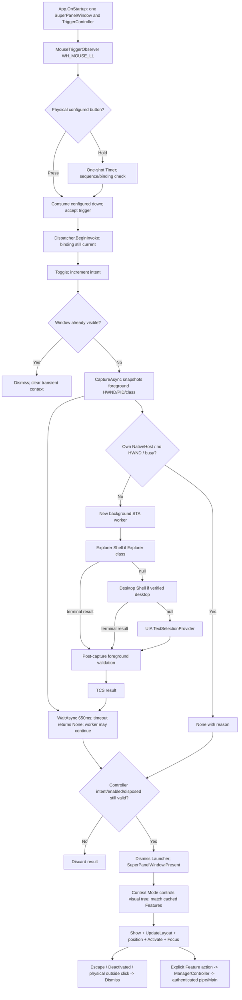

# Super Panel Context Capture Compatibility & Performance Hardening

Project: **独立专项 — Super Panel 上下文捕获兼容性与性能强化**

Round: **1 — Audit / Root Cause / Remediation Design**

Status: **AUDIT COMPLETE — IMPLEMENTATION NOT STARTED**

Audit date: 2026-10-12
Source: `D:\SystemDefault\Desktop\HomePage`, branch `codex/shared-ai-translation-2.0`, HEAD `707c5673dff479285b34a5b441bec9d3b725c737`, dirty working tree.

## A. Executive Summary

本轮以当前工作树源码为事实来源，读取已有脱敏日志，没有启动应用或进行新测试。用户报告的失败成立为调查输入；旧 6F-3 的成功记录不能否定新的控件级失败。

**无上下文慢的主要机制已获得源码及既有运行日志支持。** `TextSelectionProvider` 将“已找到文本提供方但选区为空”和“尚未找到提供方”统一返回 `null`，继续祖先和子树搜索。`SuperPanelTriggerController.Toggle` 等待整个 capture 完成才显示面板。已有 Universal Selection 预览日志中，两次 Chromium/Electron 空选区仍继续搜索至约 500ms 预算耗尽；Desktop 的有效空选择则直接结束 Shell 路径。不能据此声称所有 Manager/Codex/浏览器操作都具有同一耗时。

**一个 Chrome editable 捕获失败的直接拒绝点已确认。** 日志显示 Edit 节点有 TextPattern、返回一个 range，但 range 所属元素未通过 `IsOwnedAndUnprotected`，发生 `UIA_OWNERSHIP_DEPTH_LIMIT`；没有执行该 range 的 `GetText`。这个 reason 同时代表真正深度耗尽、父链提前终止等情况，尚不能确定底层原因或直接放宽安全校验。

**VS Code、IDEA、微信的本次失败根因尚未确认。** 现存日志没有对应应用/控件 trace。需要区分访问接口没有暴露选区、当前遍历没有到达节点、所有权拒绝、焦点变化和预算耗尽。当前代码已经有祖先/子树解析和 Desktop provider，不能再次把“只查 focused element”或“没有 Desktop provider”当作当前根因。

另有源码确认的生命周期缺口：650ms `WaitAsync` 仅限制调用方等待，不取消 STA worker；UIA/Shell 同步调用可以继续阻塞，single-flight 会保持占用。没有证明发生持续内存泄漏；已发现需要处理的长期可用性风险。

建议 Round 2 保持 capture-before-show，通过有语义的空选区终止、焦点相关的候选解析、当次缓存、安全边界诊断及取消机制缩短失败路径。先完成最小诊断/基线，再在同一轮按证据实施对应修复，不按应用名称分支，不引入剪贴板、模拟 Copy、全量文档读取或后台扫描。

## B. Independent Project Boundary

本专项暂时中断正常 Phase 序列。6F-4B 为用户验收完成；根据本次用户授权，6F-4C 人工验收已通过，按规划视为 complete。此事实仅记录于本专项，不重写其历史报告。

6F-4D、6G 均未开始。旧 Super Panel/插件/Translation 文档只作参考，不自动执行其中 TODO。本轮只新增本文件，不修改生产代码、测试、fixture、诊断开关或已有 evidence。

证据标签：**SOURCE VERIFIED** 为源码确认；**EXISTING RUNTIME EVIDENCE** 为读取既有日志；**USER OBSERVED** 为本次用户陈述；**UNKNOWN — RUNTIME INSPECTION REQUIRED** 为尚无充分运行证据。没有新的自动化或人工 PASS。

## C. User-Observed Problems

| 观察 | 本轮接受的事实 | 尚不能推断 |
| --- | --- | --- |
| NoContext 延迟 | Desktop/Explorer 感觉快；Manager/Codex/browser 感觉慢；有时成功文本捕获更快 | 每个应用精确延迟、调用次数、选区/focus 状态 |
| VS Code / Monaco | editor 中选择代码文本后没有 SelectedText | TextPattern 不存在，或必须特定应用补丁 |
| IDEA / JetBrains | editor 选择文本没有被识别 | UIA、Java bridge 或焦点中哪个环节失败 |
| browser/Codex editable | input/composer 内实际选区未识别 | 所有 editable 控件均不支持 UIA |
| WeChat | 输入区域及已发送消息选区均失败 | 只解决 input 即可覆盖消息 |
| 已工作的类别 | Notepad、Word、部分 Chromium/Electron 文本、Explorer/Desktop 文件和目录 | 对整个应用全部控件的普遍支持 |

## D. Current Trigger-to-Presentation Call Graph



Exact owners: `App.xaml.cs:173–207`; `MouseTriggerObserver.cs:52–117`; `SuperPanelTriggerController.cs:63–129`; `SelectionCaptureService.cs:16–134`; `SuperPanelWindow.xaml.cs:54–69,146–169,180–203,321–338`.

Tray invokes the same `Toggle` path (`SuperPanelTriggerController.cs:130–138`). Capture/presentation/matching does not call `EnsureAndDispatchAsync`; Manager starts only for explicit Feature/settings/page actions. Thus context capture itself remains NativeHost-only.

## E. Current Selection Capture Architecture

- `SelectionCaptureService`: foreground snapshot, single-flight admission, STA thread, provider routing, outer wait timeout and final HWND validation. It has no CancellationToken argument and no Dispose.
- `CaptureExplorer`: class gate, at most 64 ShellWindows candidates, first matching HWND document, selected items; zero selected items yields current-folder visual metadata.
- `DesktopSelectionProvider`: class/root/Shell PID validation, actual desktop Shell view, selected items; zero items yields terminal NoContext. It does not assume Desktop is ordinary Explorer IWebBrowser2.
- `TextSelectionProvider`: focused UIA element, verified foreground root, direct TextPattern, bounded ControlView ancestor/subtree resolution; RawView ancestors check ownership/password safety.
- `SelectionCapturePayloads`: text/file limits, filesystem classification, existing invocation-protocol validation. It creates no new context type.
- `SelectionContext.Mode`: payload text/files/directories; otherwise ExplorerFolder metadata or NoContext. `SuperPanelWindow` chooses the visual tree from this mode before matching.

Current representative code:

```csharp
var captured = CaptureExplorer(foreground, windowClass, attempt)
    ?? DesktopSelectionProvider.Capture(foreground, processId, windowClass, attempt)
    ?? TextSelectionProvider.Capture(foreground, processId, attempt, captureStarted);
// The controller awaits this entire operation before Present().
```

## F. Current Provider/Fallback Order

| Stage / source | Entry and exit | Maximum local work / budget | Short-circuit / failure | Cancellation and lifetime |
| --- | --- | --- | --- | --- |
| Snapshot/admission, CaptureService:21–43 | Every invocation; no HWND/self/busy -> None | Win32 snapshot; no explicit per-call timeout | Early terminal None | No token; service gate long lived |
| Explorer, :170–279 | CabinetWClass/ExploreWClass only | 64 window candidates; selected items up to 64; no cooperative stage deadline | Count=0 is terminal ExplorerFolder/None; success terminal; provider exception/no document -> next provider | Local COM references released in finally; synchronous COM cannot be interrupted by outer wait |
| Desktop, DesktopProvider:17–98 | Desktop class/root and Shell PID | Fixed service/view resolution; up to 64 selected items; no cooperative stage deadline | Success/empty/unavailable are terminal results; non-desktop -> UIA | Same COM finally release; no token |
| UIA root/focus, TextProvider:41–70 | Shell stages returned null | Root/current/focus and RawView ownership up to 33 inspected levels | Invalid focus/owner -> terminal failure; direct success returns | Local wrappers GC owned; deadline checked between calls |
| Ancestors, :73–85 | Direct candidate returned null, including empty selection | Up to 8 ControlView ancestors; shared 96-node/12-pattern ceilings | First valid text returns; invalid parent stops ancestor loop but subtree stage can follow | No explicit cancellation; foreground/deadline checks |
| Subtrees, :86–115 | No prior success | Up to 4 scopes: focus, nearest two containers, root; BFS depth 4 each; shared descendant visits <=96; candidate/pattern ceilings still shared | First valid text returns; otherwise continue until bounds/budget | Queues/dedup local; no global tree scan; safety lookup per node may add up to 33 ancestor levels |
| Range validation, :159–189,209–247 | TextPattern found | At most 8 processed ranges, 32 embedded children/range, text <=3000 UTF-16 units | Empty/safety rejection returns null, allowing later candidates; valid text terminal | UIA calls synchronous; range array itself is returned by provider before local processing cap |
| Final HWND validation / wait, CaptureService:61–133 | Worker result or elapsed outer wait | UIA cooperative budgets 500ms resolution, 650ms since capture; outer wait 650ms after thread startup | HWND change rejects result; timeout returns None | No cancellation of worker; gate cleared only in worker finally |

96 nodes is not 96 IPC calls: current property, runtime-ID, ownership, pattern, range owner and child checks add repeated cross-provider operations. Limits bound local iteration; they do not impose a hard execution limit on a single blocked COM call.

## G. NoContext Latency Analysis

### Existing evidence, read only

Inspected the 82 existing CSV files in `C:\Users\admin\AppData\Local\Temp\WebToolsNativeHost-PoC`. Four contain selection diagnostics; no application was launched. Three logs have `phase6f3-universal-selection` (24 attempts), one has the earlier `phase6f3-selection-diagnostic` (21 attempts). Only selection event allowlisted fields were extracted; no text, filenames, selected paths or window titles were read into this report.

| Existing log | Revision | SHA-256 |
| --- | --- | --- |
| `run-20261011-201021-11068.csv` | universal-selection | `DD0B7D3E2E23CCF7C02C4C009323CF6ACC3D7AC2D089A7AA245505F2D48E4AA9` |
| `run-20261011-183548-11456.csv` | universal-selection | `D0A764FD518013108F5523E19A53809F1EA8D22C187CCED73D0646B3CD250E92` |
| `run-20261011-163505-12484.csv` | universal-selection | `C91A4784A2CFDD0BE951ECBA606F7D77EA88E17B423217F65199E621699D46F5` |
| `run-20261011-155536-20156.csv` | older direct-only diagnostic | `DA18E55B2CAD69611F96D1B3C114FEF6A59CCD10ED1A31EDD8EEB81543081EB0` |

The retained Universal preview metadata at `release/native-preview-20261011-154332/stage/application/preview-build.json` records HEAD above, dirty=true, revision `phase6f3-universal-selection`, timestamp `2026-10-11T07:44:05.8053785Z`. Log revision aligns with that architecture; each historical running executable's hash was not captured, so this is not exact binary identity proof for every attempt.

### Observed failure-path timeline

Times below are **cumulative from trigger T0**, not standalone provider durations. Latest log uses xbutton1/press, so these do not include an intentional Hold wait.

| Log / attempt | Safe application/control category | Key event | Capture completed / presentation returned, ms from T0 |
| --- | --- | --- | --- |
| 201021 / SP-0001 | ChatGPT.exe, Chrome Document | Direct TextPattern; one range, zero chars at 140.7222ms; continues to 23 candidates/17 descendant visits; resolution budget exhausted | 534.2842 / 744.6471 |
| 201021 / SP-0002 | ChatGPT.exe, Chrome Pane | Direct pattern unavailable; ancestor Document empty at 190.5691ms; other Text candidates empty; 16 candidates/9 descendants; budget exhausted | 502.6141 / 544.8230 |
| 201021 / SP-0006 | chrome.exe, Edit | Direct pattern present; range-owner safety rejected at 96.8447ms; ancestor also rejected; 11 candidates/7 descendants; budget exhausted | 502.5568 / 528.9794 |
| 201021 / SP-0005 | Desktop empty | Shell returns DESKTOP_SELECTION_EMPTY without UIA fallback | 11.7514 / 51.0554 |
| 201021 / SP-0003 | Desktop empty, earlier call | Same terminal Shell path; higher cold COM/runtime cost | 214.8690 / 263.5936 |
| 183548 / SP-0006 | Notepad Document selected | Direct success, 1 candidate | 24.8335 / 39.4817 |
| 183548 / SP-0007–8 | Chrome Group selected | Ancestor success, 4 candidates | 187.4628–258.0947 / 223.5290–289.8272 |
| 163505 / SP-0006–7 | ChatGPT.exe Group selected | Ancestor success, 6 candidates | 153.9577–204.6034 / 178.3158–224.0563 |

This confirms budget-consuming unsuccessful resolution in the Chromium class and successful short-circuiting. The first empty Document continues approximately 391ms after known empty output. There is no artificial delay timer in this path: synchronous discovery and checks consume the time. The 650ms outer timeout was not the trigger for these three failures.

These traces are a small historical sample, not a controlled same-control selected/unselected benchmark. They do not record whether the operator intended selection for each attempt. ChatGPT.exe is kept as its actual process label, not automatically relabelled as current Codex. Manager/Codex-specific timings and current build differences remain unknown. Layout/show cost is also visible; SP-0001 adds about 210ms between capture completion and presentation return and needs separate measurement.

## H. SelectedText Compatibility Analysis

Current selection is obtained solely with `TextPattern.GetSelection`, then bounded `TextPatternRange.GetText`. There is no ValuePattern/DocumentRange fallback. Microsoft documents that an empty caret can be represented by a degenerate range rather than an empty array; therefore `rangeCount=1` does not prove selection. Current code rejects empty/whitespace text after range safety work. [TextPattern.GetSelection](https://learn.microsoft.com/en-us/dotnet/api/system.windows.automation.textpattern.getselection?view=windowsdesktop-10.0)

The direct path uses `AutomationElement.FocusedElement` on the worker, not a focus object snapshotted at trigger time. ControlView is used for discovery; RawView only for ownership/password ancestors. ControlView filters the raw tree, so discovery can miss internal/virtualized nodes; this is a credible limitation, not proof of a particular missing node. [UI Automation tree views](https://learn.microsoft.com/en-us/dotnet/framework/ui-automation/ui-automation-tree-overview)

Other rejection paths: offscreen candidate; invalid/runtime ID unavailable; root/focus mismatch; owner parent chain cannot reach root; password; >32 range children; expired cooperative budget; exception; invocation-envelope rejection. All must be distinguished before adding providers.

TextPattern2 is currently a diagnostic capability probe (`LookupById(10024)`), not a second text reader. It inherits TextPattern selection semantics; its additional caret/annotation methods do not manufacture real selection. Adding it alone is not a demonstrated fix. [IUIAutomationTextPattern2](https://learn.microsoft.com/en-us/windows/win32/api/uiautomationclient/nn-uiautomationclient-iuiautomationtextpattern2)

## I. Editable Text Analysis

HTML input, textarea, contenteditable and chat composer must be investigated separately from document text. A supported Edit TextPattern is already present in the Chrome failure trace. Thus “editable exposes only ValuePattern” is disproved for that one trace, but other controls may expose different interfaces.

`IsRangeUnprotected` reads enclosing element and embedded children before `GetText`; its ownership check can fail even though the original focused candidate passed. `IsOwnedAndUnprotected` ends with `UIA_OWNERSHIP_DEPTH_LIMIT` for both actual depth exhaustion and parent-null/self-parent termination (`TextSelectionProvider.cs:224–247`). The current trace cannot distinguish those causes. Correct remediation requires inspecting owner relation/depth/failure categories without printing content or relaxing checks globally.

Monaco/CodeMirror can focus an editor implementation node different from the visible text provider. Offscreen filtering and ControlView depth may matter; no tree for the user's controls is available. Never obtain the whole ValuePattern string or inject DOM JavaScript to compensate.

## J. Chromium / Electron Analysis

Existing successful Group-to-ancestor captures prove that the previous generic ancestor fix works for some Chromium document selections. The new empty Document, Pane and editable failure paths also prove that Chromium is not one uniform compatibility class.

Chromium implements UIA providers, with views controlled by accessibility properties and TextPattern for textual content. This does not guarantee that every version/control/configuration exposes current selected text. Current capability must be observed, rather than inferred from Chrome/Electron branding. [Chromium UI Automation documentation](https://chromium.googlesource.com/chromium/src/+/HEAD/docs/accessibility/browser/uiautomation.md)

No `force-renderer-accessibility` or accessibility-support switching was found in the inspected WebTools `electron/` and `src/` source. Its absence is not a root cause: capabilities already work in some cases. Do not turn on accessibility globally, alter third-party settings, or add Chromium flags without evidence and separately authorized verification.

## K. VS Code / Monaco Analysis

**UNKNOWN — RUNTIME INSPECTION REQUIRED.** None of the existing selection logs contains Code.exe. No actual HWND child/focus tree, pattern availability, range ownership or budget stage for the user's editor is known.

VS Code documents `editor.accessibilitySupport` with on/off/auto and a screen-reader-optimized mode. This makes configuration an investigation variable, not a confirmed cause or a WebTools requirement to change user settings. [VS Code accessibility](https://code.visualstudio.com/docs/configure/accessibility/accessibility)

Round 2 must contrast editor, search input and terminal independently: owned focused node -> supported pattern -> actual ranges -> owner verification -> search bounds. Use a harmless fixture document. Do not implement `if VSCode` or assume the terminal has the same provider. If the current editor configuration exposes no read-only selection API, report that boundary instead of promising universal recovery.

## L. JetBrains / IDEA Analysis

**UNKNOWN — RUNTIME INSPECTION REQUIRED.** No IDEA process/control trace exists in the inspected logs. Screen-reader support is configurable in IDEA; Java accessibility can be exposed through Java Access Bridge, whose interface is not interchangeable with the current managed UIA TextPattern reader. Official documentation does not establish which interface this user's editor exposes. [IDEA accessibility](https://www.jetbrains.com/help/idea/accessibility.html), [Java Access Bridge](https://docs.oracle.com/en/java/javase/25/access/java-access-bridge-overview.html)

Inspect editor vs input/search vs tool-window text, runtime/JBR version, supported selection interfaces and ownership. Do not implement a Java bridge dependency in the initial fix merely because IDEA is Java-based. A generic read-only selection adapter is a possible later scoped decision only if real evidence shows selection exists through that interface but is absent from UIA.

## M. Custom / Hybrid UI Analysis

WeChat input and sent-message failures are both **E. unknown — runtime inspection required**. No WeChat/Weixin trace was found. Possible outcomes are A provider bug, B resolution-strategy limit, C exposure limitation, D focus/ownership timing, or E unknown; current evidence does not select one.

Inspect each control class independently, including virtualization and visible selection. The investigation must not Realize/scroll/click controls or copy text to discover it. Read-only names/full values/whole messages are not an acceptable replacement for an actual user selection. No WeChat-specific branch is recommended.

## N. Focus / Foreground Ownership Analysis

Current normal order is trigger -> Dispatcher acceptance -> synchronous foreground HWND/PID/class -> worker UIA focus lookup -> capture result and final HWND check -> panel Show/Activate/Focus. This correctly avoids the panel intentionally taking focus before a successful capture.

It is not an atomic foreground-plus-keyboard-focus snapshot. Trigger acceptance can be delayed; focus can change inside the same HWND between snapshot and worker lookup, or during traversal. Final HWND equality does not detect an intra-window focus/selection change. Mouse location is used for trigger gesture; UIA focus is used for selection; panel anchor is fetched from the current cursor later during Present. These are distinct identities/times.

On timeout, Present can take focus while the old worker still executes; its eventual result cannot overwrite this completed caller, but focus checks may terminate remaining UIA work. Shell calls do not observe a cancellation signal. Round 2 should snapshot a safe Win32 focus identity at admission, resolve UIA on the appropriate worker, and revalidate owner/focus relevance before accepting text without requiring stable foreground after the panel intentionally activates.

## O. Timeout / Budget Analysis

T0=physical configured DOWN; T1=gesture accepted (Hold intentionally adds 300–1500ms); T2=foreground/focus snapshot; T3=capture start; T4=provider/stage boundaries; T5=capture resolved; T6=classification/validation; T7=presentation requested; T8=actually rendered visible.

| Timeline element | Current evidence | Missing detail for Round 2 |
| --- | --- | --- |
| T0/T1 | TriggerTimestamp and ActivationTimestamp; HOLD_ELAPSED | Report Hold dwell separately from activation-to-visible |
| Dispatcher/admission | DISPATCHER_ACTIVATION, INTENT_CREATED | Queue delay vs acceptance/state change |
| T2/T3 | CAPTURE_STARTED, FOREGROUND_SNAPSHOT | Exact snapshot completion; keyboard focus identity/timing; current timestamp labels share capture start |
| T4 | WORKER_STARTED, Explorer/Desktop starts/completions, TEXT_PROVIDER_RESOLUTION_STARTED, candidate strategy events | Each COM/UIA boundary duration/call count; distinct direct/ancestor/scoped fallback elapsed |
| T5/T6 | CAPTURE_COMPLETED, protocol/context/mode events | Worker vs outer timeout result; precise classification duration |
| T7/T8 | PRESENTATION_SELECTED after Show/UpdateLayout/position/Activate/Focus | Request time, first IsVisible, first render/compositor frame, activation success separately |

500/650ms are existing cooperative limits, not performance targets. Outer wait begins after worker startup; therefore it is not a hard T0-to-visible guarantee. A single UIA call can exceed the deadline. Shell stages check no local deadline. `PRESENTATION_SELECTED=SHOWN` is a returned presentation call, not a measured pixel/compositor-visible event.

Round 2 diagnostics should retain only stage, safe category, elapsed, counters, selection outcome, cancel/timeout and generation relation. Add distinct range-owner failure categories and reserve terminal events. No text, names, paths/hashes, titles, credentials or plugin private data.

## P. Cancellation / Concurrency Analysis

**Verified safe:** `_capturing` permits one worker, `_intent` rejects results from older accepted triggers/config/Launcher requests, `_visibleGeneration` rejects old queued outside dismissals, `_presentation` rejects old icon assignments. Timed-out TCS results do not automatically update the shown panel.

**Confirmed gaps:** CaptureAsync has no token; settings changes/Launcher activation/controller Dispose invalidate acceptance but do not stop the worker. Rapid invocation while capture runs creates a newer intent that immediately presents CAPTURE_BUSY/None; the earlier useful result is discarded, not cancelled. A hung worker holds `_capturing=1` until its finally executes and can disable context capture for the process lifetime.

Outside-pointer dismissal checks only visible windows. Clicking elsewhere while the first capture is pending does not invalidate `_intent`; same-HWND clicks can leave a pending invocation that later appears. This is a credible pending-intent UX race, not a reproduced failure. Ordinary visible Escape/blur/outside dismiss clears UI state but is not a unified controller cancellation operation.

Round 2 invariants: one current invocation; latest intent wins; dismiss/disable/Launcher/shutdown revoke pending acceptance and signal cancellation; observe cancellation between provider calls and on dequeue; no queued stale result can show/reopen; no unbounded replacement worker creation; explicitly describe non-preemptible COM limitations.

## Q. Memory / Resource Lifetime Analysis

| Resource | Ownership / release | Finding |
| --- | --- | --- |
| UIA root/elements/patterns/ranges | Local TextSelectionProvider and worker stack; managed wrappers GC owned | No cross-capture UIA cache; do not manually ReleaseComObject on managed UIA wrappers |
| Queues, dedup, selected text | Local bounded nodes/scopes; <=3000 output UTF-16 units | Per-invocation; a hung worker retains these until return; provider-returned arrays may allocate before processing caps |
| Shell COM objects/items | Explorer/Desktop/Payloads finally release local RCWs; interface aliases share those RCWs | Explicit cleanup present, not a confirmed leak; blocked COM delays finally |
| Worker/TCS | CaptureService worker closure owns TCS/attempt until completion | One background thread maximum; no Join/cancel/dispose on shutdown; retained-worker availability/resource risk |
| Hold Timer | MouseObserver sequence invalidation, Dispose and null on release/config/dispose | One-shot while physical gesture pending; no idle periodic timer |
| WH_MOUSE_LL / GCHandle | Observer owns hook; unhook/free on normal Dispose | Fired DOWN defers release until matching UP; unhook failure is logged and inactive observer can remain rooted until exit; no measured stacking |
| WPF Window/context | App creates once; Dismiss clears strings, arrays, bindings, context and request ID; Dispose unsubscribes Manager feedback | Expected window reuse, no per-show new Window; selected content not persisted |
| Icon tasks/cache | Async loads use presentation generation; shared NativeIconCache LRU default 64 with frozen bitmaps | Stale assignment blocked; same-key in-flight extraction not coalesced, so rapid refresh may duplicate transient work; not a proven leak |
| Diagnostics | 2000 general events, 512 selection events, 48 per attempt, bounded fields/events | Bounded retention; gated off normally; Flush on Host exit; no unlimited text buffer |
| Persisted SuperPanelState | trigger preferences and <=100 pinned FeatureRefs only | Contains no selected text/files; atomic save; original invalid settings retained |

No resource growth measurement was run. No memory-leak PASS or FAIL is claimed; no forced GC/working-set trimming is recommended.

## R. Idle CPU / Background Activity Analysis

SOURCE VERIFIED: capture is invoked only by accepted trigger/tray requests. No interval-based foreground/UIA crawler, selection polling or resident browser scanner exists in the inspected SuperPanel source. The low-level mouse hook remains resident and receives mouse events; it does not traverse UIA while idle. Hold has only a pending one-shot timer.

During a timeout, the worker can continue after the UI has resolved None; that is background activity attributable to a prior trigger, not intentional continuous scanning. Future cancellation/deadlines must reduce it without adding a polling loop. Any cache should be per invocation and discarded at completion/cancel; no persisted selections or cached stale AutomationElements.

## S. Privacy / Security Analysis

Verified boundaries: foreground root HWND/PID validated; same foreground hierarchy rather than app-name/PID-only permission; password ancestors/range owners/embedded children checked; offscreen candidates not read for text; only GetSelection text read; no DocumentRange or ValuePattern contents; no Clipboard read/write or keyboard Copy; no arbitrary third-party DOM injection.

MouseObserver does use SendInput to restore the user's non-trigger mouse gesture. This pre-existing mouse-only behavior is not a selection-discovery fallback and is not a proposed change.

`SuperPanelWindow.ActivateFeature` delivers captured payload only after an explicit action, with a 30-second staleness check, protocol validation and existing Manager authority. Current ExplorerFolder is display metadata and has no forged directory payload. Captured text is cleared on dismiss and is not in SuperPanelState or selection diagnostics.

Credible risk: a selected range elsewhere in the foreground root can pass current discovery even if unrelated to the current focused control. Ownership establishes application boundary, not intent relevance. Do not widen RawView searches or relax range ownership before proving focus/control relevance. Incorrect third-party password/selection exposure cannot be ruled out by static client code.

## T. Presentation Strategy Analysis

| Strategy | Advantages | Consequences / decision |
| --- | --- | --- |
| A. Current capture-before-show | Stable final mode; capture before panel focus; no wrong action clicked during upgrade | Current failure traversal delays presentation; retain model but fix capture decision/work |
| B. Immediate NoContext, later context upgrade | Visibly fast initial shell | Wrong general action can be clicked; board-to-menu jump; stale upgrade/dismiss/privacy races. Not recommended |
| C. Bounded fast capture, targeted fallback before interactive show | Preserves final UI/action semantics; authoritative empty can exit fast | Requires distinct outcomes and measured budget; recommended |
| Neutral non-interactive pending shell if needed | Can indicate wait without offering wrong actions | Additional UX/state model; defer unless measured non-preemptible calls make C insufficient; do not redesign in Round 1 |

Recommend C while preserving capture-before-show. Once interactive, do not replace NoContext with a late context from a completed/expired invocation. No Context remains the maintained 3×3 board; typed modes remain compact action menu, including zero matches. Feature matching cannot rewrite context mode. Future real Translation Quick Result remains deferred and is not implemented by this project.

## U. Compatibility Matrix

| Semantic class | Existing evidence | Required focused investigation / preservation |
| --- | --- | --- |
| Standard Document / Notepad | Existing direct SelectedText logs; user success | selected vs caret/empty; bounded Unicode; password negative |
| Word document | User-observed success only | preserve actual selection and multi-range behavior; record provider capability |
| Win32/WPF editable | Not uniformly established | Edit/RichEdit/WPF input separately; selection vs Value-only; no whole-control fake text |
| Chromium document | Ancestor successes; empty Document fallback failure | same-node selected/none comparison; owner relevance; no broad root scan on authoritative empty |
| HTML input | Existing Chrome Edit safety rejection; user failure | range owner tree/category; actual selected vs caret; password |
| textarea / contenteditable | User category, no separate trace | each semantic fixture independently; nested/shadow/virtualized provider exposure |
| Electron document / editable | Some existing selected document success; current editable reports fail | document/composer separately; Manager and Codex with exact current identity |
| Monaco / VS Code editor | User failure, no trace | editor focus/provider/range vs search input/terminal; accessibility configuration documented |
| CodeMirror / other editor | No current trace | capability assessment, not assumed same as Monaco |
| JetBrains editor | User failure, no trace | UIA vs Java selection interface; editor/input/toolwindow separate |
| Custom/hybrid messages and composer | User WeChat failures, no trace | virtualized message and input providers independently; unsupported explicitly reported |
| Explorer files/directories/mixed | Historical successful Shell records | preserve existing item/path/envelope checks; selected view/active-tab evidence |
| Explorer empty view | Existing ExplorerFolder records | preserve display-only current folder semantics |
| Desktop filesystem/empty | Universal preview records for files/dirs/empty | preserve verified desktop view and virtual-item rejection |
| Elevated / secure / provider-unavailable | Not tested | safe denial, no privilege escalation; app manifest is asInvoker/uiAccess=false |

An application name labels a test case, not the product dispatch rule. A pass for one row cannot certify an application's other rows.

## V. Confirmed Root Causes

| Cause / scope | Current source and behavior | Connecting evidence | Confidence |
| --- | --- | --- | --- |
| Unsuccessful/empty UIA resolution continues expensive fallback | TextProvider `TryCandidate/RejectCandidate` :159–206 returns null for empty; `Capture` :69–115 then ancestors/BFS; Controller `Toggle` :120–128 awaits before Present | 201021/SP-0001 empty at 140.7ms, continued to resolution failure at 531.4ms; SP-0002 repeats empty ancestor/descendant then budget | HIGH: demonstrated Chromium-class failure-path latency; exact Manager/Codex scope not measured |
| Chrome editable range rejected before reading text | TextProvider `IsRangeUnprotected` :209–221 calls owner validation; `IsOwnedAndUnprotected` :224–247 cannot establish root chain | 201021/SP-0006 direct Edit pattern true, rangeCount1, UIA_OWNERSHIP_DEPTH_LIMIT at 96.8ms; ancestor same rejection | HIGH for actual rejection point; MEDIUM link to user's selected-input symptom; underlying ancestry cause UNKNOWN |
| Outer timeout does not stop work | CaptureService :49–105 starts worker; :119–133 only WaitAsync; `_capturing` reset solely in worker finally :84–98 | SOURCE VERIFIED; no cancellation parameter/CTS/worker stop mechanism | HIGH architecture fact; no observed permanent hang in these logs |

Do not treat candidate limits, STA use, missing provider interface or application accessibility settings as confirmed causes of VS Code/IDEA/WeChat failure. No claim of universal compatibility or a current P0 incident reproduction is made.

## W. Unconfirmed Hypotheses / Runtime Evidence Needed

1. **Range owner parent chain is truncated or uses a different fragment root**, rather than >32 levels. Prediction: range-owner diagnostic shows parent-null/root mismatch before bound. Inspect only relation/counters/control type; retain safety before GetText.
2. **Editor exposes selection outside ControlView/depth-4 neighborhoods or the chosen scopes.** Prediction: bounded comparison locates a nonempty range in focus-related raw/semantic owner while current path misses it. Never traverse global desktop or unrelated documents.
3. **Provider does not expose selection in the current configuration.** Prediction: both correctly resolved UIA node and documented read-only selection interface absent/empty despite known harmless user selection. Test with/without authorized accessibility mode changes and restore settings.
4. **Focus moves within the same foreground HWND.** Prediction: admission focus identity differs from worker/commit focus; current HWND-only checks accept wrong timing. Snapshot and compare safe identities.
5. **Repeated ownership/property calls consume most of the budget.** Prediction: call-count/stage timing and per-invocation caching reduce elapsed without changing outcomes. Do not infer precise CPU share from a 500ms total.
6. **STA UIA/provider interaction amplifies delays.** Current worker is STA for Shell and text. Microsoft recommends a windowless MTA thread for UIA client calls; mismatch is a design risk, not a measured cause here. Compare UIA MTA with preserved Shell STA in Round 2. [UI Automation threading guidance](https://learn.microsoft.com/en-us/windows/win32/winauto/uiauto-threading)

No new reproducer or instrumentation was run under the audit-only restriction. Existing timing traces support the latency mechanism; newly reported app-specific failures remain without a replayable exact-symptom signal.

## X. Other Super Panel Risks Found

| ID / priority | Finding / source | Status and narrow recommendation |
| --- | --- | --- |
| R1 / P2 | Empty and unavailable outcomes share fallback path; repeated ownership checks; TextProvider :69–115,159–247 | Confirmed performance mechanism. Typed capture outcomes and focus-related bounded discovery |
| R2 / P2 | Range ownership terminal reason conflates parent-chain failure; later budget reason masks original rejection | Confirmed diagnostic/capture rejection path. Split safe reason categories, inspect actual owner before any safety change |
| R3 / P1 risk | Hung COM call leaves one worker and single-flight busy indefinitely; CaptureService :37–43,49–133 | Conditional availability/resource risk, no observed hang. Cooperative cancellation plus bounded worker ownership; do not spawn endless replacement threads |
| R4 / P2 risk | Delayed focus snapshot and pending external click not revoking intent | Source-supported race; not reproduced. Unified admission/dismiss/cancel and focus relevance checks |
| R5 / P2 risk | Whole foreground subtree can find unrelated retained selection | No observed disclosure. Focus-owner semantic restriction and ambiguity rejection; no global raw fallback |
| R6 / P2 risk | `async void Toggle` has no presentation exception boundary; cursor/monitor/SetWindowPos failure can throw from Present | Source-supported, no crash evidence. Contain errors and clear intent/transient state without sensitive exception payloads |
| R7 / P2 risk | Explorer first matching HWND lacks active-tab identity; Shell route precedes text even in Explorer editable input | Source declares active-tab identity unavailable. Preserve existing behavior; investigate before changing priority/view selection |
| R8 / P3 | Anchor is captured at Present, not trigger; movement during delayed capture can move panel to another cursor/monitor | Source-supported, not measured. Capture numeric anchor at accepted intent if needed; verify mixed DPI/negative coordinates |
| R9 / P3 | UI text truncation branch checks hint `前 3000` while provider emits `选中文本达到读取上限` | Source-confirmed indicator mismatch (`Window:114`, `Payloads:102`); future explicit truncation metadata preferred over hint parsing |
| R10 / P3 | Shared icon cache has no in-flight same-key coalescing; diagnostics only named previews and exit Flush | Bounded caches and generation checks exist; no leak proved. Measure transient work; diagnostics reserve terminal events, no continuous scanner |

P0 confirmed: 0. P1 observed/reproduced: 0; one P1 architectural risk (R3). P2 items include confirmed performance/rejection mechanisms and explicitly unverified risks; this audit is not a release acceptance grade. Do not interpret static inspection as clearing all runtime gates.

## Y. Proposed Round 2 Architecture

1. **Invocation session** owned by controller: generation, monotonic deadline, cancellation signal, foreground/focus and pointer snapshot, result accepted at most once. All dismissal/disable/Launcher/shutdown paths revoke the session. No fixed delayed race workaround.
2. **Provider routing by capabilities/semantics**: retain Shell view capture; UIA candidate resolution distinguishes actual focused text owner from structural Group/Pane. No app-name dispatch. For Explorer text-input priority, collect evidence and preserve Shell selections before any change.
3. **Typed outcomes**: SelectedText / ShellContext / ConfirmedEmpty / ProviderMissing / SafetyRejected / Unavailable / TimedOut / Cancelled. A valid focused text owner with an actual empty/caret selection may terminate early; a structural ancestor's empty range is not automatically authoritative for all descendants.
4. **UIA fast path**: direct owner, small relevant ancestor chain, limited focus-related neighborhood; per-invocation property/ownership-result cache; detect degenerate ranges without reading full values. Keep password and root ownership checks before GetText. Preserve known ancestor successes. Broad root BFS should not be the automatic next stage for an authoritative empty focused control.
5. **Ownership repair driven by evidence**: diagnose range enclosing/children parent relation separately. Resolve legitimate fragments using documented identity/root relations; never waive protection because PID matches, increase all depth bounds blindly, or accept another document's range.
6. **Threading/lifetime**: keep Shell COM on STA; evaluate UIA on windowless MTA per Microsoft guidance, with all UIA objects confined to that operation/thread. Keep strict worker caps and no polling. Cancellation can stop queued/cooperative work, not preempt a blocked native call. If real hangs remain, report before introducing a helper-process architecture; no broad redesign is pre-authorized by this audit.
7. **Presentation**: final bounded result before interactive show; immutable context for that presentation; no late layout/action replacement. One existing Window, matching, 3×3 board and context menus remain.
8. **Diagnostics**: stage timing/call counts, stop category, owner verification subtype and generation outcome; bounded opt-in output, terminal event preservation. No content/name/path or full UIA tree dumps.

No new provider is required by proven evidence yet. A different documented read-only selection interface is considered only when real control evidence proves UIA cannot provide it; no clipboard/keyboard injection or whole-document shortcut.

## Z. Proposed Round 2 Implementation Scope

Use one authorized implementation round with three dependent internal steps rather than repeated approval stops:

1. Add minimal safe timing/ownership diagnostics and capture a small baseline for the unresolved semantic rows. Establish an exact-symptom replay/test seam before an editor-specific compatibility claim.
2. Implement source-confirmed outcome/lifecycle/performance corrections, UIA/Shell worker separation as justified, and only the compatibility changes supported by that baseline. Retain current safety bounds until individually justified. Contain presentation failures; record unsupported providers honestly.
3. Run focused tests, build and packaged/manual compatibility checks; compare latency/resource behavior on the same environment. Submit one report for user review.

Likely source surface: TriggerController, CaptureService, TextSelectionProvider, SelectionCaptureResult/Context, DiagnosticsService and narrow Window dismissal/presentation handling. Shell provider token/deadline plumbing only; no Shell capture redesign without a demonstrated issue. Tests will be added only after Round 2 authorization at real lifecycle/capture seams. Installer, Manager/SharedAI, SDK, plugin configuration and Translation are outside scope.

**Readiness:** architecture is ready for a bounded instrumentation and implementation round. Exact VS Code/IDEA/WeChat compatibility patches are not ready to pre-specify; their capability evidence must precede those changes within Round 2. No implementation is started by this report.

## AA. Proposed Round 2 Verification Matrix

| Area | Method / records | Acceptance |
| --- | --- | --- |
| Latency baseline | Matched selected/empty/unsupported cases per semantic row; cold vs warm separated; T0/T1/T3/T5/T7/T8, stage counts; report sample count, median/p95/max | Targets agreed from measured baseline; no invented 50ms/MB gate. Authoritative empty must avoid budget-consuming whole-root search; preserve supported selection response |
| NoContext | Desktop, Explorer, Manager, browser, Codex; empty editable/nontext/custom controls | Correct final mode; bounded failure; record real rendering time independently of Show return |
| Real selection | Notepad, Word, Chromium document/input/textarea/contenteditable, Electron composer, Monaco/CodeMirror, JetBrains, hybrid message/input | Real expected selection only; exact synthetic fixture comparison without logging private content; unsupported category explicit |
| Safety | Caret/empty/whitespace, password, hidden/unrelated selected controls, owner mismatch, sensitive embedded controls, selection/envelope limits | Never whole-document/Value/clipboard fallback; no unrelated selection or plugin broadcast |
| Shell | Explorer/Desktop file/dir/mixed/empty/virtual/.lnk and tabs; editable Explorer separately | Existing success preserved; correct mode; current folder metadata never forged as selected directory |
| Lifecycle | Controlled repeated captures and rapid invoke/dismiss/reinvoke; delayed/failing provider; disable/rebind/Launcher/shutdown | One active session and capped workers; no stale reopen/context replacement; token observed; timeout does not authorize unbounded replacement |
| Window/resources | Same NativeHost PID/HWND; sample WS/PB/Handles/Threads and idle/burst CPU externally before/after settle | No sustained cycle-linked accumulation; distinguish warm-up/GC timing from leak; no forced GC or trim; capture alone Electron=0 |
| UI/DPI | Mixed DPI monitors, edges/negative coordinates, movement during capture; no-context board and all typed modes with 0 matches | Stable final mode, correct positioning/dismiss; context classification independent of Feature availability |
| Regression | Narrow capture/controller tests plus existing applicable Native/Manager checks after authorized changes | No unexplained supported-case regressions; previous unrelated failures kept separate, not silently rewritten |

Practical baseline suggestion: 10 warm samples per supported semantic condition plus separate first-use samples, followed by a modest repeated-use/cancellation burst. These are proposed sample counts, not a mandate to reopen historical three-hour Soak or 1000-search tests. Record unsupported cases separately. Tighten exact tests after baseline; expand only for a new reproducible concern.

## AB. Explicit Non-Goals

No Round 2 implementation now. No VS Code/IDEA/Chrome/Codex/WeChat product-name branches. No clipboard, Ctrl+C, keyboard injection, document/value fake selection, app configuration changes, privilege elevation, arbitrary DOM inspection, background crawler, whole-tree polling or forced GC. No Super Panel UI redesign, Native translation service, actual Quick Result, Shared AI changes, plugin configuration, 6F-4D, 6G or automatic next-phase work.

## AC. Files Inspected

Current production files: all 11 `native/WebTools.NativeHost/SuperPanel/` source/XAML files; `App.xaml.cs`; `MainWindow.xaml.cs` relevant Launcher/quick-surface/icon entry points; `Services/DiagnosticsService.cs`, `MonitorPlacement.cs`, `ManagerController.cs`, `NativeIconCache.cs`, `NativeFeatureInvocationProtocol.cs`; `app.manifest`; `WebTools.NativeHost.csproj`.

Read-only coverage/reference: NativeHost.Checks csproj/Program and source searches; `docs/super-panel.md`; `docs/super-panel-selection-context-root-cause.md`; retained Universal preview metadata; four existing diagnostic CSVs (sanitized selection fields only), and inventory of the other 78 CSVs. No current application/profile/registry state changed. No direct SuperPanel capture/lifecycle checks were found in the inspected Checks source; this is a coverage gap, not a test failure.

Source fingerprint anchors before this document was written:

| File | SHA-256 |
| --- | --- |
| TextSelectionProvider.cs | `11BF2B56671D967290805872A3B87655130FFC072EBCCE505A545390DC6BC51D` |
| SelectionCaptureService.cs | `0D367C2407713BAABCBAE83E49A0148E03E24FD324BB353C307A8726A4D83841` |
| SuperPanelTriggerController.cs | `E3A3BB337442E95D5EC9C02472007EBCDB40A01A0FD2EDB5122806602EC76BC4` |
| SuperPanelWindow.xaml.cs | `65AB825BCF6F7997BCE18451A51E0AEA1B435681F3977E55B6A458EC8982597A` |

Old direct-only descriptions and diagnostic-footer claims in historical docs are not current source truth. Current discovery includes ancestors/subtrees/Desktop; the current Window has no previous Copy Diagnostics/footer observer. This report deliberately leaves the old history intact.

## AD. Files Modified

Only `docs/super-panel-compatibility-performance-hardening.md` (new). Production files modified: **0**. Test/fixture/evidence/runner files modified: **0**. No existing reports rewritten. No build/package artifacts generated.

## AE. Git Status

Branch/HEAD above verified by Git. Initial `git status --porcelain=v1 --untracked-files=all` contained 256 entries and staged count 0; final inventory has 257 entries. Exact status-set comparison found only `?? docs/super-panel-compatibility-performance-hardening.md` added and no old entry removed or changed. The dirty implementation/Launcher/SDK/other work was preserved. Current SuperPanel source is untracked relative to this old HEAD, so it was read directly rather than inferred from HEAD filenames. No Git mutation command was executed.

Final read-only review: 16 inspected core/source/Checks SHA-256 fingerprints unchanged; staged files 0; report trailing-whitespace lines 0; `git diff --check` exit 0. These are static hygiene checks, not testing or runtime acceptance.

## AF. Final Recommendation

Approve a bounded Round 2 covering diagnostics/baseline, typed empty/unavailable outcomes, focus-relevant discovery, safe ownership repair where proven, cancellation and worker lifetime, then focused packaged verification. Keep final presentation stable and preserve working Shell/text cases. Do not promise all Windows applications expose safe selected text.

NoContext latency mechanism is explained by source plus existing traces. Editable range rejection is identified; its ownership topology requires measurement. VS Code, IDEA and WeChat roots remain unresolved pending exact control evidence. No production fix should be applied solely from those application names.

**SUPER PANEL HARDENING ROUND 1 AUDIT COMPLETE — IMPLEMENTATION NOT STARTED**

**PHASE 6F-4D NOT STARTED**

**PHASE 6G NOT STARTED**

TESTING NOT RUN — AUDIT ROUND ONLY
PACKAGING NOT RUN — AUDIT ROUND ONLY

## Round 2 — Implementation / Verification / Preview

Date: 2026-10-12. This section records the separately authorized Round 2; all Round 1 statements above remain historical. Branch/HEAD remain `codex/shared-ai-translation-2.0` / `707c5673dff479285b34a5b441bec9d3b725c737`, dirty source. Evidence root: `C:\Users\admin\AppData\Local\Temp\WebTools-SuperPanel-Hardening-R2-20261012-134753`. No production installation/profile, startup registration, Shared AI, Translation, SDK, Plugin Center, installer/updater architecture or Launcher ranking was changed.

### A. Overall Verdict

**PASS WITH NON-BLOCKING LIMITATIONS — READY FOR USER MANUAL ACCEPTANCE**

The confirmed empty-selection and invocation-lifetime fixes have focused tests and real UIA/packaged evidence. This does **not** certify universal application compatibility or close the independent project. VS Code's editor selection remains unread through the inspected UIA path; IDEA/WeChat/current Codex composer and several other semantic rows remain unverified. Manager non-text NoContext still uses its bounded discovery budget.

### B. Round 2 Scope / ledger

Order executed: safe diagnostics → controlled baseline → source/evidence-based empty handling and session fixes → focused/runtime/resource regression → canonical Preview → report. No Git mutation. The task ledger and pre-edit source copies are under the evidence root, outside Git.

Rulings:

- Preserve the existing dirty checkout and compare against per-file before-source snapshots, not the full old-HEAD diff.
- Keep existing STA Shell/UIA worker. No measured apartment comparison justifies an MTA migration in this round.
- Terminal empty needs a real focused text owner, or a verified caret owner in that focused subtree; never stop simply because the first structural ancestor is empty.
- Do not relax range ownership to fix an application without a reproduced safe relationship.
- Use capture-before-interactive-show. No asynchronous NoContext-to-SelectedText replacement.

### C. Baseline Evidence

Controlled Chromium uses a fresh TEMP browser profile, loopback page with synthetic document/input/textarea/contenteditable/password controls, and the actual SelectionCaptureService/UIA APIs. Page readiness and expected DOM selection state are checked. Document selection uses pointer actions in the owned fixture, not injection into an arbitrary third-party page.

The first document attempt ran before page readiness and was invalid; it is excluded. A corrected 10-sample document baseline replaced it. The other valid baseline cases and all raw files are retained. No test binary was hand-edited.

Additional before measurements for Notepad and VS Code use an external TEMP probe compiled from the **pre-edit** capture-source copies, with existing shared protocol/diagnostic dependencies. This is a captured-source replay for measurement, not a production baseline installer. After measurements use the current compiled production capture service. Each condition includes one first-use probe sample and subsequent warm samples; these are not application cold-start measurements.

### D. Confirmed Root Causes

1. Empty selection was treated like missing provider, causing unnecessary ancestor/subtree work. Real controlled input/textarea empty cases reproduced roughly 0.5-second discovery before correction.
2. A structural Chromium focus Group can have its actual caret owner inside the focused subtree. New safe diagnostics proved that relation for the owned document fixture. Only this proven relation promotes the enclosing real text provider's empty outcome to terminal.
3. Caller timeout did not signal cancellation; stale invocations and blocked workers retained capture ownership. Cancellation now propagates cooperatively; native-call preemption is not claimed.
4. Final scoped review found two concrete acceptance races: focus change between worker completion and UI acceptance; and pending outside-click revocation queued behind a capture continuation. Both were reproduced by focused tests (16/18 RED, with focus change confirmed) and corrected (18/18 GREEN).

The original Chrome/Edit enclosing-owner failure was **not reproduced** in the simple owned editable fixtures; its safety checks are preserved. No claim that its exact root topology is repaired.

### E. Production Files Modified

- `native/WebTools.NativeHost/App.xaml.cs`: R2 diagnostic preview identity; explicitly gated disposable acceptance integration.
- `native/WebTools.NativeHost/Services/DiagnosticsService.cs`: safe owner/outcome fields, terminal-event reserve, internal sanitized snapshot for the isolated driver.
- `native/WebTools.NativeHost/Diagnostics/Phase4EResourceControlServer.cs`: Super Panel commands only when passed the additional isolated acceptance objects.
- `SuperPanel/CaptureInvocation.cs` (new): transient generation, monotonic budget, numeric foreground/focus/anchor snapshot, cancellation and worker leases.
- `SuperPanel/TextCandidateDecision.cs` (new): internal typed outcome/authority decisions.
- `SuperPanel/SuperPanelEscapeObserver.cs` (new): passive, temporary Escape observer using the existing hook API.
- `SuperPanel/SelectionCaptureService.cs`: session-aware admission, cancellation, strict worker cap, shutdown ownership.
- `SuperPanel/TextSelectionProvider.cs`: reason classification, authoritative empty/caret decisions, current focus validation, invocation-local runtime-ID cache and removal of duplicate ownership checks.
- `SuperPanel/MouseTriggerObserver.cs`: pending-trigger cancellation disposition; preserve matching DOWN/UP and existing visible outside-click forwarding.
- `SuperPanel/SuperPanelTriggerController.cs`: invocation ownership, synchronous pending revocation, final focus revalidation and presentation exception containment.
- `SuperPanel/SuperPanelWindow.xaml.cs`: dismissal notification, admission anchor, contained lifecycle integration, safe snapshot and layout-visible timing proxy.
- `SuperPanel/DesktopSelectionProvider.cs`, `SelectionCapturePayloads.cs`: cooperative cancellation checks; existing Shell selection/classification semantics unchanged.

No `SelectionContext` public modes, persisted schema, Feature/Plugin API or capture limits were added/changed. Existing 500ms UIA resolution / 650ms capture limits are retained.

### F. Tests / Verification Tools

- `native/WebTools.NativeHost.Checks/SuperPanelHardeningChecks.cs` (new): real decision/service/controller tests; WPF window reuse; fake hook callback flags/pass-through; controlled UIA probe and disposable-profile preparation.
- `native/WebTools.NativeHost.Checks/Program.cs`: narrow explicit CLI dispatch only; existing default checks remain.
- `scripts/verify-super-panel-hardening.mjs` (new): own Chromium fixture/profile and capture samples; never attach to an existing browser/user page.
- `scripts/verify-super-panel-hardening-packaged.ps1` (new): canonical stage copy under guarded TEMP, unique test mutex/pipe/profile, exact process identity, real production controller, external OS sampler and normal shutdown.

Scratch before-probe/editor/Shell tooling lives outside the repo. Test-only selection setup can select synthetic content in an identity-checked fixture; production capture adds no keyboard injection or clipboard operation. No unrelated historical test was rewritten.

### G. Capture Outcome Architecture

Internal outcomes: SelectedText, SelectedContext (Shell), ConfirmedEmpty, ProviderMissing, SafetyRejected, Unavailable, TimedOut, Cancelled. They do not change public context/protocol types.

Direct authority requires a focused Edit/Document text provider supporting selection. Caret/empty detection precedes reading range text. Structural empty remains discovery-capable. For a structural focus with a Document/Edit provider, scoped caret authority additionally requires a genuine collapsed range, verified enclosing owner, bounded ancestry inside the current focus subtree, and still-current UIA focus. Password/ownership rejection cannot become selected-text success.

### H. Cancellation / Session Architecture

One controller invocation owns generation, cancellation, deadline and immutable admission metadata. Worker lease retains the token source until the native worker's finally runs, even when the controller releases its owner lease early. A blocked native call cannot be forcibly stopped; there is still at most one capture worker and no replacement-thread loop.

Escape, ordinary outside click, second configured trigger, rebind/disable, Launcher takeover and shutdown revoke acceptance. Pending pointer/Escape revocation is synchronous on the hook's Dispatcher, before deferred result acceptance. A second configured trigger cancels without replaying that trigger as an unrelated application action. Visible outside-click forwarding keeps its previous behavior.

The temporary Escape hook observes physical Escape only, passes all keyboard input through, and is removed at completion/cancel. Failed unhook retains an inactive rooted callback and blocks replacement stacking. No idle keyboard observer/capture scanner is added. Final Win32 foreground/focus is checked immediately before acceptance; stale or cancelled results cannot show a panel. Presentation exceptions clear state and emit only safe categories.

### I. NoContext Performance Fix

The owned empty input/textarea cases no longer walk the broad fallback tree. Verified focus-subtree caret authority also avoids the document/contenteditable empty scan. Missing/unavailable providers still have bounded discovery; this was not implemented by globally reducing timeouts or deleting useful ancestor resolution.

### J. Editable Text Findings / Fix

Controlled Chromium input, textarea and contenteditable selections were captured before/after. Empty counterparts resolve NoContext; password remains rejected. Range owner failures now distinguish parent unavailable, self-parent, depth exhausted and root mismatch.

Original user Chrome/Codex editable rejection: **PARTIALLY RESOLVED** (diagnostic ambiguity fixed, simple controls pass; original failing topology not reproduced). No PID-only allowlist, depth increase, safety bypass, full value or document fallback.

### K. VS Code Findings / Result

VS Code 1.140.0 was launched with independent TEMP user-data/extensions directories and a synthetic file. Before and after, the focused Chrome Edit TextPattern reports a degenerate caret while the test's selection setup uses Ctrl+A in the owned window. No selected text is returned. Before warm median is about 506ms; after about 38ms, but **selection compatibility is not certified**.

This establishes the inspected provider response, not absence of every safe selection interface. The exact visible-editor/provider relationship requires additional evidence. No application branch, setting change in the real VS Code profile, DOM injection or speculative adapter was added. Matrix status: **NOT VERIFIED** for editor selection.

### L. IDEA Findings / Result

Installed IDEA 2025.2.1 was found. The first isolated-startup attempt had a test-tool properties formatting defect; it is excluded and retained as invalid setup evidence. After fixing the separate config/system/plugins/log lines, the isolated first-run window still did not reach a verified editor. No agreement, settings import or account action was accepted.

Normal close/WM_CLOSE did not terminate the two task-created IDEA fixtures. Cleanup used only their exact PID, executable, startup time and synthetic-file command identity; forced cleanup was **IDEA test-helper cleanup**, never WebTools shutdown evidence. No raw IDEA logs, user configuration or tokens were read. Selection remains **NOT VERIFIED**; no Java Access Bridge added. [JetBrains properties override](https://www.jetbrains.com/help/idea/tuning-the-ide.html), [LightEdit command](https://www.jetbrains.com/help/idea/lightedit-mode.html).

### M. WeChat Findings / Result

Weixin is installed/running, but no harmless isolated composer/sent-message fixture could be prepared without using private chats or sending messages. Neither was automated. **NOT AVAILABLE FOR TEST** in this safe workflow; cause remains UNRESOLVED. No WeChat branch or message/value/name fallback.

### N. Focus / Ownership Changes

Numeric foreground/focus and monitor anchor are snapshotted at admission; UIA objects remain worker-local. UIA focus is revalidated before selected-text return, and Win32 identity again before presentation. Ownership/password checks still gate GetText. Only redundant immediately repeated validation is removed; runtime IDs are cached by wrapper reference within the bounded invocation, not across applications.

### O. UIA Threading Decision

STA retained. Observed empty-path correction already produces improvement; no controlled STA/MTA comparison was obtained. The Microsoft MTA guidance remains a follow-up item, not a reason to claim this round changed apartment behavior.

### P. Privacy / Security Review

No clipboard/Copy, ValuePattern text, DocumentRange text, full message/code fallback, arbitrary third-party DOM injection, browser extension, continuous UIA polling or password capture. Only actual GetSelection ranges are read. Diagnostics exclude content, selected paths/names, window titles, credentials and plugin private data. Captured context is cleared on dismiss.

The acceptance extension is reachable only after existing strict disposable Phase4E profile/catalog/unique pipe validation plus `WEBTOOLS_SUPER_PANEL_ACCEPTANCE=1`; ordinary production startup ignores that environment flag without the explicit test mode. It does not expose a new plugin/Manager API.

### Q. Shell Regression

Real packaged Explorer: selected file → SelectedFiles, directory → SelectedDirectories, empty folder → ExplorerFolder: **PASS**. The first scratch tool used an unsupported null SelectItem call; a later script quoting typo was also a tool failure. Both failed runs are retained/excluded. The final owned-folder run passed without production fixes.

Focused tests preserve file/directory/mixed classification, NoContext vs ExplorerFolder distinction and cancellation before item reads. Current Desktop capture was not newly exercised; existing Desktop evidence is historical, not new PASS.

### R. Runtime Compatibility Matrix

| Semantic row | Current result | Evidence / limitation |
| --- | --- | --- |
| Notepad selected / caret | PASS / PASS | Real owned synthetic file, 5 samples per condition before/after |
| Word selected | NOT AVAILABLE FOR TEST | Installed; no safe isolated Word/template workflow executed; historical user success retained |
| Chromium document selected / empty | PASS / PASS | Corrected owned pointer-selection fixture, 10 samples each |
| Chromium input / textarea selected / empty | PASS / PASS | Owned fixture, 10 each |
| Chromium contenteditable selected / empty | PASS / PASS | Scoped caret proof and 10 each |
| Chromium password | PASS | 10 samples rejected as PASSWORD_CONTROL |
| Unrelated input selection + button focus | PASS (bounded fixture only) | 2 samples return NoContext; not universal relevance proof |
| Manager NoContext | PASS (correctness), latency limitation | Real isolated packaged Manager; capture about 507ms |
| Current Codex document/composer | NOT AVAILABLE FOR TEST | No safe isolated current Codex fixture; historical traces are not current PASS |
| VS Code editor selected | NOT VERIFIED | Focused UIA Edit returns caret; no selected code read |
| VS Code caret | PASS | NoContext; 5 after samples |
| VS Code search/input/terminal | NOT VERIFIED | Not separately exercised |
| IDEA editor/input/toolwindow | NOT VERIFIED | Isolated startup did not reach verified editor |
| CodeMirror | NOT AVAILABLE FOR TEST | No independent identified fixture |
| WeChat composer/message | NOT AVAILABLE FOR TEST | Private live chat not used |
| Explorer file/directory/empty | PASS | Actual packaged NativeHost and owned Shell view |
| Explorer mixed/virtual rejection | NOT VERIFIED at real UI | Classification tests only |
| Desktop file/directory/shortcut/empty | NOT VERIFIED in Round 2 | Existing historical successes; no fresh Desktop selection manipulation |

### S. Before / After Capture Latency

Milliseconds. Warm median excludes the first query in each probe process; Chromium has 9 warm samples and traditional/editor has 4. p95 on these small groups is unstable and effectively near the maximum, so it is not used as a performance gate. Presentation is measured separately.

| Matched fixture | Before warm median | After warm median | After warm max |
| --- | ---: | ---: | ---: |
| Chromium document selected | 62.68 | 87.13 | 102.31 |
| Chromium document empty | 280.37 | 68.58 | 90.55 |
| Chromium input selected | 57.92 | 52.87 | 67.78 |
| Chromium input empty | 503.31 | 44.66 | 51.95 |
| Chromium textarea selected | 66.56 | 63.14 | 69.80 |
| Chromium textarea empty | 472.77 | 32.94 | 48.29 |
| Chromium contenteditable selected | 54.42 | 50.76 | 81.25 |
| Chromium contenteditable empty | 503.53 | 57.28 | 63.78 |
| Notepad selected | 18.32 | 19.62 | 21.72 |
| Notepad caret | 240.67 | 12.26 | 14.35 |
| VS Code editor selection (unread) | 505.65 | 37.58 | 40.63 |
| VS Code caret | 348.68 | 40.16 | 46.20 |

Document selected capture has a small regression in this sample; it is reported rather than hidden. It remains successful. Cold/first-query values and all per-stage events are in raw evidence; no claim of equal latency across apps. The button/non-text and Manager cases still have discovery cost; Manager NoContext is not claimed fixed by the focused-owner fast path.

T0/T1 are explicit trigger/activation timestamps (Hold dwell separate). R2 records presentation request and WINDOW_VISIBLE after layout/position/activation. This is an **IsVisible-after-layout proxy, not compositor/pixel timing**.

### T. Repeated Use / Resource Result

Real copied canonical NativeHost, same PID **2488**, same panel HWND **4393198**. 30 real captures (15 SelectedText + 15 NoContext), 30 dismissals, 5 rapid start/cancel pairs; one panel object/window, transient clear, pending=false, workers=0 at checkpoints. Native-only target Electron=0 throughout. Thirty seconds initial settle and thirty seconds final settle; external approximately 1-second sampling.

65 JSONL records: **64 resource samples + 1 process-exit sampling error** after normal NativeHost shutdown. It is a terminal sampler observation, not an unexplained missing in-life sample.

| Last 10 samples of stage | Initial settled | Final settled |
| --- | --- | --- |
| Working Set bytes | 137,162,752–137,261,056 | 195,047,424–195,067,904 |
| Private Bytes | 62,083,072–62,259,200 | 96,309,248–96,354,304 |
| Handles | 706–715 | 785–788 |
| Threads | 22–25 | 22–23 |
| GDI | 8 | 24 |
| USER | 29–31 | 42 |
| Idle CPU (one-core convention) | mean 0% | mean 0% |

Burst samples show handles 789→801→787, threads 27→29→30 then settled 22–23; no monotonic accumulation observed. CPU burst samples include roughly 32–98% of one core. Memory/GDI/USER increased after first real UIA/panel use then settled; they did not return to cold baseline. This modest test supports bounded behavior in its observed window, not indefinite leak freedom or memory savings. No forced GC/trim or huge Soak.

### U. Automated Tests

- Diagnostic RED 0/2 → GREEN 2/2.
- Internal outcome/session tests and real WPF/controller cases: final **18/18 PASS**.
- Review-race reproductions: **16/18 RED → 18/18 GREEN**; actual fixture focus change was confirmed.
- Existing NativeHost default suite: **70/72**, same two existing invocation-source / 17-features-limit expectation failures.
- UpdateHelper: **10/10 PASS**.
- `pnpm test`: **486/507 PASS**, same 21 unrelated catalog/runtime/protocol/installer/old navigation failures as 6F-4C baseline.
- Node script syntax and PowerShell AST parse: PASS.

No unrelated failing assertion was changed.

### V. Typecheck / Build

`pnpm run typecheck` retains the existing `electron/plugins/node-command-execution.ts(112,57)` unknown-to-string diagnostic. Classification **B. PRE-EXISTING / UNRELATED**. Web check runs before it and passes. `pnpm run build`, NativeHost Release build/publish and canonical packaging PASS. Existing unresolved UIAutomation reference warnings remain. No dependency/lockfile change or install was required.

### W. Packaged Runtime Smoke

Actual canonical NativeHost/Manager copied into a TEMP path containing spaces and Chinese, with separate profile and unique pipe/mutex. Initial run safely stopped before sending fixture keys when Windows denied foreground activation; tool repaired using UIA SetFocus on the identity-checked fixture. Second run PASS.

Normal NativeHost exit confirmed; target Electron after exit=0. Unrelated live NativeHost PID **9920** remained running. No production install/profile/startup operation or installer launch.

Additional real Shell/Manager run: Explorer modes PASS; Manager renderer ready; Manager empty capture gives NoContext; normal Manager close yields target Electron=0 while NativeHost remains; then isolated NativeHost exits normally. These are control-driven production paths, not physical mouse/hotkey manual PASS.

### X. Preview Evidence

Command:

```powershell
pnpm run package:win -- -PreviewOnly -PreviewName WebTools-SuperPanel-Hardening-R2-Preview -PreviewUxRevision superpanel-hardening-r2
```

Canonical stage: `D:\SystemDefault\Desktop\HomePage\release\native-preview-20261012-150409\stage\application`. 550 files. Metadata: product 0.1.0, HEAD above, dirty=true, build timestamp `2026-10-12T07:04:45.0894497Z`. NativeHost win-x64 Release self-contained; Manager production app.asar.

| Artifact | Bytes | SHA-256 |
| --- | ---: | --- |
| `release/native-preview-20261012-150409/WebTools-SuperPanel-Hardening-R2-Preview.zip` | 237,645,719 | `AD3CFC6FD8A0609473EE3FACB698DEC29134D421126A92CF1A392BE17FFACF61` |
| `release/native-preview-20261012-150409/WebTools-SuperPanel-Hardening-R2-Preview-Setup-0.1.0.exe` | 191,683,856 | `61C6399DBCE9CFD5F4D9AFEF4152D5BE6FCF31B00D3F8931E109CCC345548D62` |
| NativeHost DLL | 874,496 | `AB959584FFC9E781EA8F349955C78BFDE63A4E34006E672B458D9912467406A9` |
| Manager app.asar | 34,931,030 | `BA7E730B1444A7A738CFF3B9A03379F8DA0C2AE17C3BD96CBE874C2AA9AF06B7` |

ZIP ↔ stage: 550 entries, 550 staged files, 0 hash mismatches. Canonical script uses the same stage for NSIS. Existing previews not overwritten. Installer was **not installed**; real runtime smoke used the disposable copied stage.

Key machine evidence:

- `C:\Users\admin\AppData\Local\Temp\WebTools-SuperPanel-Hardening-R2-20261012-134753\packaged 验收 fb4acbdb491343a6be35d96a2038961a\acceptance.json`: SHA-256 `9EC34C9927BA033FDE766304F021156F6613F7F151B85C8927E0BF1A01BAA709`.
- `C:\Users\admin\AppData\Local\Temp\WebTools-SuperPanel-Hardening-R2-20261012-134753\packaged 验收 fb4acbdb491343a6be35d96a2038961a\resources.jsonl`: `53900D84BED19361DCF6A763EA65C7153B541DB2C49A1BF2CBEA85EEF802B74B`.
- `C:\Users\admin\AppData\Local\Temp\WebTools-SuperPanel-Hardening-R2-20261012-134753\packaged 验收 fb4acbdb491343a6be35d96a2038961a\shell-manager.json`: `026B323172CB3D92B1173662663C15AEA9E4A25C196E0DC2ECE6FB6173232D87`.
- Before/after capture JSONs and failed tool logs retained under evidence root; no original Round 1 evidence altered.

### Y. Remaining Limitations / Round 1 Unknowns

| Round 1 unknown | Status | Round 2 evidence |
| --- | --- | --- |
| Range owner parent failure detail | PARTIALLY RESOLVED | Distinct reasons implemented; original rejected editable topology not reproduced |
| Editor nodes outside bounds/view | UNRESOLVED | No arbitrary bounds/view expansion |
| Current provider exposes no usable selection | PARTIALLY RESOLVED | VS Code focused proxy reports caret; not proof all alternative interfaces absent |
| Admission/acceptance focus race | RESOLVED for verified cases | Two focused RED→GREEN regressions and acceptance revalidation |
| Repeated metadata/ownership cost | PARTIALLY RESOLVED | Duplicate immediate passes removed; invocation-local ID cache; meaningful empty-path gains |
| STA vs MTA cost | UNRESOLVED / DEFERRED | No matching apartment measurement; STA retained |
| IDEA / WeChat / Word / current Codex | NOT AVAILABLE or UNRESOLVED | See semantic matrix; no speculative adapters |

Native COM/UIA calls remain non-preemptible; a permanently hung call can hold the one worker until process exit. Cancellation prevents acceptance and stops subsequent cooperative work, not the current native call. No helper process or OS integration layer was added to conceal this limit.

### Z. Other Risks / Failure Classification

No new observed crash, data damage, worker stacking or Electron auto-start. Two blocking P2 review findings were fixed and regression-tested. Platform hang risk and unverified provider classes remain explicit; not represented as certified P0/P1-free universal behavior.

Failures: existing Node/type/Native expectation failures = B; initial page-readiness, foreground activation, Shell fixture calls/quoting and IDEA properties startup = C (tool/environment); VS Code selection = E (provider response observed, broader cause still unresolved). No fabricated D/unsupported label for uninspected alternatives. Earlier first-use memory increases are not claimed as leaks.

Deferred P3: truncation-label hint parsing, exact compositor-visible timing, mixed-DPI/negative-coordinate physical acceptance, icon in-flight coalescing. No arbitrary GC or new polling.

### AA. Git / File Boundary

Only the production/test/tool files enumerated above and this report were edited for Round 2. Pre-existing Launcher, plugin/runtime, SDK, UI and documentation work retained. No stage/commit/push/reset/checkout/restore/clean/stash/merge/rebase/tag. Build/Preview outputs are ignored `release/`; raw profiles/evidence are outside the repo.

Final static review: `git diff --check` exit 0, staged count 0, report trailing-whitespace lines 0. Before/after porcelain inventory 257 → 264 entries; only the six new Round 2 source/test/tool paths and newly modified resource-control server are added to the status set, with no prior entry removed. Existing dirty/untracked paths retain their status; per-file pre-edit source comparisons identify the scoped edits. HEAD and branch unchanged. No task-created NativeHost, Code, Notepad or IDEA fixture remains; unrelated NativeHost 9920 remains running.

### AB. Next Recommendation

Review/test the R2 Preview manually: real configured Press/Hold trigger, Escape/outside/rapid cancellation, supported text/Shell contexts, original Chrome/Codex editable failure and VS Code editor selection; include mixed-DPI if available. For remaining unsupported/unverified editor/provider classes, collect the new safe owner/range/focus trace before approving a new adapter or threading/isolation architecture. Do not start roadmap phases or declare this independent project complete.

**SUPER PANEL HARDENING ROUND 2 IMPLEMENTED AND VERIFIED — AWAITING USER MANUAL ACCEPTANCE**

**PHASE 6F-4D NOT STARTED**

**PHASE 6G NOT STARTED**

## Focused Fix — Development Only

User acceptance after Round 2 reported the five practical problems still present. The Round 2 measurements above remain historical; they are not verification of these new changes.

- **NoContext:** remove unconditional foreground-root and ancestor-sibling subtree scans. Inspect the focused node, bounded RawView ancestors and the focused subtree. A non-text action control or top-level Window/Pane without a text provider stops discovery. An empty selectable Document covers ordinary Text leaves, avoiding repeated label selection calls observed in the existing Manager trace (Pane focus, empty Document, repeated empty Text providers, ~507ms). Embedded Edit/Custom/Document scopes remain independently inspected; structural emptiness alone does not terminate capture. Budgets remain unchanged.
- **Editors / editable controls:** an offscreen or HWND-less focused Edit may be an accessibility proxy. Its empty/caret result is deferred until bounded local owner discovery finishes; a concrete focused HWND text owner retains the immediate empty path. RawView exposes intermediaries omitted by ControlView. Actual selected ranges must pass existing foreground/password/owner validation plus focus relevance. Ancestor providers can establish the focused embedded-child relationship with endpoint comparisons against `TextPattern.RangeFromChild`; no text is read from that probe range. Only `GetSelection` ranges supply captured text. See [Microsoft TextPattern / RangeFromChild contract](https://learn.microsoft.com/en-us/dotnet/api/system.windows.automation.textpattern?view=windowsdesktop-10.0).
- **VS Code / IDEA / browser / Codex / WeChat:** the changes above address generic focus-proxy and local provider discovery, including non-editable selected text. There are no application-name branches. They do not establish support when UIA exposes no usable selection, when the real provider is an unrelated sibling, or when safe range ownership cannot be established. No new Java Access Bridge, MSAA/IAccessible2 adapter or native TextPattern2 client was introduced. Runtime compatibility remains unverified.
- **Memory / first use:** dispatch to Shell providers before entering their COM/dynamic methods, and keep text-provider entry non-inline, so unrelated provider bodies are not entered/JITted by every capture. Preserve one reusable Window and worker bounds. The fixed 3×3 board now uses only actual items; empty cells no longer instantiate hidden button/icon/binding templates. Initial presentation batches layout changes into one explicit layout update, groups identical visible icon loads, and starts selected-text buffers at 256 characters rather than reserving the full 3000 immediately. No forced GC, trim, polling or teardown/recreate loop.

Source-level initialization attribution:

| Stage | Existing cost / change |
| --- | --- |
| NativeHost startup | SuperPanelWindow/InitializeComponent, settings/controller, mouse observer and shared icon cache already exist; these cannot alone explain the later first-trigger delta. No new startup graph added. |
| Trigger / capture | Invocation, one STA worker, cancellation observer; UIA is needed only on the text route. Shell entry is now gated before its dynamic call sites. |
| First show | HWND/composition/text rendering plus item templates; remove empty item templates and repeated explicit initial layout work, share duplicate icon requests. |
| Repeated use | Reuse Window/shared bitmap cache; invocation queues/ranges stay transient. No additional cross-invocation accessibility cache. |

The reported 20+ MB delta has not been attributed to individual components in this development-only round. These changes remove concrete avoidable work; no measured MB reduction, uTools parity or runtime PASS is claimed. UIA/WPF warm-up remains, and blocking native calls remain non-preemptible. Narrower discovery and empty-proxy recovery need regression coverage when testing is authorized, especially structural document selections and normal editable empty latency.

Files changed in this round only: `native/WebTools.NativeHost/SuperPanel/TextSelectionProvider.cs`, `native/WebTools.NativeHost/SuperPanel/SelectionCaptureService.cs`, `native/WebTools.NativeHost/SuperPanel/SuperPanelWindow.xaml.cs`, and this concise section. Existing tests, fixtures, verification/evidence/packaging scripts and historical measurements were not changed. Source-level review only; no tests, typecheck, build, runtime or packaging executed. No Git staging/commit/push.

SUPER PANEL FOCUSED FIX DEVELOPMENT COMPLETE — AWAITING TEST AUTHORIZATION

PHASE 6F-4D NOT STARTED

PHASE 6G NOT STARTED

TESTING NOT RUN — USER HAS NOT AUTHORIZED TESTING
PACKAGING NOT RUN — USER HAS NOT AUTHORIZED PACKAGING

## Focused Fix — Testing / Verification

Evidence labels used below:

- **USER OBSERVATION** — the reported symptoms this round was asked to verify; not itself runtime proof.
- **SOURCE EVIDENCE** — static review of the already-present Focused Fix source.
- **NEW RUNTIME EVIDENCE** — results collected in this verification round.
- **TEST LIMITATION** — a scenario that was unavailable, incomplete, or not safely verifiable.
- **INFERENCE** — interpretation supported by evidence, but not a direct measurement.

### A. Overall Verdict

**FAIL — USER-REPORTED PROBLEMS REMAIN**

The focused NativeHost build and 18 focused checks pass. Available Manager and synthetic Chromium NoContext cases are substantially faster than the historical slow traces, but they are not a same-build, same-procedure before/after comparison. Real VS Code editor selection was not independently visually confirmed and returned NoContext; actual Codex, normal browser, IDEA, and WeChat selection scenarios were not completed. The first-use resource run still records a large increase, and there is no comparable cold-run A/B proving that this Focused Fix materially reduced it. The five reported problem groups therefore have not all been verified resolved.

No production defect was fixed during this round. No Preview, installer, or Portable ZIP was created.

### B. Build / Test Environment

- Repository: D:\SystemDefault\Desktop\HomePage
- Branch: codex/shared-ai-translation-2.0
- Source HEAD: 707c5673dff479285b34a5b441bec9d3b725c737
- The working tree was already broadly dirty; no files were staged.
- Runtime tool versions: .NET SDK 10.0.401; Node.js v24.21.0.
- dotnet build native/WebTools.NativeHost.Checks/WebTools.NativeHost.Checks.csproj -c Release — **PASS**, 0 errors, 5 warnings (four UIAutomation reference warnings and CS8604 at TextSelectionProvider.cs:89).
- dotnet native/WebTools.NativeHost.Checks/bin/Release/net10.0-windows/WebTools.NativeHost.Checks.dll --super-panel-hardening-checks — **PASS, 18/18**.
- Release NativeHost executable SHA-256: 6B34A7E78D1FC006C84DEDF431056EE2EB0520B4118CC3138E931AD02C5EFADF.
- Checks assembly SHA-256: D578C4DB11C0168949723A86794EB14146690287C4E4FC97B87C9472D4B36ED2.
- The full pnpm test, pnpm run typecheck, and product packaging were not run as part of this focused verification.

### C. Exact Focused Fix Diff Verified

**SOURCE EVIDENCE:** The already-present changes in TextSelectionProvider.cs, SelectionCaptureService.cs, and SuperPanelWindow.xaml.cs match the reported scope:

- narrow NoContext discovery around the focused node, bounded RawView ancestors, and the focused subtree;
- defer empty/offscreen/HWND-less editor proxy results while bounded local owner discovery runs;
- require focus relevance and safe ownership for selected ranges; only GetSelection ranges provide captured text;
- gate Shell provider entry before provider methods are entered;
- avoid empty hidden 3×3 shortcut-cell visual controls, batch initial layout, group repeated visible icon loads, and initialize selected-text buffers at 256 characters.

No app-specific allowlist or new accessibility adapter was found in the reviewed change. The source review does not establish runtime compatibility with providers not successfully exercised below.

### D. NoContext Results

| Environment | Result | Evidence / limitation |
| --- | --- | --- |
| Desktop | NOT TESTED in this focused round | Historical Desktop evidence remains historical and does not verify this binary. |
| Explorer empty folder / selected file / directory | NOT TESTED | A disposable Explorer-window attempt did not surface a discoverable window within 25 seconds; no user folder or selection was inspected. |
| Packaged Manager | 5 accepted warm captures: 21.65, 23.95, 27.77, 28.28, 26.26 ms; median 26.26 ms. Presentation/layout proxy median 46.65 ms. | Actual staged production Manager executable with isolated TEMP profile and test NativeHost. Initial attempt was discarded because focus changed and the intent became stale; it produced no presentation event. This is not physical mouse/keyboard acceptance. |
| Browser | Synthetic Chromium fixture only | Ten samples per case. Warm NoContext medians: document 46.16 ms, input 58.27 ms, textarea 52.05 ms, contenteditable 42.58 ms. Not a real browser profile or user page. |
| Codex | NOT TESTED | No actual Codex document/composer selection was exercised. |
| VS Code caret | NoContext, 43.32 ms | Synthetic editor file and isolated profile. |
| IDEA | NOT TESTED | IDEA did not reach a safely testable editor scenario. |
| WeChat | NOT TESTED | No safe synthetic test was available without interacting with private conversation data. |

The packaged Manager warm NoContext result does not reproduce the historical approximately 507 ms trace, but the different build and procedure prevent a direct before/after conclusion. The first Manager attempt had no presentation and is not counted as a latency pass.

### E. SelectedText Results

| Environment / control | Result | Acceptance qualification |
| --- | --- | --- |
| Notepad | SelectedText; reported character count 62 for the 62-character synthetic fixture | The text was intentionally not logged. No byte-for-byte/text equality assertion was made, so exact selected-content matching is not independently proven. |
| Word | NOT TESTED | No safe Word fixture was run. |
| Chromium document selection | 10/10 reported SelectedText | Synthetic local Chromium fixture. Captured private text was not logged; the summary does not establish an exact content comparison. |
| Chromium input selection | 10/10 reported SelectedText | Synthetic fixture only; not proof of the real browser or Codex composer topology. |
| Chromium textarea selection | 10/10 reported SelectedText | Synthetic fixture only. |
| Chromium contenteditable selection | 10/10 reported SelectedText | Synthetic fixture only. |
| Chromium empty/caret controls | 10/10 NoContext per empty case | Synthetic fixture only. |
| Chromium password control | 10/10 NoContext with PASSWORD_CONTROL | Negative case passed. |
| Codex composer | NOT TESTED | No actual composer selection verification. |
| VS Code editor selection | NoContext, character count 0; capture 428.67 ms; diagnostics included UIA_TEXT_PATTERN_UNAVAILABLE, SELECTION_RANGE_SHAPE, UIA_EXCEPTION, then stale-intent discard | Ctrl+A was sent to the isolated VS Code window, but no screenshot/visual inspection confirmed that text was visibly selected. This is a strong unresolved failure signal, not proof of the exact selection state or its root cause. |
| IDEA editor selection | NOT TESTED | No actual selected editor text was verified. |
| WeChat input / sent message | NOT AVAILABLE FOR SAFE AUTOMATED TEST | No messages were sent and no private message text was read. |

Provider discovery alone is not counted as SelectedText success. Synthetic Chromium results do not establish that the real browser or Codex issue is fixed.

### F. NoContext Before / After Evidence

- Historical Round 2 Manager evidence was approximately 507 ms; current staged Manager accepted warm capture median was 26.26 ms. This is directionally encouraging, but not an apples-to-apples comparison.
- Historical Round 2 synthetic Chromium warm medians versus current synthetic Chromium warm medians:

| Case | Historical Round 2 warm median (ms) | Current warm median (ms) |
| --- | ---: | ---: |
| Document empty | 68.58 | 46.16 |
| Input empty | 44.66 | 58.27 |
| Textarea empty | 32.94 | 52.05 |
| Contenteditable empty | 57.28 | 42.58 |

Two current cases are faster and two are slower. Fixture/build/procedure identity is not sufficiently matched to claim a measured overall improvement. No immediate pre-Focused-Fix same-binary A/B exists.

### G. SelectedText Compatibility Matrix

- **PASS for mode detection only:** synthetic Chromium document, input, textarea, and contenteditable selections each returned SelectedText in 10/10 samples. Exact selected-string equality was not established in the sanitized summary.
- **PARTIAL:** Notepad returned SelectedText with the expected fixture character count, but exact text matching was not checked.
- **NEGATIVE CONTROL PASS:** password fixture rejected capture in 10/10 samples.
- **UNRESOLVED:** VS Code returned NoContext after the test driver sent Ctrl+A; visible selection was not independently confirmed.
- **NOT TESTED:** Word, actual Codex document/composer, IDEA, real browser page/composer, and WeChat.

### H. Memory First-Use Results

One isolated Release NativeHost PID 21184 and one Super Panel HWND 525914 were used throughout M0–M7. The test used an isolated TEMP profile, unique test pipe/mutex, nine synthetic projected features, three pinned references, and a synthetic 62-character Notepad selection. The installed production NativeHost was not used for the test. Three samples were collected per checkpoint; values below are medians. No forced GC, working-set trim, or process restart was used.

| Stage | Private Bytes | Δ Private Bytes | Working Set | Δ Working Set | Handles | Threads | GDI | USER | Cumulative CPU ms |
| --- | ---: | ---: | ---: | ---: | ---: | ---: | ---: | ---: | ---: |
| M0 startup settled, before panel use | 62,525,440 | 0 | 137,129,984 | 0 | 706 | 24 | 8 | 30 | 10,562.5 |
| M1 first NoContext presentation | 72,241,152 | +9,715,712 | 160,149,504 | +23,019,520 | 789 | 28 | 24 | 46 | 11,031.2 |
| M2 first dismiss + settle | 86,347,776 | +23,822,336 | 177,119,232 | +39,989,248 | 789 | 28 | 24 | 46 | 12,015.6 |
| M3 second NoContext | 89,640,960 | +27,115,520 | 182,722,560 | +45,592,576 | 798 | 29 | 24 | 47 | 12,921.9 |
| M4 second dismiss + settle | 89,333,760 | +26,808,320 | 183,218,176 | +46,088,192 | 795 | 28 | 24 | 47 | 13,343.8 |
| M5 first SelectedText | 80,629,760 | +18,104,320 | 176,308,224 | +39,178,240 | 795 | 29 | 24 | 47 | 14,000.0 |
| M6 SelectedText dismiss + settle | 82,432,000 | +19,906,560 | 178,716,672 | +41,586,688 | 792 | 28 | 24 | 47 | 14,328.1 |
| M7 four additional NoContext uses + settle | 80,547,840 | +18,022,400 | 179,777,536 | +42,647,552 | 805 | 26 | 24 | 46 | 15,718.8 |

First NoContext capture was 98.42 ms with a 293.42 ms visible-window proxy. The second was 14.39 ms / 38.69 ms. First SelectedText capture was 32.47 ms / 66.17 ms. M7 capture samples were 6.51–17.45 ms and visible proxies 26.71–43.54 ms.

The first presentation increased Private Bytes by 9,715,712 bytes and Working Set by 23,019,520 bytes. After the first dismiss-and-settle checkpoint, the deltas were +23,822,336 and +39,989,248 bytes. At M7 they were still +18,022,400 Private Bytes and +42,647,552 Working Set versus M0. Private Bytes peaked at M3/M4 and then fell; these eight checkpoints do not establish a long-duration leak or convergence bound.

### Runtime Evidence Artifacts

Sanitized summary files are outside the repository under the system TEMP directory:

- Chromium fixture: C:\Users\admin\AppData\Local\Temp\WebTools-SuperPanel-FocusedFix-3ed5be382dcd4a55a23904bdcda12ddf\after\summary.json — SHA-256 50AE3E33CA32A2E0D7596D92E7FB834DEFAB7F57299BF97D8943180C5B01C32A
- M0–M7 resource run: C:\Users\admin\AppData\Local\Temp\WebTools-SuperPanel-Focused-Memory-Retry-5de2e68e706b4e9fafaee94d39cac043\focused-runtime-summary.json — SHA-256 DB3D10D5E6955FE433DAF738A5EBE9B7B332D1C5F59B349DB2B40A52E158283A
- Packaged Manager captures: C:\Users\admin\AppData\Local\Temp\WebTools-SuperPanel-Focused-Manager-Retry-fac4cf4748164fa698141256f7cc086f\manager-capture-summary.json — SHA-256 9EEFDDF2942F684429998248DAD8E881448933F12C748DD20C087F6C57EAA1A4
- VS Code probe: C:\Users\admin\AppData\Local\Temp\WebTools-SuperPanel-Focused-VSCode-48bcefda6f4449cd85c54bb4a2f99452\vscode-capture-summary.json — SHA-256 58D553CDAA8440BDF829D92C1346FBD8703A5894511ADB06505B70FE68531418

### I. Memory Attribution

- **What initialized:** M0 was taken after about 20 seconds of startup plus an explicit five-second settle. Source inspection shows SuperPanelWindow/InitializeComponent, settings/controller, mouse observer, and shared icon cache already exist at startup; their one-time initialization is part of M0.
- **First show:** M1 captures the first-show WPF/HWND/composition/layout/render path and the first NoContext presentation. These were not byte-isolated from one another.
- **UI Automation / text selection:** M1 was NoContext and M5 was the first SelectedText call, but there was no controlled no-UIA-vs-UIA run that can assign bytes to UIA entry separately.
- **Shell COM:** Shell provider entry is now source-gated; this run did not isolate Shell initialization as a separate memory stage.
- **Icons / board:** the test profile contained three pinned items. There was no screenshot or resource-by-resource allocation trace to quantify icon and template savings.
- **After dismiss:** M2/M4/M6/M7 remain above M0. The M3/M4 Private Bytes peak later decreases, but Working Set remains elevated.
- **Attribution conclusion:** WPF presentation/runtime warm-up, UIA, icon/bitmap work, and retained application objects cannot be separated byte-for-byte from this run. The remaining delta includes runtime/framework effects and possibly application-owned retained allocations; the relative portions remain **Unknown**. No uTools comparison is used as a gate, and no MB improvement is claimed versus Round 2.

### J. 3×3 Board Regression

**SOURCE EVIDENCE:** XAML retains UniformGrid with three rows and three columns. Geometry continues to use nine equal cells; only actual pinned entries create item visuals.

**NEW RUNTIME EVIDENCE:** the three-pin isolated profile exercised repeated NoContext/SelectedText presentation on the same HWND, and transient state cleared at the verified checkpoints.

**TEST LIMITATION:** no screenshot-based visual comparison was collected. The full nine-item board, add/remove, drag reorder, and pagination were not visually exercised. No claim is made about visible empty-cell spacing or drag behavior.

### K. Shell / Known-Good Regression

- Packaged Manager no-selection capture and repeated same-window show/dismiss paths completed in the isolated runtime.
- Notepad synthetic selection returned SelectedText with matching character count; exact content equality remains unverified.
- Password rejection passed 10/10.
- Explorer fixture discovery failed to surface a test window in 25 seconds, so Explorer empty folder, selected file, and selected directory were not tested in this round.
- Desktop and Word cases were not tested in this round.
- After isolated tests, test NativeHost, staged Manager, and Notepad were closed. The separately installed production NativeHost at D:\webtools\WebTools.NativeHost.exe (PID 20524, observed start time 2026-10-12 16:11:55) remained running. No production process was stopped. The packaged Manager test observed target Electron count return to 0; the wrapper's final close boolean was not independently recorded because its post-run reporting expression had a PowerShell syntax error after all six captures.

### L. Privacy / Safety Regression

- Static source review found no Clipboard read, Ctrl+C/Copy injection, ValuePattern full-text fallback, DocumentRange full-document fallback, third-party DOM injection, browser extension, background UIA polling, or app-name allowlist in the Focused Fix path.
- Only TextPattern GetSelection() ranges supply captured text.
- The password negative fixture returned NoContext with PASSWORD_CONTROL in all ten samples.
- Synthetic Notepad/Chromium/VS Code content was used. Selected text, private messages, real credentials, AI tokens, and private file paths were not written into the evidence summaries.
- **Isolation limitation:** VS Code was launched with unique TEMP user-data and extension directories, but its log showed access to the pre-existing C:\Users\admin\.vscode-shared\sharedStorage\state.vscdb (wasCreated:false). Its contents were not read and no deliberate edit was made; the run cannot claim that VS Code avoided all existing shared app metadata. VS Code was not relaunched.

### M. Failures Classified A–F

- **A — NEW FOCUSED FIX REGRESSION:** none established by the available evidence.
- **B — USER-REPORTED PROBLEM STILL PRESENT:** the first-use memory concern remains measurable in this run (+9,715,712 Private Bytes / +23,019,520 Working Set at M1, with elevated values after dismiss); no same-procedure pre-fix comparison proves a material reduction. The reported selection compatibility problems also remain unverified for actual Codex/browser/IDEA/WeChat users.
- **C — PROVIDER / PLATFORM LIMITATION:** not confirmed. The VS Code result alone does not prove that the visible editor selection was available to the OS provider.
- **D — TEST / ENVIRONMENT LIMITATION:** Explorer window discovery, IDEA, Word, actual Codex, real browser, and WeChat scenarios were unavailable or not safely completed. The VS Code visible selection was not screenshot-confirmed. Full visual board interactions were not tested.
- **E — PRE-EXISTING / UNRELATED:** the NativeHost build completed with the five listed warnings; no new build error was introduced. No unrelated full Node suite result is asserted in this focused report.
- **F — ROOT CAUSE STILL UNRESOLVED:** VS Code returned NoContext with a UIA exception/selection-shape diagnostic after Ctrl+A, but the actual visible selection was not independently verified. Memory attribution and same-build before/after impact also remain unresolved.

### N. Remaining User-Reported Problems

1. **NoContext latency:** current warm packaged Manager and synthetic Chromium results are fast, but actual Codex, real browser, Explorer, Desktop, and IDEA cases were not established; cold Manager presentation included an invalidated first attempt. The real-world cross-application claim remains open.
2. **VS Code / IDEA editor selection:** VS Code returned NoContext without visual confirmation; IDEA was not tested. Neither is verified fixed.
3. **Browser / Codex editable selection:** synthetic Chromium controls detected SelectedText, but actual browser and Codex composer were not tested. The user's reported topology remains unverified.
4. **WeChat/custom UI selection:** not tested safely.
5. **First-use memory:** a substantial initial and retained resource delta is present; no same-procedure baseline proves whether the Focused Fix helped. Exact component attribution remains unknown.

### O. Exact Production Files Modified During Testing

**NONE.** No production source file was edited in this testing round.

### P. Test-Only Files Modified

**NONE.** No repository test, fixture, verification runner, or evidence baseline was edited. Disposable runtime evidence and synthetic profiles were written under system TEMP. Ignored NativeHost Release build outputs were produced for verification.

### Q. Git Status / Dirty Tree Preservation

- Branch remains codex/shared-ai-translation-2.0; HEAD remains 707c5673dff479285b34a5b441bec9d3b725c737.
- The pre-existing dirty tree was preserved. Before this report append, git status --porcelain contained 238 entries (70 untracked and 168 modified/deleted tracked paths); this round did not stage, commit, push, reset, checkout, restore, clean, stash, merge, rebase, or tag.
- Staged path count: 0.
- git diff --check reported no whitespace errors for tracked diffs. This report is untracked, so its contents were checked separately for trailing whitespace after append.

### R. Recommendation for Next Development Round

Do not treat this result as user manual acceptance. A next, separately authorized fix round should first make a visually confirmed, harmless VS Code editor selection scenario deterministic, then verify exact selected fixture matching for the real editor and actual browser/Codex composer without logging text. Separately run matched cold-start M0–M7 comparisons if the goal is to establish whether the memory changes helped; retain the current evidence and do not infer savings from the Round 2 figures. IDEA, WeChat, and untested Explorer/Word cases should remain explicitly unsupported or unverified until safe reproducible fixtures exist.

**FAIL — USER-REPORTED PROBLEMS REMAIN**

SUPER PANEL FOCUSED FIX TESTING COMPLETE — AWAITING USER REVIEW

PHASE 6F-4D NOT STARTED

PHASE 6G NOT STARTED

PACKAGING NOT RUN — USER HAS NOT AUTHORIZED PACKAGING

## Copy Capture Replacement — Source Implementation Only (2026-10-12)

**USER OBSERVATION:** the latest Focused Fix installer still failed the user's original compatibility cases and additionally failed ordinary browser/Codex text selection. This is a reported regression, not a runtime root-cause certification. The user's installed DLL was read-only compared with the latest preview DLL and matched. The earlier 18/18 checks and synthetic Chromium results are not acceptance evidence for this replacement.

**USER APPROVED DIRECTION:** retire UIA text discovery from the production text path and use one application Copy operation. The written design and its product policies were reviewed and approved. This round is limited to source writing; no tests, fixtures, compiler/typecheck, build, runtime, packaging or Git checkpoint operations were executed.

**SOURCE IMPLEMENTATION:**

- New CopyTextCaptureProvider uses a per-invocation message-only clipboard owner, one Copy shortcut, a bounded sequence-change wait, original foreground/focus validation, clipboard-owner attribution and bounded Unicode text. It does not read an unchanged clipboard as selection.
- Known native console/Windows Terminal window classes use Ctrl+Insert, following the supplied uTools excerpt and documented Terminal binding, instead of potentially interrupting a command with Ctrl+C. There is no app-name allowlist or automatic shortcut retry; custom bindings/embedded terminals are not certified.
- Optional supported-format backup is bounded to 64 formats / 8 MiB, allocated before any restoration. Conditional restoration checks the sequence under the clipboard lock and skips after detected physical input/newer updates. Temporary backup buffers and native handles are released by the transaction. Backup failure/unsupported formats do not refuse capture.
- SelectionCaptureService retains the existing Shell paths and single worker but removes the production call to TextSelectionProvider. TextCaptureFailed is an internal result flag, not a schema/API change. Failed text capture sends a Native tray notification and does not open Panel.
- SuperPanelWindow uses ShowActivated=false, WS_EX_NOACTIVATE and MA_NOACTIVATE; explicit Activate/Focus and keyboard-navigation requests are removed under the approved mouse-first policy. The existing board and context layouts remain. Shortcut menu sources receive the same non-activation handling, and outside clicks are checked against both panel and open-menu bounds.
- One passive Escape observer is retained while capture/panel is active and released on dismissal. Physical keyboard input cancels a pending transaction; injected Copy input passes through. Generation checks continue to prevent cancelled/late presentation. Explicit Tray → Super Panel opens the generic board without copying from the tray.
- The existing selected-text payload, limits, Feature matching, authenticated Main revalidation, and Translation handoff remain. No raw clipboard API or private-content logging is added to plugins.

**FILES WRITTEN:** CopyTextCaptureProvider.cs; CaptureInvocation.cs; SelectionCaptureService.cs; SelectionCapturePayloads.cs; SelectionContext.cs (transient Native-only notice, not a transport/persisted schema); SuperPanelEscapeObserver.cs; SuperPanelTriggerController.cs; SuperPanelWindow.xaml / .xaml.cs; App.xaml.cs (notification wiring only); Services/TrayIconService.cs (notification method only); Services/DiagnosticsService.cs (safe metadata allowlist only). The current Super Panel document and approved design were updated, and this section was appended. Historical measurement sections were not rewritten. Tests/fixtures and the unrelated Launcher edits were not changed.

**IMPLEMENTATION LIMITS / NOT VERIFIED:** foreign-owned original clipboard data is not materialized for backup because it may be delayed-rendered; capture continues and such data will often not be restored. Null/cross-process clipboard result owners are currently rejected as ambiguous; real application clipboard brokers must be verified. GetClipboardData may synchronously request rendering of a copied format and is not forcibly preempted. The single-worker bound and cancellation prevent extra workers/stale presentation, but no universal hang-free claim is made. Application Copy can copy a current line without visible selection; custom copyable sensitive controls cannot universally be identified, and clipboard history may observe temporary data. Context-menu foreground behavior and drag behavior are source changes awaiting real runtime checks.

**STATIC REVIEW:** source reading only. An independent source-review dispatch could not run because its model was at capacity; no independent review PASS is claimed. Existing UIA/no-Clipboard test expectations need reassessment in the next authorized verification round; they were neither rewritten nor reported PASS here. The compiled app and D:/webtools were not operated or changed by this source round.

TEMP profiles do not isolate the Windows clipboard. Old capture probes now enter Copy and cannot retain their old read-only claim; later runtime verification must explicitly prepare/preserve the test clipboard or use a separate session. No such probe was executed in this source round.

COPY CAPTURE SOURCE IMPLEMENTATION COMPLETE — VERIFICATION NOT RUN

TESTING NOT RUN — USER AUTHORIZED CODE WRITING ONLY

BUILD / RUNTIME / PACKAGING NOT RUN — USER AUTHORIZED CODE WRITING ONLY

PHASE 6F-4D NOT STARTED

PHASE 6G NOT STARTED

## Copy Capture — Zero Sequence / NoContext Correction (2026-10-13)

**USER OBSERVATION / PRODUCT CORRECTION:** no selected text should open the normal general 3x3 board, not a Windows notification. Browser and Codex were examples of a general rule, not application-specific exceptions. First text capture after startup failed across applications until the user manually performed Ctrl+C. This supersedes the prior notification/no-panel policy for absence of a new text result.

**REAL FAILURE EVIDENCE:** after the user normally exited the tested preview, its existing safe trace was read from C:/Users/admin/AppData/Local/Temp/WebToolsNativeHost-PoC/run-20261013-081401-17800.csv. SHA-256: 3780BBCCB9692ADFA0BF89FCAC2293E44FDC24200C30F6D7B1D70C763EA328E8. The executable is the extracted Copy Capture preview and its revision is superpanel-copy-capture. No text contents or private clipboard contents were read/logged for this investigation.

- Ten attempts returned COPY_CLIPBOARD_UNAVAILABLE before any COPY_INPUT_SENT event. SP-0001 completed after 34.00 ms; subsequent rejected attempts generally took only a few milliseconds. This is not an observed keyboard-injection failure.
- That reason has one originating branch in the tested provider: it rejects initialSequence == 0 before trying backup or sending Copy. The trace therefore directly establishes the zero-value rejection as the cause of these failures. It does not record the original clipboard's formats, so it does not prove that every empty clipboard necessarily has sequence zero.
- After the user's manual copy, SP-0017/18 captured SelectedText in Code.exe (108.37 / 26.57 ms); SP-0019/21/22 captured SelectedText in ChatGPT.exe (25.31 / 37.86 / 44.09 ms). This transition matches the user observation and explains why a real first copy unblocks the previous implementation: it changes the shared clipboard counter, whereas restarting NativeHost alone does not.
- SP-0020/23 sent Copy but reached the outer timeout at 666.16 / 651.07 ms. Those traces do not alone prove the selection state; the user reports the no-selection case. Copy alone cannot distinguish no selection from an unresponsive copy command. The corrected product rule treats no new result as NoContext and never reuses prior clipboard text.
- Desktop/Explorer selection records in this run remain historical evidence for the unchanged Shell paths, not regression verification of the new fix.

**SOURCE FIX:** clipboard access is now confirmed by actually opening the clipboard, and sequence zero is accepted as a baseline and a counter value after rendering. No artificial Copy/clear/initialization write is added. Empty/non-text results and Copy sent without a new text update produce NoContext without TextCaptureFailed. Invocation-local atomic CopyInjected / CopyResultObserved flags apply the same fallback when the outer deadline wins; actual access/input/attribution/read errors still notify. A failed Unicode read is distinguished from a valid empty string. Existing cancellation, foreground identity, generation, restoration and single-worker rules remain; late results cannot replace the shown board.

Files changed for this correction: CopyTextCaptureProvider.cs, CaptureInvocation.cs, SelectionCaptureService.cs, current Super Panel documentation and the approved design; this report section is append-only. No application-name allowlist, UIA reintroduction, shared API/schema, Launcher, Translation, installation or unrelated UI change.

**VERIFICATION LIMIT:** source review plus original real failure trace only. No new tests, compiler, build, runtime probe or package was run for this correction. The previous package is not the corrected source. The captured zero-rejection cause is confirmed; successful first capture after the fix remains to be verified in a later authorized build/manual run. Application Copy semantics (including editor current-line copy) and other recorded compatibility limits remain.

COPY CAPTURE CORRECTION IMPLEMENTED — RUNTIME VERIFICATION PENDING

## No-selection board disappears — functional fix and verification (2026-10-13)

This section records the newly authorized functional testing; it does not rewrite the source-only status or measurements above. The user reports that selected-text capture works, but triggering without selection in browser/Codex/Word can make the panel disappear. The user's selected-text confirmation remains **USER CONFIRMED**, not independently verified application coverage.

### Confirmed lifecycle cause and minimal fix

`SelectionCaptureService.CaptureAsync` cancels the capture worker on its 650 ms outer deadline and accepts a `TimedOut` / `NoContext` result when Copy was injected but no new result was observed. `SuperPanelTriggerController.ToggleAsync` then presents the general board. Its former unconditional post-presentation cancelled-token check immediately called `SafeDismiss()` on that accepted fallback. Cancelling capture work incorrectly revoked its already accepted presentation.

The new regression exercises the real service deadline, controller and WPF window, with a deliberately stalled test capture body instead of touching the clipboard. Before the production fix: **0/1**, `visible=False mode=NoContext hooks=0 notified=False`. After the fix: **1/1**, `visible=True mode=NoContext hooks=1 notified=False`; the existing physical-Escape callback hides the window and releases its observer. This proves a panel-dismissal defect, not a NativeHost process crash. It does not establish that every user-described disappearance has the same cause.

The production change is confined to the post-presentation condition in `native/WebTools.NativeHost/SuperPanel/SuperPanelTriggerController.cs`: preserve only an accepted timeout/no-context/non-error fallback with cancellation reason `timeout` and no physical-input change. Generation and native foreground/focus checks remain enforced. Explicit cancellation, outside click, Launcher takeover, changed focus and stale selection results are not exempted. No UIA text search, app-name exception, delayed re-show, or second copy is introduced.

### Real Release runtime functional evidence

Isolated self-contained `Release / win-x64` NativeHost was published from HEAD `707c5673dff479285b34a5b441bec9d3b725c737` with the existing dirty tree and this fix. Existing guarded resource-test mode used separate TEMP profiles, unique control pipes and mutex identities, and a test-only hotkey. The real production capture/controller/WPF presentation were driven through the isolated control pipe. Chrome used its own TEMP user-data directory and a controlled loopback page, never the user's browser/Codex contents.

The user explicitly prepared the harmless shared clipboard baseline before testing. Clipboard writes/cleanup were allowed only for known synthetic fixture text or empty content. The baseline was restored at the end. Clipboard is shared by Windows, not isolated by a test profile.

| Functional case | Evidence / result |
| --- | --- |
| Chrome document, input, textarea, contenteditable and non-text button without selection | **PASS: 10/10**, two rounds, including a round after clearing test clipboard formats |
| Board stays visible after capture completes | **PASS**, checked after at least 1.1 s; no immediate disappearance |
| Window reuse and worker/transient cleanup | **PASS**, PID `13352`, same panel HWND `1247054` for all ten empty cases; one window, no pending capture or remaining worker; dismiss clears transient state |
| Selected document/input | **PASS: 2/2**, same PID/HWND |
| Selected contenteditable using actual click + Ctrl+A input | **PASS: 1/1**, separate isolated PID `17780`, HWND `722874` |
| Electron during cases and after shutdown | **PASS: 0** for the exact packaged Manager executable |
| Isolated Host/browser shutdown | Normal exits; exact test NativeHost and Manager executable counts return to **0** |
| Actual Word document capture | **NOT VERIFIED**: owned scratch document opened, but Windows foreground activation could not be reliably acquired; no Word capture assertion executed; owned Word instance closed normally |
| Physical Escape in real runtime | **NOT TESTED**: SendKeys Escape is injected and deliberately ignored by the production observer. The focused real-controller/hook-callback test passes; injected input is not labelled physical-key acceptance |
| Real reboot/window-station sequence zero | **NOT TESTED** here: clearing clipboard formats does not reset its sequence counter. The prior user's zero-counter failure trace and code correction remain separate evidence |
| Browser/Codex/Word universal compatibility | Not claimed; no per-application allowlist or special capture path was added |

Intermediate results are retained. The first driver attempt timed out on initial catalog readiness before any case; its precisely identified isolated Launcher was closed with WM_CLOSE, leaving the live preview untouched. A second attempt ran before page DOM readiness and exited normally. The primary browser run passed ten empty cases and two selected cases, then programmatic contenteditable selection did not yield a Copy update. It was repeated with real click/Ctrl+A input and succeeded without another production change. Synthetic Escape was initially misclassified as a physical-key assertion; source inspection corrected the evidence label. Word activation attempts never reached a capture assertion and are not PASS evidence. These are not hidden by aggregating a green overall runner exit.

### Regression and build results

- `dotnet build native/WebTools.NativeHost.Checks/WebTools.NativeHost.Checks.csproj -c Release`: PASS, zero errors, five existing warnings (UIAutomation references and nullable old `TextSelectionProvider`).
- `dotnet .../WebTools.NativeHost.Checks.dll --super-panel-no-context-regression`: RED 0/1 before fix, GREEN 1/1 after fix.
- `dotnet .../WebTools.NativeHost.Checks.dll --super-panel-hardening-checks`: **19/19 PASS**; historical 18 checks retained plus the timeout-board regression.
- `dotnet publish ... -c Release -r win-x64 --self-contained true`: PASS, same five warnings.
- `pnpm test`: **486/507 PASS, 21 FAIL** in the current wider dirty tree. Failures include plugin/Manager contracts, UI and developer workflow checks; this task changed none of those Node modules or tests. Their causes are not all investigated here, and full-repository regression is not claimed PASS.
- `pnpm run typecheck`: **FAIL**, `electron/plugins/node-command-execution.ts:112` TS2345 (`unknown` passed as `string`), outside this NativeHost fix. No unrelated repair was made.
- `git diff --check`: PASS (existing line-ending warnings are not whitespace errors).

This task changed the controller, the focused Checks implementation and its Program flag, and the three current capture documentation files. The temporary functional driver, synthetic documents/profiles and raw evidence are outside Git. No commit, push, installer, user profile change, startup registration change or manipulation of `D:\webtools` was performed. The user's existing preview PID `21668` remained running and was not used as the test target.

### Evidence and corrected ZIP

Evidence root: `C:\Users\admin\AppData\Local\Temp\WebTools-NoContext-Functional-5f67c0b6b73f4a1ca11e8cd234ed058b`.

Sanitized summary: `functional-summary.json`, SHA-256 `C150BF132C4B9DCF9DAE1EDD6A72175AEAFEF5ACEE8C6432F1B11D29321ABAF0`. It references per-file hashes for `browser-primary-evidence.json`, `editable-evidence.json`, `runtime-evidence.json`, focused checks, Node/typecheck/publish logs and package evidence. Selection contents are not included in the runtime snapshots; fixture setup contains only intentional synthetic text. Intermediate evidence files are preserved in the same root.

ZIP: `D:\SystemDefault\Desktop\HomePage\release\super-panel-no-context-fix-20261013-124609\WebTools-SuperPanel-NoContext-Fix-Preview.zip`.

- Size: **244,663,470 bytes**; SHA-256 `0B16879BF5CB2F5115DF6790F88950A93065E06B6BA6D0E7624AE1FE8AD81F24`.
- Preview revision: `superpanel-copy-capture`; fix revision: `accepted-no-context-timeout-20261013`.
- 550 ZIP entries checked; NativeHost executable/DLL, self-contained runtime, metadata and `Manager/resources/app.asar` present.
- ZIP NativeHost DLL equals the verified Release stage, SHA-256 `A1F7D7A47577D9F720FAFE6FDA5D0C43F54E5D0C876F0A45A9DA1EC4ABF760B3`.
- Manager is reused unchanged from the prior CopyCapture fix preview; ASAR SHA-256 `BA7E730B1444A7A738CFF3B9A03379F8DA0C2AE17C3BD96CBE874C2AA9AF06B7` matches both stages. No new Manager build or general product acceptance is claimed.

**CONFIRMED NO-CONTEXT TIMEOUT DISMISSAL FIXED — TARGETED WPF + CHROMIUM FUNCTIONAL VERIFICATION PASS.** Word/physical-key coverage and the wider working-tree Node/typecheck failures retain the limits above. This is a focused preview, not a claim of a bug-free release.

## Compact pending response and reused-window reveal correction (2026-10-14; timing superseded below)

### Decision and implementation

User approved responsiveness over slow Copy compatibility: after injecting one Copy, observe the first clipboard sequence update for approximately **200ms**. If none arrives, accept NoContext and show the nine-slot board. This does not prove there was no selection; a slow application may be missed on that invocation. The original 650ms total invocation budget still bounds preparation and subsequent owner validation, text reading and clipboard restoration. No second Copy, UIA fallback, unchanged-clipboard text read or late switch from the accepted board is introduced. Sequence zero remains valid. Cancellation, foreground checks, generation and clipboard ownership/restoration rules remain in force.

For presentation, the existing reusable, nonactivating window starts and stays transparent while hidden. Each presentation measures its content, applies bounded Height and arranges it before Show; height remains content-derived rather than a fixed board size. After Show/layout, a Dispatcher Input-priority callback reveals only the current visible generation. Dismiss/replacement aborts that callback; Dismiss conceals before Hide. Already visible pending-to-context transitions remain visible. The compact logo-only pending design, board, action virtualization and icon loading remain intact.

The reveal ordering follows the render-queue ordering used by WPF's own `PostContentRendered`, not a fixed-duration delay. This is a managed ordering guarantee, not an acknowledgement from the desktop compositor. See [WPF Window source](https://source.dot.net/PresentationFramework/System/Windows/Window.cs.html).

### Evidence and limits

- RED: new presentation regressions failed **2/9** before the correction. At native `WM_SHOWWINDOW`, the reused window measured 64 DIP high with Opacity=1. This machine did **not** reproduce a large stale HWND size; it did show that the old code exposed the window before the subsequent render work. No recording independently identified the user's flashed DWM frame.
- GREEN: the same regression measured **58 DIP / Opacity=0** at native show, then Opacity=1 after dispatcher processing, with the same HWND and no activation. Close/reopen/replacement callbacks could not reveal a dismissed or obsolete presentation. All presentation checks: **9/9 PASS**.
- RED: extracting the original full-budget first-response wait yielded **661ms**, remaining budget zero, and admitted a delayed 300ms update. Both new deadline regressions failed as intended.
- GREEN: first-response checks cover unchanged sequence zero, first update from zero, a slow update beyond the deadline, and cancellation before reading the sequence. The no-update measurement was **210ms**, with **424ms** invocation budget remaining. These use injected sequence readers and do not access the real clipboard; they are not per-application Copy compatibility evidence.
- `dotnet run --project native/WebTools.NativeHost.Checks -c Release -- --super-panel-hardening-checks`: **33/33 PASS**, including the 9 presentation checks, existing no-context timeout survival, outside-click/Escape/focus cancellation, repeated HWND reuse, virtualization and paging.
- `dotnet build native/WebTools.NativeHost/WebTools.NativeHost.csproj -c Release --no-restore`: **PASS**, zero errors; four existing UIAutomation reference warnings. The preceding recompilation also emitted the existing nullable warning in the old `TextSelectionProvider`.
- Real browser/Codex/Word capture, compositor-frame recording and installed-build visual acceptance were **not rerun**. The tests verify the corrected sequencing and deadline; they do not certify universally flicker-free desktop rendering. Historical Node/typecheck results above are not replaced by this targeted NativeHost result.

Changed in this round: `SuperPanelWindow.xaml`, `SuperPanelWindow.xaml.cs`, `CopyTextCaptureProvider.cs`, `SuperPanelPresentationChecks.cs`, `SuperPanelHardeningChecks.cs`, and this report. No production installation/profile/clipboard modification, packaging, staging, commit or push. Existing unrelated working-tree changes are retained.

## Decoupled first presentation — uTools state/timing semantics (2026-10-14)

This is the latest source correction. It supersedes the preceding 200ms no-update cutoff and logo-only pending design without rewriting their recorded results. User authority now requires a real compact initial surface, approximately 50ms UI decision, and continuing ownership of slower Copy/restoration work.

### Reference and resulting flow

Read-only references: `D:/SystemDefault/Desktop/rea/utools-superpanel-analysis.md` and `D:/SystemDefault/Desktop/rea/utools-superpanel-evidence/utools-superpanel-source-excerpts.json`. The latter's `triggerShow` (`dist/main.js:1:334171`) sets initial bounds before `showInactive`, then invokes renderer `showInit`. `componentDidMount/showInit` (`dist/voice/index.js:2:231116`) checks simulated Copy after 50ms, or shows panel menus after 20ms for no payload. `setWindowBounds` (`dist/main.js:1:342076`) resizes/repositions the same window. These are supplied static source evidence, not this round's uTools runtime measurements.

WebTools now starts `CaptureAsync` and synchronously prepares/shows `PresentInitialCompact` on the existing WPF window. Its real title/Search header is visible, actions collapsed; the separate Pending XAML/logo/cache and pending-only input suppression are removed. Width comes from current board geometry; measured compact height in the check is **64 DIP**. Bounds/arrange precede Show, opacity/reveal-generation guards remain, and a render-priority ordering turn precedes fallback so an already elapsed cold-start checkpoint cannot synchronously replace the initial surface before its queued reveal work.

A cancellable **50ms UI checkpoint** runs concurrently with capture. Completed validated results go directly to their context. Pending results provisionally show the real default nine-slot board without `TryAccept`, invocation cancellation, second Copy or a new window. The worker keeps its original total budget. An untouched current invocation can later switch that same HWND to text/files/directory/Explorer context. A NoContext completion leaves an already shown default board in place.

Panel clicks are observed at the existing physical mouse hook boundary and WPF preview event; wheel operations use the WPF preview event. They mark the invocation as presentation-revoked without cancelling the clipboard worker. This preserves the user's page/picker and lets read/restore complete. Keyboard input, outside clicks, focus change, Launcher takeover, close and generation replacement retain cancellation/stale checks. The interaction rejection runs before an expired-text error path, so UI scheduling delays cannot close an already operated picker. Dismiss still clears all transient context and hides/conceals the same window.

Cancelled injected Copy gets owner-verified restoration-only observation through the **remaining original deadline**, using the same single worker/lease. This does not read late selection text, start a replacement worker or monitor while idle. A newer physical input, sequence or unverified owner prevents an unsafe write; clipboard lock contention retries only within the remaining budget. Backup availability/format limits are unchanged. A Copy arriving beyond 650ms cannot be guaranteed restored. No universal clipboard restoration claim is made.

### Verification

- Before implementation, revised regressions returned **31/36**: the original 200ms cutoff lost the slow update, the real header was absent, and default/late-interaction flow waited for capture. Quick capture and existing lifecycle tests remained green.
- A further busy-UI case returned **40/41**: expired text could close a user-operated picker before the interaction guard ran. The guard ordering was minimally corrected; this intermediate failure is retained here.
- Final `dotnet run --project native/WebTools.NativeHost.Checks -c Release -- --super-panel-hardening-checks`: **42/42 PASS**, including 9 presentation tests. Covers compact native Show with old context cleared/opacity zero, default expansion while the worker is still active, fast text, slow valid text, user picker plus delayed UI acceptance, physical-key hook callback, changed real foreground, close/new tray generation, original timeout-board behavior, Escape, Launcher takeover, bounded cleanup and newer-input/owner rejection. Same HWND assertions, action virtualization, icon work and paging remain covered.
- Last check measurements: first cold check's default board **282ms** from its test clock (includes initial WPF HWND/layout work), a subsequent same-window board **71ms**, both with capture still active; unchanged clipboard transaction **659ms**. These are a few synthetic-provider Checks observations, not application latency distributions or installed desktop measurements. The 50ms timer is not an assertion that all first displays finish in 50ms.
- `dotnet build native/WebTools.NativeHost/WebTools.NativeHost.csproj -c Release --no-restore`: **PASS**, zero errors, four existing UIAutomation resolution warnings. Recompiled checks also showed the previously recorded old `TextSelectionProvider` nullable warning.
- Tests used temporary state/pipe identities, fake capture/sequence/restore seams and the real WPF controller/window; no shared clipboard read/write, production app/profile/startup modification or installed-app activation was performed. Restore-policy seams and source review are not labelled real OS clipboard acceptance. No compositor recording or packaged cross-application acceptance was performed for this correction.

### Differences and scope

The stack remains C# + WPF. WebTools uses its real header/3×3 board, not uTools' React microphone/translation bar or 3×4 menu; it anchors to monitor work area through its existing placement helper. The current Feature contract has no foreground-window matching mode, so the provisional fallback is the default board. Unlike the supplied single-check `showInit` branch, WebTools keeps its slower capture alive, admits only validated payloads, and applies generation/input/focus plus restoration rules. WPF cold initialization/dispatcher/DWM timing remains distinct from an already loaded uTools renderer. No fixed 0.5s wait or fade animation was added.

Changed this round: `SuperPanelWindow.xaml`, `SuperPanelWindow.xaml.cs`, `SuperPanelTriggerController.cs`, `CaptureInvocation.cs`, `CopyTextCaptureProvider.cs`, the two SuperPanel Checks files, `docs/super-panel.md`, and this report. Existing unrelated dirty changes are preserved. No package, stage, commit or push. The previously supplied Pending-Reveal preview ZIP does **not** contain this subsequent correction.
