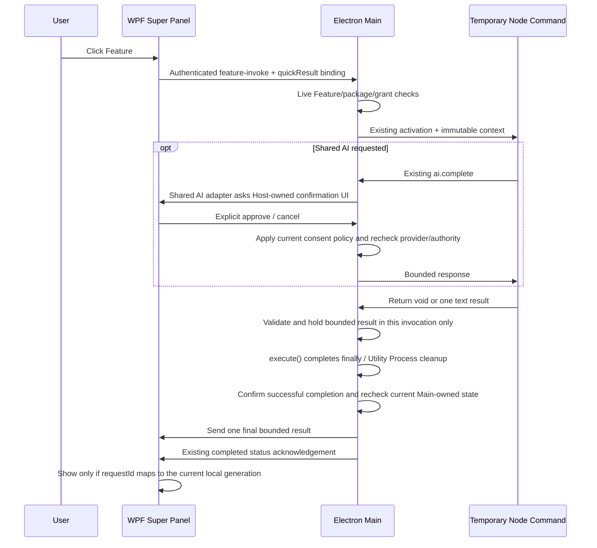

# Phase 6G-0 — Feature Quick Result Design

**Date:** 2026-10-16

**Status:** DESIGN GATE COMPLETE — USER APPROVED

**Approval:** 用户于 2026-10-16 明确回复“审核通过”。此确认批准本设计，不代替后续实现及运行时验收。

**Scope:** Phase 6G-0 design gate approved. Phase 6G-1 is in implementation planning only; production implementation has not started.

**Source identity:** `codex/shared-ai-translation-2.0` / `707c5673dff479285b34a5b441bec9d3b725c737`, with the existing dirty working tree.

## 1. Purpose and authorization

用户已确认插件卸载问题解决，并同意继续下一项工作。仓库中的 `docs/phase6f5-sdk-developer-workflow.md` 已记录 Phase 6F-5 COMPLETE；本阶段以 `docs/phase6f-plugin-platform-roadmap-after-utools-analysis.md` §K 为路线依据，进入 **6G-0 Feature Quick Result Design Gate**。较早 6F-4E 报告中的“6F-5 尚未开始”保留为当时的历史记录，不作为当前阶段状态。

用户批准的方向是：由 Host 展示有界纯文本，Main 校验 Feature 身份和当前授权，NativeHost 只展示；先完成契约和威胁边界，再进入 Translation 2.0 实现。最新“开始正式的开发流程”授权本阶段完成源码审计和正式书面设计，不被解释为已经验收尚不存在的实现。

产品目标保留：选中文本后，用户能调用真实 Translation Feature，并在 Super Panel 中看到快速结果。首版需要用户点击相应 Feature；仅捕获选区、显示面板或匹配 Feature 都不发起翻译/AI 请求。未来的自动结果策略需要单独的产品和隐私决策。

本文定义后续实现需要遵守的合同，所有新 API、消息、状态和限制均为**设计决定，尚未实现**。现有源码行为与设计决定分开记录。

## 2. Source audit and evidence limits

| Current source | Confirmed behavior | Design implication |
| --- | --- | --- |
| `src/shared/feature-invocation-contracts.ts` | 请求关联到 UUID、FeatureRef、调用来源和可选上下文；请求最多 16 KiB；状态回执最多 256 bytes。 | 保留既有状态回执；正文使用独立的有界结果消息。 |
| `electron/services/feature-invocation-service.ts` | Main 做当前 Feature 调用、30 秒上下文新鲜度检查和每个 Pipe session 最多 2,048 个请求的防重放。 | 结果不能成为第二个激活入口；复用请求身份和防重放，不把正文塞进长期 replay map。 |
| `electron/services/feature-activation.ts` | 所有 Surface 通过活体授权进入现有 Window/Command 路由。只有 Node + node-command 组合能无窗口执行。 | 首版结果生产者限定为现有 Node Command；不创建隐藏 Web renderer。 |
| `electron/plugins/plugin-command-entry.ts` | handler 只允许返回 undefined；非空返回值目前会失败。 | 新的纯文本返回值需要显式、向后兼容的 SDK/Host 扩展，不能声称当前已经支持。 |
| `electron/plugins/node-command-execution.ts` | 每次 Command 创建临时 Utility Process，使用 AbortSignal、30 秒执行预算、最多 8 个活动命令；`execute()` 在返回前完成 finally/子进程清理并释放本次运行资源。 | Main 先在本地暂存有界结果；只有执行成功且 cleanup 完成后，才发送最终结果。用现有 invocation ownership、当前插件/授权状态和 package snapshot/hash 检查，不提前向 Native 发送候选正文。 |
| `electron/plugins/plugin-development.ts` + `electron/main.ts` | 开发会话通过独立开发协议连接；Host 校验并物化带 revision/hash 的 runtime package，要求首次授权确认，并为开发 Feature 创建 session-bound authority。开发态 Node Command 已能通过该 authority 执行。当前 Super Panel 使用的 Feature Projection v2 来自生产 `FeatureRegistry`（输入为 PluginManager 与 built-in 状态）；`PluginCatalog` 另外生成插件快捷入口投影。两条投影均未接入开发 session，Native Feature activation 也只调用 `PluginManager.authorizeWebFeature`。 | Quick Result v1 同时支持当前已授权开发会话和已安装插件，但需要实现一个明确的 Main/Native 开发态投影与授权桥接。桥接必须重新验证开发 session、revision、validated snapshot/hash 和 Feature authority；不能从项目路径、UI 投影或插件返回值推导授权。开发态证据与打包产品证据分别标记。 |
| `native/WebTools.NativeHost/SuperPanel/SuperPanelWindow.xaml.cs` | Window Feature 会关闭面板；Command 保留面板并显示执行状态。Dismiss 清除上下文、请求和展示状态。 | 复用 Command 路径和现有 WPF 窗口，新增独立结果状态。 |
| `native/WebTools.NativeHost/Services/NativeFeatureInvocationProtocol.cs` | Native 也强制 16 KiB 请求和 256-byte 回执；文本选区上限 3,000 UTF-16 code units。 | 现有输入边界不随结果功能扩大。 |
| `electron/services/native-manager-client.ts` | Main 对经过认证的 Pipe 消息异步分派。 | 取消不应等待长时间运行的 Feature 完成。 |
| `native/WebTools.NativeHost/Services/NativeManagerPipeServer.cs` | Native 按当前 peer/session 验证消息；普通请求处理在读取循环中等待完成。 | 新确认消息必须快速回 ACK，人工决定另发关联消息，不能阻塞 reader 等用户点击。 |
| `electron/plugins/web-host-capabilities.ts` | 当前插件 Shared AI 调用会检查声明、grant、当前 authority、一次性 user gesture 和发送确认；异步调用前后复查 authority。 | 是否需要发送确认、如何使用 gesture 和如何复核 provider 属于 Shared AI consent policy，不属于 Quick Result 数据合同。 |
| `electron/plugins/electron-plugin-host.ts` | 现有 Command 确认使用独立原生 MessageBox。 | Super Panel outside-click 会清除面板；两者交互存在源码可推导的风险，但尚无真实 Quick Result Runtime 验证。当前推荐同窗 Host-owned 确认 adapter。 |

以上为当前工作树的静态源码审计，不是新自动化、Windows Runtime、安全认证或性能证据。未启动应用、未读取真实 Profile/Token、未修改 `D:\webtools` 或开机启动项。未运行测试、typecheck、build 或 package。

uTools 只作为已批准路线图的产品参考。本文不新增关于其二进制、CSS、网络隔离或内存行为的事实主张，也不把 WebTools 的不同技术栈实现称为逐行移植。

## 3. Selected approach and first-version scope

采用 **Host-rendered bounded text result**：一个已显式调用的 Node Command 可以产生一个纯文本结果，由 Main 作为唯一转发者交给当前 Super Panel。插件不提交 WPF、HTML、Markdown、脚本、按钮、URL 动作或窗口指令。

其他方案的处理：结构化富内容增加 schema/renderer 分支，延后；嵌入插件 Web 页面增加窗口和内容边界，延后；在 NativeHost 建立翻译服务违背现有 ownership，不采用。

首版范围：

- Manifest v3、已安装且已启用的 Node `presentation.type: command` Feature。
- 用户在 Selected Text 面板上点击 Feature，且该 Feature 的现有 acceptedContexts 接受本次 selected-text。
- 每次调用最多一个最终结果；无 streaming、部分结果、进度推送或多结果列表。
- Launcher、Manager、No Context、文件/目录上下文及 Web Window Feature 保持已有调用语义；首版不在这些 Surface 展示 Quick Result。
- 同一 Quick Result 合同适用于已安装且已启用的插件，以及当前已连接、已由用户授权并持有有效 validated build 的开发态项目。Native 只在该开发 session 有效期间投影其 Feature；Main 每次调用都必须按开发 session、revision、validated snapshot/hash 和当前 Feature authority 重新授权。项目路径或 UI 中可见的 Feature 本身不构成授权。
- 开发态 Quick Result 是受支持的开发工作流，但其结果只记为 `DEVELOPMENT WORKFLOW PASS`；它不能代替 `REAL PACKAGED PASS`。正式打包验收仍使用已安装、经 Host validator 验证的插件和真实 packaged runtime。两类证据分开记录，不以限制开发态功能来避免证据混淆。
- 不新增权限名称、Manifest 字段、FeatureRef 格式或持久化 schema。显示一次调用的纯文本返回值不授予其他 Host 能力；AI/config/storage 仍分别检查既有能力。

## 4. Public author contract

设计新增一个 Node SDK 类型，保持 `defineCommand` 名称和原有 void handler 可用：

```ts
export interface FeatureTextResult {
  readonly kind: 'text'
  readonly text: string
}

export interface CommandInvocation {
  // Retain the current context, signal and webtools members.
  readonly resultTarget?: 'super-panel'
}

export declare function defineCommand(
  handler: (invocation: CommandInvocation) =>
    void | FeatureTextResult | Promise<void | FeatureTextResult>
): (invocation: CommandInvocation) =>
    void | FeatureTextResult | Promise<void | FeatureTextResult>
```

`resultTarget` 由 Main 决定，只在本次受支持、已协商的原生结果调用中提供；插件不能借返回值自选目标。这个值不是授权令牌，读取或伪造它不能通过 Main 的当前调用检查。

作者示例（示意公开合同，不是实现或当前可运行示例）：

```ts
defineCommand(async invocation => {
  if (invocation.resultTarget !== 'super-panel') return
  const context = invocation.context
  if (context?.type !== 'text') return
  const text = await computeUsingDeclaredCapabilities(context.text, invocation)
  if (invocation.signal.aborted) return
  return { kind: 'text', text }
})
```

上述返回类型和 Native 展示语义对生产插件与有效开发 session 完全相同。差异仅在 Main 的 authority 来源和证据标签；开发 session 失效或 build revision 被替换时，旧调用必须取消，旧 revision 的结果不得提交。

示例中的 computeUsingDeclaredCapabilities 代表插件自身业务逻辑，不是新增 SDK API。调用 Shared AI 时仍走现有 `invocation.webtools.ai.complete`，受既有声明、grant 和确认约束。

旧 void Command 仍返回 completed；结果模式下返回 undefined 显示“执行完成，未返回快速结果”，不伪造正文。返回其他类型、额外字段或无效文本使本次 Command 失败。没有结果目标时，新 Host 接受合法 text 返回值但丢弃正文，只保留原有完成状态；不得弹窗、写剪贴板或重开面板。

旧 SDK/Host 没有此输出合同。新作者应检查可选的 resultTarget，并为不支持的 Host 返回 void 或走其已有 Window Feature。新合同不能承诺旧 Host 接受任意结构化返回。后续实现必须在开发文档中说明这个兼容范围，且在发布要求此能力的包前核定 minHostVersion；6G-0 不修改产品/SDK 版本或发布包。

## 5. Payload and resource limits

| Item | Rule |
| --- | --- |
| Author result | 严格的 plain-data `{ kind: 'text', text }`，拒绝 getter、额外字段、数组、循环值和非字符串。 |
| Text | 最多 8,192 Unicode scalar values、32,768 UTF-8 bytes，两者同时满足；拒绝未配对 surrogate、NUL 和除 TAB/CR/LF 外的 C0 控制字符。 |
| Normalization | 只把 CRLF/CR 统一为 LF；保持正文顺序、大小写和空格；空白正文无效。不执行 Markdown/HTML，不做 URL 自动链接。 |
| Native result payload | JSON 序列化 UTF-8 最多 65,536 bytes，包含关联元数据；既有 4 MiB frame 上限不扩大。 |
| Retention | 每个当前面板 presentation 最多保留一个结果；每次 invocation 最多产生一个结果。Main 暂存的结果受同一文本/信封上限约束。正文不写磁盘、不进入 replay map、索引、projection 或普通日志。 |
| Execution | 保留最多 8 个全局活动 Command 和现有 30 秒 Command 预算；不另加结果显示倒计时。 |
| Result lifetime | 结果由明确的 presentation/source 事件清除：Panel dismiss/hide、Escape、outside click、Launcher 打开、新 Selected Text capture、另一项 Feature invocation，或 Main/Pipe 可用时送达的插件 disable/uninstall/replacement、开发态来源撤权/重载/替换通知。stale invocation、Main ↔ Native Manager Pipe session 断开/重连、正常 Electron idle exit、Utility Process 正常退出本身均不清除 Native 已接收的结果。 |
| Delivery | 不发送未完成的 candidate，也不新增 candidate ACK。最终结果沿当前已认证 Pipe 直接发送；继续使用现有 invocation ownership 和 acknowledgement/after-acknowledgement 生命周期。Shared AI adapter 的人类确认决定单独关联，不能阻塞 Pipe reader。 |

超限必须失败并显示固定错误，不能静默截断成看似完整的翻译。UI 可以对合法长文本滚动，但不扩大内存保留上限。Utility Process 的 Node 代码拥有当前用户 OS 权限；这里的配额约束 Host 接受和保留的数据，不构成 OS sandbox 或恶意 Node 代码的全局内存保证。

## 6. Authority and data flow



Native 使用现有 requestId，并在本地将其关联到当前窗口 generation、FeatureRef 和选区；没有第二个 presentationId。只有仍然对应当前本地 generation 的请求才可更新可见面板。Main 将**未完成调用**关联到当前已认证 Pipe peer/session、实际 validated package snapshot/hash、Feature authority 和 Main 内部 runtime generation。runtime generation 不扩展成公共协议字段。生产调用的 authority 来自当前 PluginManager 状态；开发调用的 authority 来自当前已确认的 PluginDevelopment session，并绑定其 sessionId、build revision、validated snapshot/hash。两者都必须由 Main 检查。

插件返回对象只含 kind/text。pluginId、FeatureId、hash、session、请求 ID、结果目标或 runtime generation 均由 Main 绑定，不信任 Utility Process 对这些字段的声明。Main 在接纳调用和异步 Host effect 前后检查当前 authority；在 Command cleanup 成功后，再用现有 invocation ownership/request record 与 Main 当前插件状态确认该调用仍可提交。生产来源检查 enabled/grant、package snapshot/hash 和 Feature 身份；开发来源检查已确认且仍连接的开发 session、sessionId、当前 build revision、validated snapshot/hash 和 Feature 身份。两种来源都检查 Pipe peer/session 和未取消状态。

这里的“Pipe session”专指 Main ↔ Native 的 Manager Named Pipe 传输会话；“开发 session”专指 PluginDevelopment 与外部开发工具之间的独立会话。正常 Command cleanup 对本次 authority 的释放是预期收尾，不等同于外部撤权。外部撤权、插件停用/卸载/替换、开发 session 断开或 build revision 替换，均须取消或拒绝尚未提交的旧调用。这里复用现有状态，不新建 grant epoch 或通用 completion receipt。

Node Command 的返回值只在 Main 内存中暂存，绝不在 Command cleanup 完成前发给 Native。只有 `execute()` 返回成功、Utility Process/finally cleanup 已完成且 Main 的 invocation revalidation 通过，Main 才发送最终结果。failed、cancelled、超时、cleanup failure、过期、撤权或**结果发送前** Pipe session 失效均丢弃暂存文本。这样把“结果已计算”与“结果可展示”分开，但不引入 Native candidate/commit 两阶段。

Main 使用现有 activationInFlight、Command lifecycle、authority closure 和 after-acknowledgement 路径维持本次调用的所有权；不另建 Electron activity counter 或 completion receipt 框架。若 implementation audit 发现现有 request record 无法在 cleanup 后区分正常释放和外部 revoke，必须先指出具体调用序列，再提出最小修正，不预先增加独立 grant epoch。

最终结果发送与既有完成回执必须沿现有 invocation acknowledgement 生命周期正确排序；Host 不得在结果写入/现有完成回执尚未处理时因 idle 判定退出。实现时扩展现有 activationInFlight / after-acknowledgement 机制，不增加独立活动计数系统。Native 一旦按当前 requestId/local generation 接受最终结果，该纯文本就是 Native 拥有的惰性 presentation state，不再依赖 Pipe、Electron 或 Runtime authority 存活。之后的正常 Electron idle exit、Pipe session 关闭及后续新 Pipe session 建立都不得单独清除它；如果 Pipe 在 Native 接受前断开，则该未完成调用取消且不显示结果。

正常完成后的 authority release 或 Utility Process/Electron idle exit 不会删除已提交文本。文本保留在 Native 的当前 presentation 内，直到表 5 定义的显式清除事件发生；该选择没有自动 TTL，意味着面板一直保持显示时文本也会继续显示。面板关闭时本地清除。若 Main 仍运行且已提交结果的来源发生相关插件停用、卸载、替换或开发来源撤权/重载/替换，Main 可发送绑定到原 requestId/FeatureRef 的定向 clear；开发来源的 build revision 变化按来源替换处理。正常 Electron idle shutdown 对开发 session 的资源清理不等同于开发者撤权事件，也不清除已提交文本；如果 Main/Pipe 已不可用，不能把断连当作清除命令。不得依赖 Feature Projection revision 代替结果 slot 的精确失效关联。

这不代表完成后继续持有 Runtime 权限：展示内容不能发起任何新的 Host 操作。再调用必须重新经过 Feature activation 和新用户操作。

## 7. Private Native transport extension

沿用实际 peer authentication 和现有 Named Pipe，只增加双端协商能力 `super-panel-quick-result-v1`。协议 envelope 版本、既有 feature-invoke 状态回执和 256-byte 回执限制不变；不新增公开 Pipe 或插件可访问的 Native API。

在双方都协商成功时，现有 feature-invoke 请求可增加唯一可选字段：

```ts
quickResult?: { readonly version: 1 }
```

它只表示本次请求使用 Quick Result v1；不是权限或 authority token。它只允许 `source: super-panel`、selected-text、Node Command。Main 在 SDK invocation 上设置 `resultTarget: 'super-panel'`；该字段由 Main 派生，不由 Native 或插件通过此协议字段授权。总请求仍不超过既有 16 KiB，其他调用使用原字段集合。无协商则不发送新字段；不执行新的输出通道。

新消息均使用严格字段集合和现有受认证 peer：

| Direction / type | Payload and behavior |
| --- | --- |
| Main → Native `feature-result-v1` | `{ resultVersion: 1, requestId, ref, text }`；这是完成 cleanup 和 Main revalidation 后的最终正文，Native 仅在 requestId 仍绑定当前本地 generation 时直接显示。成功接收后，正文留在 Native presentation，不再绑定传输 Pipe session 的存活期。 |
| Native → Main `feature-result-cancel-v1` | `{ requestId, ref }`；定向 abort/取消仍在运行的调用，幂等处理。插件不能调用或转发此消息。Native hide/dismiss 会使当前 slot 失效；Pipe 断开也取消尚未完成的 Main invocation。 |
| Main → Native `feature-result-clear-v1` | `{ requestId, ref }`；仅清除仍绑定该 requestId 的结果/slot，避免旧 clear 删除较新的结果。 |

requestId 使用现有 UUID v4；ref 使用现有 FeatureRef 规则。结果、取消与 clear 消息严格拒绝重复字段、未知字段、错类型和失配关联。最终结果 payload 仍遵循 64 KiB envelope 上限。Native local generation 不出现在公共消息中。

取消必须经当前已认证连接快速发送，不能排在等待 Command 的 Manager intent queue 后。Native 的入站 reader 不等待 UI、人类输入或 provider。结果最终发送使用已有 Pipe 处理和 invocation acknowledgement 生命周期，不额外等待 candidate ACK。控制消息复用现有 session 和队列限制，不建立无限等待或无限 map。

Main 不能在 PluginManager store/operation queue 的互斥范围内等待 Native UI、确认或网络；复用现有“活体 authority + 锁外异步执行”结构。取消或 Shared AI 确认的处理不得与最终 feature-invoke completion acknowledgement 互相等待。

### Shared AI confirmation adapter messages

确认消息只属于当前 Shared AI consent adapter，不属于所有 Quick Result。只有该 adapter 的现有 policy 要求发送确认时，才通过当前已认证 session 交换一次性 confirmation request/decision；关联沿用 requestId，并可用一个 adapter-local consentId 区分同一调用中的确认等待。它不改变 Quick Result v1 的结果传输或清理模型。

确认请求包含 Host 生成的插件身份、当前 provider 身份和有界 preview；Native 不能回传插件可控的权限字段。Native 的 decision 只表达用户明确选择，不直接授权 Feature/Package。该消息交互需快速登记后继续 Pipe reader，实际 UI 与 provider 请求在 reader 外处理。

## 8. Shared AI consent policy and presentation adapter

Quick Result 与 Shared AI policy 分层：

| Layer | Owns |
| --- | --- |
| Quick Result Contract | `FeatureTextResult`、Main 派生的 `resultTarget`、invocation/result correlation、取消、失效和 Native 有界纯文本 presentation。 |
| Shared AI consent policy | 是否需要发送确认、user gesture 的一次性消费、provider/data consent、确认 UI presentation、provider identity recheck，以及调用现有 Shared AI service 的时机。 |

因此，Shared AI policy 后续调整不应迫使 `FeatureTextResult`、`resultTarget` 或 Quick Result result transport 重设计。

当前推荐的 presentation adapter 是 **同一个 WPF Super Panel 里的 Host-owned AI confirmation 区**。它是 Shared AI consent policy 的 UI 适配，不是新的 grant 或插件授权捷径。现有 Command 独立 MessageBox 与 Panel outside-click dismissal 的组合带来可由源码推导的交互风险；该风险尚未通过真实 Quick Result Runtime 验证，不能描述为已证实故障。

Main 从当前实际插件身份、provider 身份和既有 policy 生成模型，Native 只显示固定平台文案“确认发送至当前共享 AI 服务？”，插件身份、现有 preview/缩略说明，以及固定“取消”“确认发送”按钮。插件不能提供按钮标签、回调、HTML 或任意确认类型。不得把原始凭据、endpoint token 或 SecretStore DTO 送到 Native。

本版只把同窗确认作为 Quick Result Shared AI adapter 的推荐呈现；其他确认需求继续使用原有 Host UI。若外部确认 UI 与 outside click 发生交互，源码只支持把它列为待验证风险，不能假定一定关闭或一定可用。非 Quick Result 的现有确认路径保持原语义。

当前 policy 的 user gesture 是一次性额度，按现有实现最多消费一次；AI confirmation 是独立的数据发送同意，不应在确认前后重复消费同一个 gesture。Main 将批准绑定到同一 invocation 和 provider identity；provider 在等待期间变化则拒绝发送，不能把旧确认用于另一个 provider。仅点击 Feature 不被自动当作发送确认。确认等待沿用现有 Command 执行预算，不无限期暂停。

取消语义有边界：Host 可以阻止尚未确认的请求发送、传播 AbortSignal、停止本地等待并拒绝/丢弃迟到结果；如果请求已被远端 Provider 接收，Host 不能保证远端停止处理或不产生费用。Shared AI credential、SecretStore、provider endpoint 和实际发送始终由 Host 所有。

没有配置 AI 或缺少能力时给出固定错误，不读取/打印真实 Secret，也不静默切换 provider。自动请求、批量请求、Host 第二套 Translation、插件拿 raw key、以 Node 本地网络冒充 Host-mediated AI 都不属于这个合同。

Quick Result Contract 与 Translation engine/provider 无关。进入 Translation Plugin 2.0 Production Implementation 前，6G-1 必须先完成并审核 **Legacy Translation capability parity review**。对照至少覆盖：MyMemory、Shared AI Translation、Qwen-MT、source/target language semantics、provider/engine preference、model preference、credentials ownership、request parameters、input/output limits、timeout/cancellation、error semantics、provider/result metadata，以及现有用户 settings/preferences。

该 parity review 必须明确每个现有能力是通过既有公共 Plugin API 保持、经明确产品决策调整，还是需要 adapter。尤其评估 **Qwen-MT minimum Host-mediated adapter**：如果现有公共 Plugin API 无法保留 Qwen-MT 的产品能力，再设计最小、Translation-specific、Host-mediated capability。不要假设 `SharedAI.complete()` 能替代 MyMemory 或 Qwen-MT，也不要为 Qwen-MT 修改通用 Quick Result Contract。本阶段不复用私有 Translation IPC、不实现新 provider API、不删除旧路径，也不宣称已经达到 Translation parity。

## 9. Native presentation and state transitions

沿用同一个非激活 WPF 窗口和目前 Selected Text UI。在原选区预览与动作区域内加入有界的 Host 结果/确认区域，使用现有主题与密度 tokens；不创建第二个过渡窗口，不回显旧结果，不改变 Copy 捕获或真实紧凑首帧。

| State / event | Required transition |
| --- | --- |
| SelectedText actions → click eligible Command | 新 slot，清除旧结果，显示执行状态；输入选区作为不可变快照。 |
| Running → Host AI confirmation | 同窗确认；维持非激活、鼠标操作和 Escape 取消。 |
| Confirmation → approve | 仅发送一次匹配决定，回到 Running；Main 决定是否允许网络请求。 |
| Running → text returned | Main 严格校验并在当前 invocation 内存暂存单个有界结果；Native 不收到正文。 |
| Running → successful cleanup + Main revalidation | Main 确认 execute/cleanup 成功、调用未被取消且现有插件/package/grant/session 状态仍有效，然后发送最终文本。 |
| Final result → matching Native requestId/local generation | 显示纯文本结果和实际 Feature 来源；不启动自动显示倒计时。 |
| Running → completed without text | 显示普通完成且无快速结果状态。 |
| Pending → failed/rejected/cancelled/timeout/cleanup failure | 丢弃 Main 暂存正文；展示固定短错误或取消状态，不显示原始 stack。 |
| Any visible state → another Feature invocation | 旧 slot 先失效并取消仍在运行的调用，再登记新 slot。 |
| Any → outside click/Escape/hide/new capture/Launcher | 立即清空本地结果/slot，尽力取消仍在执行的调用；requestId 与 local generation 阻止迟到结果覆盖新状态。 |
| Visible result → normal Utility Process exit / Electron idle exit | 已成功提交的文本保留在当前 Native presentation，不保留 Utility Process、Electron 或 Runtime authority。 |
| Pending invocation → Main ↔ Native Manager Pipe disconnect | 取消未完成调用并丢弃 Main 暂存正文；若 Native 已接受最终结果，按下一行保留，不因传输断开回滚。 |
| Visible result → Manager Pipe disconnect/reconnect/new Pipe session | 保留已由 Native 接受的正文；Pipe 生命周期只影响之后的新调用。 |
| Pending invocation → stale request/old generation | 丢弃未完成 slot 和 Main 暂存正文，拒绝迟到结果；不因此清除一个已由 Native 接受的结果。 |
| Any → relevant plugin disable/revoke/uninstall/replace or development session revoke/reload while Main/Pipe is available | 清除匹配的旧 slot/结果，拒绝随后到达的旧结果。这里的 revoke 指插件/开发来源 authority 撤销，不指正常 Pipe session 断开或调用完成时的 authority release；若通知无法送达，不把断连解释成 clear。 |

结果使用纯文本 WPF 控件；保留行换行，限制显示区域并允许有界滚动，不把动作列表的虚拟化变成外层无界 ScrollViewer。标题和来源由 Host 信息产生，文本不能覆盖确认按钮或面板控制。首版不新增复制、外链、富文本、编辑和自动重试按钮。

不以捕获时的原前台 HWND 作为执行中永远不变的要求：明确点击 Feature 后，以当前面板 slot、可见 generation 和授权生命周期关联结果；否则合法的 Host 交互会造成误拒绝。选区捕获阶段既有的前台/剪贴板所有权检查继续独立生效。

## 10. Threat and failure review

| Condition | Required behavior / future evidence |
| --- | --- |
| 插件伪造 ref、session、requestId 或 generation | Main 使用自己的 child/authority 绑定；Native 使用自己的 slot；伪造不能定向其他调用。 |
| 撤权/替换恰好发生在 handler 返回或最终发送前 | 当前 invocation ownership、授权检查和 slot clear 阻止提交；不能只在启动时检查。 |
| 正常 finally 释放 authority | 将其视为本次调用的预期 cleanup；仍须成功完成清理并通过现有 Main 状态复核才能发送最终结果。 |
| hide 后重开、切换 Feature、旧 peer 回包 | generation/新 ID/peer session 阻止旧输出闪回；无自动重开。传输 Pipe 断开会取消未完成调用；已由 Native 接受的正文不因断开或新 Pipe session 清除。 |
| Main 暂存结果后，Command cleanup 失败或结果发送前 Pipe 断连 | 不展示；只有 cleanup 成功且 invocation revalidation 通过才发送最终结果。Native 已接受后的 Pipe 断开不回滚已显示文本。 |
| Main 仍运行时开发 session 被外部断开/撤权或 build revision 替换 | 取消该开发来源的未完成调用；拒绝旧 revision 的迟到结果，并在 Pipe 可用时清除匹配的已提交结果。正常 Electron idle shutdown 造成的 session teardown 不触发此清除。 |
| 一次 command 发多个/畸形/超限结果 | Main 拒绝，不扩展 retained state，不覆盖已提交的新结果。 |
| Shared AI confirmation 与取消交错 | adapter 使用 requestId/本地 consent state，Pipe reader 不等待 UI/provider；同一 gesture 不重复消费。 |
| provider 在 AI 确认后变化 | 绑定现有 provider identity；变化拒绝本次请求，用户需重试。 |
| Panel 外部点击或 Native 异常退出 | 本地立即清除，Main 尽力 abort + 既有 Utility cleanup；未确认不发送请求。已被远端接受的请求能否停止不作保证。 |
| Command 已完成、Manager 关闭 | 结果本身不保留 Electron；Native bounded text 不代表继续持有执行权限。 |
| Node 插件直接用本地 OS/网络能力 | 沿用已公开的当前用户本地代码信任模型，不声称 Host API 是 OS sandbox。 |
| 输出包含选区、翻译或错误信息 | 普通日志只记关联 ID、状态和 byte count；无正文/提示词/原始凭据；测试使用合成数据。 |

这些是设计要求，不是已通过的 adversarial cases。本文不授予 Gate 1/Gate 4 新认证，不恢复已明确 unsupported 的能力。

## 11. Phase 6G-1 entry gate and subsequent implementation sequence

### Translation production implementation entry gate

开始任何 Translation Plugin 2.0 Production Implementation 前，必须先完成并审核 Legacy Translation capability parity review。该 review 至少逐项记录旧能力、当前设置/数据来源、新插件拟采用的公共 API、兼容差异、证据和用户可见影响：

- MyMemory、Shared AI Translation、Qwen-MT 三条现有路径；
- source/target language semantics 和自动源语言行为；
- provider/engine preference、model preference、现有 user settings/preferences；
- credentials ownership，以及是否继续完全由 Host/SecretStore 持有；
- request parameters、input/output limits、timeout/cancellation；
- error semantics、provider/result metadata 与调用反馈。

review 必须明确哪些能力可由既有公共 Plugin API 保持，哪些需由产品决策有意改变。对 Qwen-MT 进行单独的 **minimum Host-mediated adapter** 评估：只有在现有公共 API 无法保持其产品能力时，才提出最小、Translation-specific、Host-mediated capability。不得把该能力并入通用 Quick Result Contract，也不得默认以 `SharedAI.complete()` 替代 Legacy Translation。

### Quick Result implementation sequence after final design approval

最终设计审核通过后，仍需另行冻结实现计划并获准实现；届时按依赖顺序进行 focused tests 和最小改动，已有无关 dirty files 保留：

1. **Closed result/transport contracts:** 定义共享结果 parser 与 Native mirror；覆盖 Unicode、双重大小限制、严格字段、requestId/local-generation binding 和旧 ACK 兼容。
2. **Node Command return and Main delivery:** 扩展 Node worker/SDK 的可选 text return；Main 在本次 invocation 内有界暂存，等 `execute()` 成功完成 finally/Utility Process cleanup，再使用现有 invocation ownership、package/hash/grant/session 检查并发送最终结果。生产来源复核 PluginManager authority；开发来源复核当前已确认的 PluginDevelopment session、sessionId、revision、validated snapshot/hash。保留旧 void 行为，不增加 Native candidate 两阶段。
3. **Existing invocation lifecycle integration:** 复用现有 activationInFlight、Command lifecycle、request record 和 after-acknowledgement 路径；只添加实现所需的最小 per-invocation 状态，不建通用 coordinator/receipt/activity framework。
4. **Native lifecycle/presentation:** 增加结果/确认区、requestId 到本地 generation 的绑定、事件清除和取消；区分未完成 invocation 的 Pipe ownership 与已接受结果的 Native presentation lifetime；为当前有效开发来源增加受限的 Native Feature projection/activation bridge。保留窗口、HWND、首帧、捕获、热键和动作虚拟化。
5. **Shared AI consent adapter:** 当前策略要求确认的 Quick Result AI 请求采用推荐的同窗 Host-owned confirmation；验证一次性 gesture 消费、provider identity recheck、取消边界和未确认前不发送。
6. **Public SDK and external author:** 类型和作者说明；在 `D:\SystemDefault\Desktop\webtoolstest` 生成独立 Node Command 示例，通过正式 validate/pack/inspect 及实际 Host validator。
7. **End-to-end acceptance:** 分别验证有效开发 session 工作流和隔离的 packaged production 工作流，报告中使用不同证据标签；packaged 路径使用隔离 installation/Profile/Pipe，验证真实 Utility Process → Main → authenticated Pipe → WPF，并记录产物、进程清理和人工剩余项。开发态 PASS 不抵扣 packaged gate。

上述为设计后的建议实施顺序，不表示已经开始 Phase 6G-1、Translation parity review 或 Production Implementation。真实 Translation 实现必须先通过本节 entry gate；Quick Result 的实现也必须先经独立授权。

## 12. Future verification and acceptance matrix

| Requirement | Necessary evidence before implementation closeout |
| --- | --- |
| Pure contract | TS 与 C# 对相同有效/无效向量给出相同结果；8192/8193 scalars、32768/32769 UTF-8 bytes、64 KiB envelope、代理项、空白和额外字段边界。 |
| Authorization | 生产来源使用真实 installed validated snapshot；开发来源使用当前已确认、仍连接且具有 validated snapshot 的开发 session；两者均验证 Feature、snapshot/hash 和当前 authority。未启用、缺 grant、错 Feature、旧 package/revision、撤权、替换均拒绝；无私有 IPC bypass。 |
| Development Quick Result | 有效开发 session 可以从 Native Super Panel 调用 Node Command 并显示 Quick Result；Main 仍运行时的外部断开/撤权、重载或 revision 替换会取消旧调用、拒绝迟到结果，并在 Pipe 可用时清除匹配结果。正常 Electron idle shutdown 不清除已接收结果。结果标记 `DEVELOPMENT WORKFLOW PASS`，不得计作 `REAL PACKAGED PASS`。 |
| Existing behavior | void Command、Window Feature、Legacy/v1、Launcher/Manager、无协商双端和无结果目标调用不回归。 |
| Result ordering | Main 暂存的正文在 cleanup 成功和 Main revalidation 前不离开 Main；之后仅当前 requestId/local generation 可显示。cleanup failure、重复、过期、clear race 和错 session 均无旧正文。 |
| Result lifetime | 验证 dismiss/hide、Escape、outside click、Launcher、新 capture、新 invocation、Main/Pipe 可用时的相关插件状态变化；已接受结果跨正常 Utility Process/Electron idle exit 及 Manager Pipe disconnect/reconnect 保留，Pipe disconnect 只取消未完成 invocation；Main 在线且 Pipe 可用时，开发来源外部撤权/reload 清除匹配结果；无 TTL 计时器。 |
| Cancel races | queue 中取消、启动中、AI 确认中、结果在途、hide/reopen、switch、Native 退出、Main 断连；不得 deadlock 或让旧结果覆盖；断言本地停止/丢弃，不断言远端已接受请求停止计费。 |
| AI consent | 点击 Feature 不自动发送；按当前 policy 完成同一 invocation/provider 的确认后才发送；gesture 不重复消费；取消、超时、provider change、撤权均阻止尚未发出的请求并丢弃迟到结果；不使用真实付费服务。 |
| Native UI | 真实鼠标调用、同窗确认、滚动长正文、非激活、外部点击、Escape、主题、窄屏；旧上下文不闪回。 |
| Runtime ownership | 真实 Node Utility 退出；Manager 与其他 Plugin Window 都关闭时目标 Electron=0；Native 可显示有界已完成文本并继续工作。 |
| External author | 仅 local tarball，无 checkout 私有 imports/workspace links；官方 validate/pack/inspect + authoritative Host install validation。开发态 Quick Result 和正式 packaged acceptance 分开记录，不相互替代。 |
| Translation parity gate | 在 Translation Plugin 2.0 Production Implementation 前，Legacy parity matrix 覆盖 MyMemory、Shared AI、Qwen-MT、语言/偏好/模型/凭据/参数/限制/取消/错误/metadata/settings；Qwen adapter 决策有证据和明确边界。 |
| Data protection | 全部测试放用户指定 D 盘目录；独立 Profile/Pipe/installation；不动真实 Nook、SecretStore、Token、启动项及无关进程。 |
| Regression | 按实际改动运行 focused tests、pnpm typecheck/test/build、NativeHost Checks、UpdateHelper Checks；一次有效 packaged smoke，不重跑历史 soak/资源压力。 |

证据标签保持 AUTOMATED PASS、REAL PACKAGED PASS、USER CONFIRMED PASS、NOT TESTED/INCONCLUSIVE 的区别。6G-0 文档审查不能替代任何运行时验收。

## 13. Non-goals and phase decision

- 不实现 Translation Plugin 2.0、真实自动翻译、Qwen-MT adapter 或 Legacy 迁移/删除；进入 Translation Production Implementation 前必须完成 §11 的 parity entry gate。
- 不新增 Web→Native 通道、任意 HTML/Markdown、隐藏 renderer、常驻插件服务、AI Tool/MCP、OCR、Marketplace 或在线更新。
- 不改变 Clipboard capture、约 50ms 首轮检查、面板真实紧凑首帧、Launcher 热键/搜索、Manager 卸载/替换或产品布局。
- 不创建 SDK tarball、测试插件、安装器、性能基准或新安全认证。
- 6G-0 仅产出本设计文档；后续实施计划独立归档。保留历史证据和全部已有工作。无 stage、commit、push、PR、tag 或 release。

**Phase 6G-0:** DESIGN GATE COMPLETE — USER APPROVED.

**Phase 6G-1:** IMPLEMENTATION PLAN PREPARED — PRODUCTION IMPLEMENTATION NOT STARTED.

**Production implementation:** NOT STARTED.

**Testing / packaging:** NOT RUN — DESIGN GATE ONLY.

用户已审核通过本合同中的首版 Node Command/Selected Text 边界、单次纯文本结果、Main 暂存→cleanup/revalidation→Native 最终显示、事件驱动结果清除、Shared AI consent adapter 分层、Legacy Translation parity entry gate 和无常驻结果进程。下一步审核 `docs/superpowers/plans/2026-10-16-phase6g1-feature-quick-result-foundation.md`；本设计审批不代表产品实现或运行时验收已完成。
