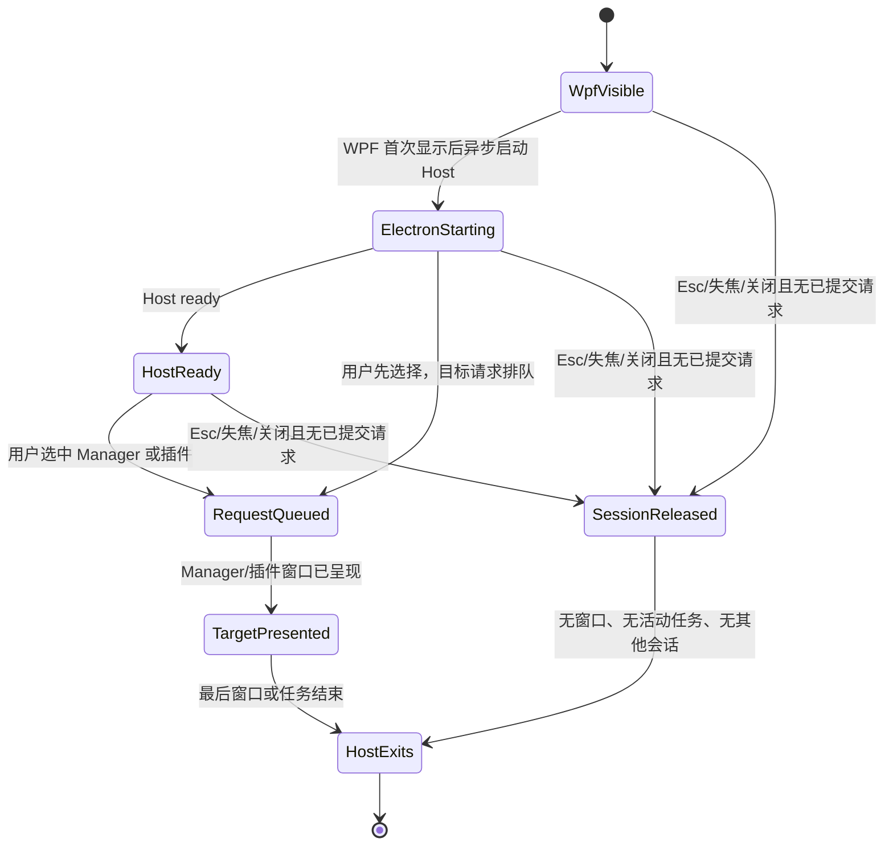

# WebTools 启动器会话内 Electron 临时预热设计

**日期：** 2026-10-20\
**状态：** 已复核设计方案，待实现\
**目标：** 在 Electron 每次使用后完全退出的前提下，把 Electron 冷启动尽可能与用户使用 WPF 启动器的时间重叠，并保持 WPF 搜索框和面板立即响应。\
**范围：** WPF 搜索框、展开后的启动器面板、Super Panel、Manager 和普通插件窗口的启动会话与退出行为。本文只定义方案，不修改运行时代码、不运行测试。

## 结论

不根据搜索词猜用户最终要打开 Manager 还是哪个插件。WPF 搜索框、展开面板和 Super Panel 是同一个产品里可能发起 Electron 功能的入口；在用户打开其中一个快速操作界面后，可以并行启动一个**仅有 Electron 主进程、尚无 Manager 或插件窗口**的 Host。用户明确选择目标后，再把准确的 Manager 或插件请求交给 Host。

这个预热只属于当前 WPF 快速操作会话。用户在没有选择 Electron 功能时按 Esc、失焦关闭或用其他方式结束该会话，Electron 就退出；选择了功能后，临时会话所有权交给正在打开的窗口或任务，最后一个窗口/任务结束后 Electron 退出。不得在 NativeHost 启动时启动 Electron，也不得通过常驻进程换取后续快速打开。

WPF 必须先完成自身的首次显示和输入焦点交付，之后才异步请求 Electron 启动。Electron 的启动不能被 WPF 等待，也不能阻止 WPF 首帧、搜索输入或面板交互。方案不新增 WPF 或 Electron 的加载转场、空壳窗口或第二个加载提示。

若实测发现会话预热明显拖慢 WPF，或 Electron 可操作时间没有足够改善，就停止这条路线，转为验证磁盘上的 Node/V8 编译缓存和 Chromium Blink Code Cache。备选验证沿用[《Electron 冷启动代码缓存设计》](2026-10-20-electron-cold-start-code-cache-design.md)，不与本方案同时启用，以免 A/B 无法归因。

## 用户目标与边界

- WPF NativeHost 可以常驻；Electron Host 在没有有效 WPF 启动器会话、Electron 窗口或已接管任务时必须退出。
- 用户触发搜索框或面板时，WPF 应先立即可见并可输入。Electron 的进程启动和应用初始化不得串行挡住 WPF。
- 用户从 Manager 标志、插件搜索结果、展开面板卡片或 Super Panel 选择功能时，Host 已经启动的部分可以复用；还在启动时，准确的目标请求可排队，Host 就绪后再交付。
- Manager、插件、Translation 的目标窗口仍由实际请求创建。预热不创建 BrowserWindow、隐藏 Renderer、插件窗口或前置加载页面。
- 用户结束 WPF 会话但未打开 Electron 功能时，Electron 应正常退出；目标窗口或命令仍在运行时不得被会话结束误杀。
- 不增加无活动超时。结束行为由 WPF 会话关闭、目标窗口关闭、任务完成及现有明确关闭动作触发。
- 调研、运行日志、测试 profile 和验收材料继续放在 `D:\SystemDefault\Desktop\webtoolstest`，不写入 C 盘用户缓存。

## 当前实现观察

当前分支已经有一个全局预热流程，但其触发点和进程所有权不符合上述目标：

1. [`App.xaml.cs`](../../../native/WebTools.NativeHost/App.xaml.cs) 在 NativeHost 完成启动时调用 `PrewarmElectronHost()`，而不是等 WPF 搜索框或面板出现。
2. [`ManagerController.cs`](../../../native/WebTools.NativeHost/Services/ManagerController.cs) 将 `_electronHostPrewarmRequested` 设为持续状态；创建 Host 时将 `hostOnly` 与 `keepWarm` 都设为 true。
3. [`ManagerProcessLauncher.cs`](../../../native/WebTools.NativeHost/Services/ManagerProcessLauncher.cs) 把 `WEBTOOLS_ELECTRON_KEEP_WARM` 传给 Electron；[`electron/main.ts`](../../../electron/main.ts) 据此阻止 Host 在没有窗口时退出。
4. `electron/main.ts` 的 `hostOnly` 初始激活路径还设置了 60 秒 `initialHostActivationTimer`。会话所有权接入后，必须由明确的会话/请求持有状态替代它：不能让无所有者的 Host 多留 60 秒，也不能在会话仍有效时自行释放 Host。

因此不能只把 `PrewarmElectronHost()` 从一个调用点移到另一个调用点。必须一起改掉永久 `keepWarm` 所有权，并为预热会话增加可结束的生命周期表达，否则 Electron 仍会留在后台。

当前入口已经有可复用的交付路径：

| 用户入口 | 当前 WPF 请求路径 | 实际目标 |
| --- | --- | --- |
| 搜索框中的 Manager 标志 | `BrandButton_Click` → `ManagerController.OpenPage` | Manager 页面 |
| 输入后选择插件功能结果 | `ActivateResult` → `ManagerController.InvokeFeature` | 搜索结果对应的插件功能 |
| 展开区域的插件卡片 | `OpenPlugin` 或 `ActivateResult` → `ManagerController` | 对应插件/功能 |
| Super Panel 的功能项 | `SuperPanelWindow` → `InvokeSuperPanelFeature` | 对应插件功能或快速结果 |

这些入口无需共享同一种 UI 点击事件；它们只需要共用 Electron Host 的临时会话所有权，并在用户作出选择时交付各自准确的请求。

## 会话模型

建议由 NativeHost 为每个可见的 WPF 快速操作会话持有临时 `launcherSessionId`。搜索框与其展开面板属于同一窗口，共享同一会话；Super Panel 若作为独立窗口显示，则持有自己的会话。Electron Host 维护当前有效会话 ID 集合；同一 WPF 窗口重新显示时复用尚未结束的 ID，不重复启动 Host。会话只表示“用户当前正在使用 WPF 快速操作界面，Electron 可以为这次操作临时准备”，不表示用户已经选择某个具体插件。



会话规则：

1. WPF 快速操作界面显示并完成首次绘制后，NativeHost 创建会话 ID，并在后台请求启动 Electron Host。触发代码不能同步等待 `Process.Start` 后的 Host Ready，也不能占用 WPF UI 线程等待 Electron。
2. Host 以 `hostOnly` 模式启动，不创建 Manager/插件窗口；Host 就绪后等待会话请求或真实目标请求。首次启动时，NativeHost 必须在 Electron 能判定空闲之前交付初始会话 ID（例如通过启动参数携带，并在 Host 初始化时登记），不能只依赖后续 Named Pipe 消息；否则 Host 可能在 Pipe 连接前被现有空闲退出逻辑关闭。在首次所有权同步完成前，Electron 不得执行空闲退出判断。
3. 用户选择 Manager、插件、Translation 或 Super Panel 功能时，NativeHost 先登记/排队确切请求，再允许 WPF 隐藏。请求提交必须原子地把会话所有权转交给该请求，或先建立请求持有权再释放 WPF 会话；不能让 `Hide`/失焦回调先释放唯一所有者。启动器先关闭、Electron 后启动完成的顺序必须能正确交付请求。重连后需要重送的请求按 `requestId` 去重，避免 Pipe 在交付或应答期间断开造成重复执行。
4. 临时会话只有在目标窗口确认已呈现，或命令/快速任务确认已被 Electron 接管后才释放。交接期间 NativeHost 保留请求持有权，直到收到确认或明确失败结果；不能在 BrowserWindow 刚创建、目标仍不可见时就当作交接完成。
5. 用户在没有已提交 Electron 请求时结束 WPF 会话，NativeHost 释放会话 ID。Electron 收到释放后，若没有其他 WPF 会话、Manager/插件窗口、活动命令或已接管的功能任务，就正常退出。
6. 会话在 Electron 启动期间结束时，NativeHost 立即将该 ID 标记为已释放。若此时出现新 WPF 会话，新 ID 独立登记；旧 ID 的迟到释放不能结束新会话或已提交的请求。
7. WPF 请求和 Electron 自身的窗口/任务状态共同决定退出。一次会话的释放不能结束另一会话或仍在执行的任务；释放按 ID 幂等处理，重复或迟到的释放不改变其他所有权。
8. NativeHost 是活动会话和待交付请求的权威记录方。首次连接和 Pipe 重连时，NativeHost 先发送完整的当前会话 ID、已提交请求及请求状态快照；Electron 原子同步这份快照后才允许执行空闲退出判断和新请求。快照包含启动以来发生的创建、释放和请求变化，因此不依赖多条增量消息的到达顺序。断线不表示会话结束；待确认请求通过 `requestId` 去重后继续交付。

此处的 `HostReady` 指 Electron 已完成启动，并完成首次所有权快照同步，可以安全接收目标请求；仅 `app.whenReady` 或 Pipe 刚连接不算 HostReady。

会话生命周期由事件驱动，不设置 60 秒或其他自动超时。现有 `initialHostActivationTimer` 必须删除，或改为检查有效的会话/请求持有状态；不能用另一个默认期限延续旧行为。

需要一个轻量的 Named Pipe 会话状态表达，或等价的现有协议扩展。单纯复用当前 `WEBTOOLS_ELECTRON_KEEP_WARM=1` 不足以表达“本次启动器会话结束”；永久环境变量也不能再作为退出抑制条件。这个生命周期标记只管理本次 Host 的所有权，不是对插件 API、翻译供应商或开发者功能增加新的限制层。

### WPF 与 Electron 的先后顺序

启动搜索框时，WPF 先走当前已有的窗口定位、显示和输入焦点逻辑。首次可见帧和输入焦点就绪后，再在后台队列启动 Electron。实现可以从 `ShowLauncher`、`ShowFromTray` 以及 Super Panel 显示入口接入一个协调器，但必须通过事件时间戳验证“WPF 已显示/可输入”先于 Electron 启动；具体 Dispatcher 调度点由实现者按现有 WPF 生命周期选择。

预热开始后，WPF 继续处理本地应用、网站、文件搜索和普通输入。预热期间搜索框/面板照常显示，不显示新增 spinner 或“正在打开”状态。若用户没有走向 Electron 功能，结束 WPF 会话时立即释放 Host。任何优化都不能把 WPF 首次显示改成“等 Electron 起来以后再显示”。

### 各入口交付

- **Manager 标志：** 点击时走现有 `OpenPage` 请求；若 Host 已 Ready，直接请求 Manager 页面；若仍在启动，入队后等待 Ready。不得增加独立加载页；等待时只使用统一的现有窗口交接状态。
- **搜索结果：** 由现有 WPF 搜索结果身份（FeatureRef/PluginRef）决定目标，不对自由文本或搜索词做预判。用户按 Enter 或点击结果后，把相同的 FeatureInvocation 请求交给 Host。
- **展开面板卡片：** 卡片点击走现有 `OpenPlugin`/`InvokeFeature` 请求路径。选中请求必须先交给 `ManagerController` 并取得请求持有权，然后再隐藏 WPF，避免当前“先 Hide、后 OpenPlugin”的事件顺序与会话释放竞争。
- **Super Panel：** 作为另一个 WPF 快速操作面，显示时获取同类临时会话；选中功能后复用 `InvokeSuperPanelFeature` 交付。关闭/取消且未选择功能时释放会话。
- **Translation：** 仍是其现有独立目标窗口；由真实翻译请求触发。启动器预热本身不执行翻译、不请求服务商，也不创建 Translation 窗口。

### 交接期间的 UI

目标选择后，各 WPF 入口共用现有单一交接状态；若目标可以立即呈现，则直接切换窗口，不显示加载提示。若仍需等待，复用 MainWindow 的 `HandoffPanel`，并且只在目标请求已提交后显示；预热阶段不显示它。展开面板卡片也必须先提交请求，再进入同一交接状态，不能先隐藏 WPF 造成桌面空白。Electron 直接加载实际 Manager、插件或 Translation 目标，不先显示空壳、第二个加载页或 spinner。目标可呈现后，由现有交接逻辑完成窗口切换并释放请求持有权。

## 退出与异常路径

- **Esc、WPF 失焦或面板关闭：** 若当前会话没有已提交目标请求，释放会话；Host 在无窗口/任务时退出。若请求已提交，WPF 的隐藏不能取消它。
- **Manager/插件打开失败：** 完成/失败响应返回后清理请求占有；无窗口和其他任务时让 Host 退出，并恢复现有 WPF 错误反馈。
- **命令型插件：** 请求由 Electron 接管到命令完成；完成后如果没有其他窗口或任务，退出 Host。
- **目标窗口已打开时再次按快捷键：** 按现有 WPF/Electron 焦点与窗口行为处理，不启动第二个 Host，不因新 WPF 会话的结束误关目标窗口。
- **Electron 启动失败或 Named Pipe 断开：** WPF 照常可用；短暂 Pipe 断连按会话同步规则重连。Electron 进程退出时，未送达的目标请求立即报告现有错误；会话清理不得关闭或阻塞 WPF。
- **正常退出：** 继续使用现有 Electron 优雅退出路径。设计不增加预热后的闲置计时器，也不通过强杀进程代替生命周期收尾。

## 可测量假设与验收

本方案不是降低 Electron 从 `Process.Start` 到 Host Ready 的实际时间，而是尝试把这一段放到用户已经打开 WPF、正在输入或选择的时间里。报告必须同时显示“从 WPF 快速面首次触发到目标可操作”和“从用户选择目标到目标可操作”；不得只报 Electron 已启动、Host Ready、空窗口、交接提示或首帧。

每个入口分别记录以下时间点，并用同一 request/session ID 关联：

```text
WPF show requested
WPF first visible frame / input focus ready
launcher session created / released
Electron process start requested
Electron main entry / app ready
Named Pipe connected / ownership snapshot synchronized / Electron Host ready
user target selected
request ownership acquired / queued / delivered / accepted
Manager renderer ready OR plugin/Translation page usable
target window presented OR command/task accepted
Named Pipe disconnected / reconnected (if applicable)
Electron process exit
```

### 对照组

| 组别 | Electron 预先状态 | 用户流程 | 用途 |
| --- | --- | --- | --- |
| A：当前冷启动基线 | WPF 快速面显示前确认 Electron Host 已退出 | 显示 WPF 后直接选择目标，选后才启动 Electron | 对照 WPF 与目标耗时 |
| B：会话内预热 | WPF 快速面显示前确认 Electron Host 已退出 | WPF 首帧/输入焦点后后台启动 Host，再选择目标 | 测重叠启动带来的收益和 WPF 资源影响 |
| C：取消会话 | 同 B | 打开搜索框/面板，不选择 Electron 功能，按 Esc 或失焦 | 验证临时 Host 能退出 |

使用同一打包版本、profile、设备和目标页面；每个路径至少 7 组有效样本，A/B 交替执行。测试前确认上轮 Electron 主进程及子进程都已退出；WPF NativeHost 可以常驻。测试数据和日志放在 `D:\SystemDefault\Desktop\webtoolstest\electron-launcher-session-prewarm\`。

逐路径验收：

1. Manager 标志打开 Manager。
2. 搜索后以 Enter 和鼠标点击打开普通插件。
3. 展开面板插件卡片直接打开普通插件。
4. 从搜索结果或面板打开 Translation，确认只有用户选择后才创建目标窗口并发起一次正常翻译流程。
5. Super Panel 选中功能。
6. 只打开搜索框/面板后按 Esc、失焦，以及打开本地应用/网址后确认 Electron 退出。
7. 在 Host 尚未连接 Named Pipe 时结束原会话，确认 Host 启动完成后退出；同时在旧会话启动期间新开会话，确认旧 ID 释放不会关闭新会话。
8. Named Pipe 在会话中断开后重连，确认有效会话/请求同步成功；释放事件不会丢失，也不会把断线误当成释放。
9. 在 Host 尚未 Ready 前选择目标，确认请求不丢失、不重复；交接确认前进程保持存活。
10. Manager、插件窗口关闭或任务完成后确认 Electron 主进程/子进程全部退出；没有目标选择的会话在释放后不继续保留到现有 60 秒计时器触发；有效会话持续超过 60 秒时 Host 不得因旧计时器退出。
11. WPF 首帧、输入焦点、搜索响应和面板点击在预热组没有可见停顿；预热阶段无 spinner；目标交接期间最多只有现有 WPF 交接状态，没有双加载提示或内容覆盖。

### 建议的采用标准

以下数字是本设计的建议评审门槛，不是已验证结果：

- WPF 首次可见与输入焦点 P50 相比基线恶化不超过 20 ms 或 5%（取更严格者），P90 也单独报告；搜索响应和面板交互没有可见卡顿。
- 对至少一个常用 Electron 入口，WPF 快速面显示到目标可操作 P50 改善至少 100 ms 且 10%；P90 不得回退超过 5%。其他入口单独报告，不用单个平均值掩盖差异。
- 无目标选择的取消会话能在会话释放后正常结束 Electron，且不新增后台常驻。
- 已提交请求在 WPF 先隐藏、Electron 后完成启动的竞态下仍只交付一次。

如果启动成本在用户常见的输入/选择时间内没有足够重叠，或预热造成 WPF 卡顿、Electron 清理失败，就判定会话预热没有达到目标；禁用预热后转入下一节，不继续增加预加载层。

## 后备方案：持久化 V8/JS 编译缓存

若会话预热未通过上述门槛，Electron 仍保持“用户选择时才冷启动”，只保留磁盘缓存，进程在每次使用后退出。按[《Electron 冷启动代码缓存设计》](2026-10-20-electron-cold-start-code-cache-design.md)单独进行受控验证：

1. 先验证 Node 的内置 Module Compile Cache 能否在本项目打包 Electron 中启用，并在新 Electron 进程中复用；不可用时再比较其他实现。
2. 再单独验证 Chromium Blink Renderer Code Cache 的生成、读取和 Manager/插件实际收益。
3. 单项确认有命中后才测组合；任何 cache miss 或缓存不可用都要无损回退普通冷启动。
4. 比较标准仍是目标页面可操作时间，不以缓存文件出现或模块加载变快代替端到端收益。

术语边界：这条后备路线指 VS Code 当前实现中可见的 Node Module Compile Cache 和 Chromium Blink Code Cache。它们是可跨进程保存的编译缓存，不是为 WebTools 自制 V8 Startup Snapshot。不要把“V8 快照”“Node 模块编译缓存”和“Renderer Code Cache”混成一个开关；如果之后要做自定义启动快照，应另立方案并先验证 Electron/V8 构建和版本兼容性。已有代码缓存评估已指出：WebTools 的 Node 24 运行时与 Renderer 体量使收益仍须打包 A/B 证明，不能保证达到 500 ms。

## 实现范围约束

- 不重做标题栏、插件 UI 或 SDK；可把现有 MainWindow `HandoffPanel` 接到尚未使用它的 WPF 入口，保持交接状态一致。
- 不增加 Electron 常驻、隐藏 Renderer/BrowserWindow、额外空壳、额外 spinner 或双层加载提示。
- 不引入自动闲置超时。
- 不把预热请求等同于 Manager 或插件已被用户选择；实际目标仍只由用户操作确认。
- 先单独实现并测量会话预热；只有它未达到前述采用标准时，才转入代码缓存后备方案，避免同时改动而无法判断收益来源。

## 相关实现与资料

- [`App.xaml.cs`](../../../native/WebTools.NativeHost/App.xaml.cs)
- [`MainWindow.xaml.cs`](../../../native/WebTools.NativeHost/MainWindow.xaml.cs)
- [`ManagerController.cs`](../../../native/WebTools.NativeHost/Services/ManagerController.cs)
- [`ManagerProcessLauncher.cs`](../../../native/WebTools.NativeHost/Services/ManagerProcessLauncher.cs)
- [`electron/main.ts`](../../../electron/main.ts)
- [Electron 冷启动代码缓存设计](2026-10-20-electron-cold-start-code-cache-design.md)
